# B15 · CR-023 — Premises, Units, Imports · THE DESIGN, IN DIAGRAMS

**Status: DRAFT FOR PO REVIEW · 2026-08-21 · v2.29.72**
**Authority:** five r10 screenshots of PRM-01 / PRM-01U / PRM-04 and five of
WFL-01.premises.1–5, supplied by the PO 2026-08-21, plus
`05-prototype/r10-2026-08-16/SMARTBillHub.dc.html` itself.
**Requirement:** `12-governance/11-change-requests.md` → CR-023.
**Binding UI law:** B14, and **rule 21 — new UI is Tailwind, no custom CSS**
(PO, twice: *"do everything using tailwind and not custom CSS"*; *"I want exact
same UI using Tailwind; so ensure you copy all changes"*).

> **Nothing in this document decides an open question.** Where the rules ran out
> the gap is marked ⛔ and carries the question it is waiting on. A lane building
> from this file stubs those with `raise NotImplementedError("OQ-###")`.

---

## 1 · WHAT CHANGES — the shape of it, before any detail

Today Premises and Units are **two separate routes with two separate pages**.
r10 draws **one page with three tabs** whose header actions change with the tab,
and a third tab that does not exist here at all.

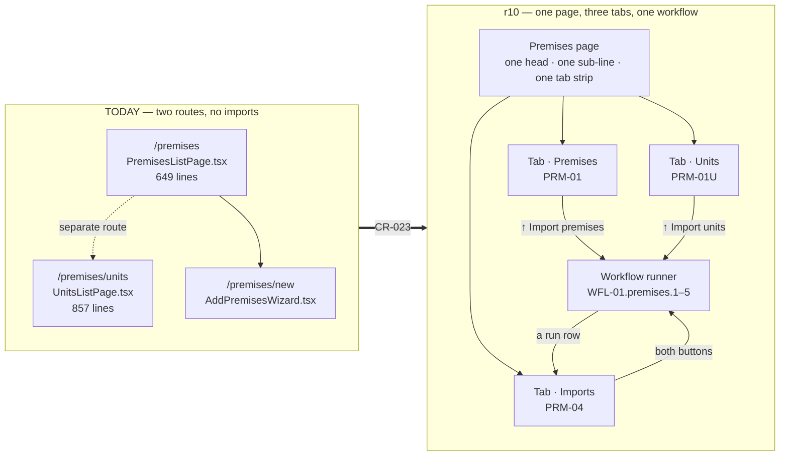

**The restructure is the work.** Restyling two pages leaves the tab strip, the
shared head and the whole Imports tab unbuilt.

---

## 2 · THE SCREEN MAP — every id, and which exist today

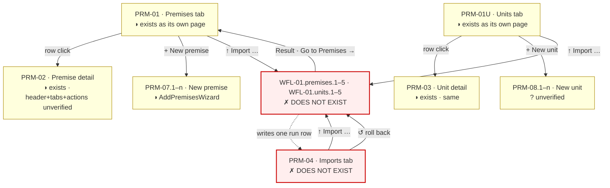

⛔ **`WFL-01` belongs to a WORKFLOWS module this repo does not have.** r10 routes
every import through `module:'workflows'`, and our fourteen doc modules contain
no such module — Work/Workflows scope is **OQ-249**, still open. CR-023 therefore
has to say where the runner lives. See §8.

---

## 2A · THE DETAIL VIEWS — PRM-02 and PRM-03, from the PO's screenshots

The PO's ask names the shape: *"details view { header + Tabs + Actions }"*. Both
detail views follow it, and **they differ in every part** — different back link,
different kicker, different KPI tiles, different tab set, different actions.

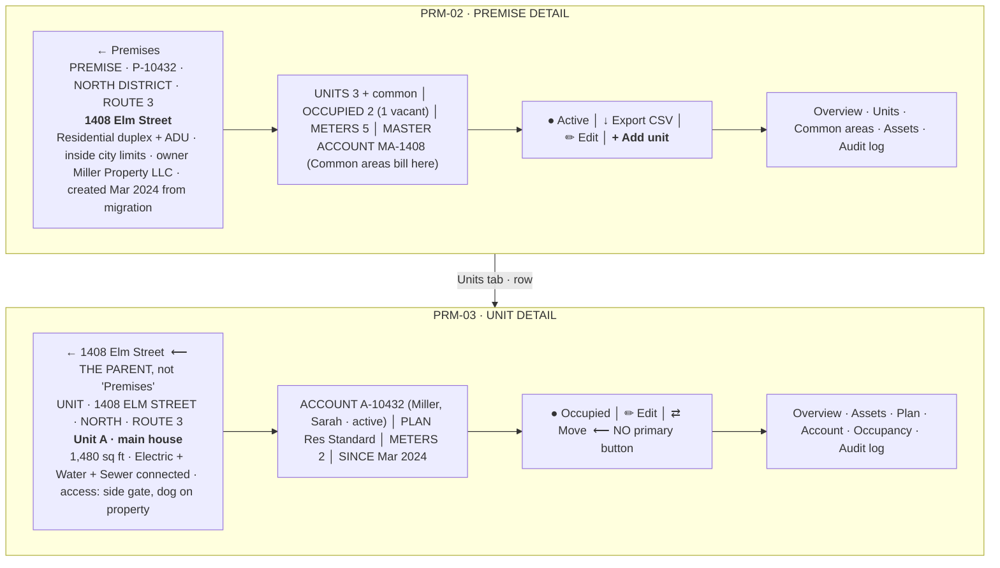

### 2A.1 · PRM-02 · Premise detail

| Tab | What it holds |
|---|---|
| **Overview** | Two columns. **Left:** Address `1408 Elm Street, Austin, TX 78704` · Premise type `Residential · duplex + ADU` · **Jurisdiction `Inside city limits — no ×1.5 multiplier`** · Services available `Electric · Water · Sewer`. **Right:** Area (**select**) `North district` · Sub-area (**select**) `Route 3` · Owner / manager `Miller Property LLC · (512) 555-0184` · Common areas `Hallway & exterior lighting → master account MA-1408`. |
| **Units** | `UNIT │ TYPE │ SQ FT (right) │ METERS │ PLAN │ ACCOUNT │ STATUS │ ACTIONS`. `Unit A · Main house · 1,480 · M-4021 · M-4022 · Residential Standard · A-10432 · Miller, Sarah · Occupied`; `Unit B · Second floor apartment · 920 · M-4108 · — · Vacant since Jun 2026 · Vacant`; `Unit C · Garden ADU · 460 · M-5099 · pending install · Residential Standard · pending · Move-in Aug 20 · Nguyen, K. · Pending`. **Four row icons: view · edit · move · remove.** |
| **Common areas** | *"Shared spaces no tenant occupies — their usage bills the owner's master account, never a tenant. The gap between the building's master meters and the sum of unit meters lands here too."* KPI: `MASTER ACCOUNT MA-1408` · `COMMON AREAS 2` · `JULY COMMON BILL $69.60` · `UNALLOCATED USAGE 3.1%` (*Master vs unit meters*). Table `COMMON AREA │ METERS │ PLAN │ JULY BILL │ STATUS`: `Hallway & exterior lighting · M-4109 · electric · Small Commercial · $41.20 · Active`; `Shared irrigation · M-4110 · water · Small Commercial · $28.40 · Active`. `MASTER` callout. Actions `+ Add common area` · `Open master account →`. |
| **Assets** | `ASSET │ TYPE │ UNIT │ INSTALLED │ STATUS │ 👁`. Note `M-4109 · M-4110` share ONE row typed `Common area · E + W`, unit `Common`; `M-5099` shows `Install WO-4834 · Aug 18` and status `Pending install`; `M-4108` reads `Idle · vacant`. |
| **Audit log** | `WHEN │ ACTOR │ ACTION`. Actors include **`System`** and **`Migration`**, not only people: *"Premise created · 3 units · 4 meters linked"* (Migration), *"Unit B account closed · final read 8,412 · deposit refunded"* (System), *"Sub-area changed Route 2 → Route 3 (re-districting)"*. |

### 2A.2 · PRM-03 · Unit detail

| Tab | What it holds |
|---|---|
| **Overview** | Unit type `Main house · single family` · Floor area `1,480 sq ft` · **Services connected `Electric · Water · Sewer (85% of water)`** · Read route `Route 3 · sequence 0142` · Access notes `Side gate · dog on property · customer prefers SMS ahead`. |
| **Assets** | `ASSETS ON THIS UNIT` + **`+ Assign from inventory`**. `ASSET │ TYPE │ LAST READ │ INSTALLED │ STATUS │ 👁 −`. **`M-4021 · Net meter · AMI · E · ×10`** — the register multiplier is ON SCREEN. `RULE` callout: *"Removing a meter records its final read and sends it to inventory — the unit can't bill that service until a replacement is assigned."* |
| **Plan** | Current plan **`Residential Standard · v2`** · On plan since `Mar 12, 2024` · Rate schedules `Res Electric Tiered · Res Water Inclining · Sewer flat` · **Eligibility check `Passes — residential · 5/8" & 1φ 100A · inside city`**. Action `Change plan →`. |
| **Account** | Account `A-10432 · Miller, Sarah` · Start date `Mar 12, 2024 · no end date` · Status `Active · balance $247.30 · 42 days past due` · Autopay `Off — blocked after NSF Aug 16` · Delivery `E-bill · sarah.miller@example.com`. Actions `Open account →` · `Move-out…`. |
| **Occupancy** | `OCCUPANT │ ACCOUNT │ START │ END │ CLOSING READ │ FINAL BILL │ STATUS`. `Miller, Sarah · A-10432 · Mar 12 2024 · current · — · — · Active`; **`— vacant — · MA-1408 · owner · Jan 4 2024 · Mar 12 2024 · — · Base only · paid · Vacancy billing`**; `Nguyen, Thomas · A-09218 · Feb 1 2022 · Jan 4 2024 · 38,120 kWh · 980 kgal · $96.40 · paid · Closed`. `GAP` callout: *"Between occupants the unit bills base-only to the owner's master account — no unmetered gaps in the timeline."* |
| **Audit log** | as PRM-02. |

### 2A.3 · ⚠ SEVEN THINGS THESE TWO SCREENS ASSERT THAT ARE NOT MERELY LAYOUT

Each of these is a **product capability stated as fact on a screen**. Hard-won
law 1 applies in reverse: a screen claiming a capability is not the capability.

| # | The claim | State here |
|---|---|---|
| 1 | **COMMON AREAS are a first-class object** with their own meters, their own plan, their own bill line and a **master account** that is not a tenant. | `common_area` appears in `metering`; **`master_account` appears only in `apps/billing/final_bill.py`**. Whether a common area is a Unit, a flavour of Unit, or its own table is undecided — and it changes the schema. **⛔ OQ-314.** |
| 2 | **UNALLOCATED USAGE `3.1%`** — the gap between a building's master meter and the sum of its unit meters, stated as a percentage on the premise. | `unallocated` exists in `apps/billing`. Whether anything computes THIS figure per premise is unverified. A percentage on a screen with no source is DEF-366's shape. |
| 3 | **`Sewer (85% of water)`** — a service priced as a percentage of another service's consumption. | A real utility rule (sewer-on-water). Not visible in the rating packet. **⛔ OQ-315.** |
| 4 | **`×10` register multiplier on the asset row.** | This is exactly the quantity R3b applies — and Wave A's brief records that **metering already applies it before billing sees a read**, so wiring R3b naively bills 100×. Showing it here is correct and useful; it must not be applied twice. |
| 5 | **Plan `v2`** — a plan version, on the unit. | `DEF-410`: a plan has NO version history. **Wave G is building it right now.** This screen is one of its consumers. |
| 6 | **`Eligibility check · Passes — residential · 5/8" & 1φ 100A · inside city`** — eligibility EVALUATED, with the attributes that decided it. | `DEF-404`: the rule builder does not exist and **nothing evaluates a rule**; `eligibility_rule` is stored as authored and read by nothing. This line cannot be filled today. |
| 7 | **Vacancy billing to the owner's master account, base-only, with no gap in the timeline.** | `Unit.vacant_standby_auto` exists. The PO ruled base-only billing as a staff choice earlier this session. Whether a VACANT period bills the OWNER is the part that is not established. **⛔ OQ-316.** |

**Good news in the same list:** `Unit.square_feet`, `Unit.rate_plan`,
`Unit.plan_effective_from`, `Premises.inside_city_limits` (added this session for
the outside-city surcharge, BR-RAT-101/102) and the `audit` module all exist. The
`Jurisdiction` line on PRM-02 — *"Inside city limits — no ×1.5 multiplier"* — is
**readable from what was built today**, and it is the one line on either screen
that can be filled immediately.

---

## 3 · THE THREE TABS — exactly what r10 draws

**Shared by all three tabs** — one page head, one sub-line, one tab strip:

| Part | Value, verbatim from r10 |
|---|---|
| `h1` | `Premises` — on all three tabs, including Units |
| sub-line | `428 premises · 1,247 units · 34 vacant · 12 pending activation` |
| tabs | `Premises` · `Units` · `Imports` |
| head actions | **change with the tab** — see below |

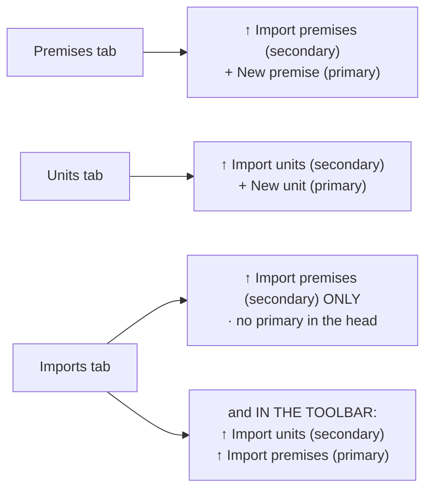

⚠ **The Imports tab carries the import buttons TWICE** — once in the page head
and again on the right of its own toolbar, and the primary/secondary emphasis
differs between the two. That is r10's own markup, confirmed in the screenshot.
A lane must copy it rather than tidying it.

### 3.1 · Premises tab (PRM-01)

Definition line: *"A **premise** is a physical property or address. Each premise
may contain one or more **units** (apartments, suites, sub-metered spaces) —
those live in the Units tab."*

Toolbar, left to right: search `Search address…` · `All` chip · `+ Filter ▾` ·
column-chooser icon. Right-aligned segmented control: **All · Residential ·
Commercial · Mixed use**.

| # | Column | Alignment | Notes |
|---|---|---|---|
| 1 | Premise ID | left | plain text on premises, **accent-coloured link on units** |
| 2 | Address | left | |
| 3 | Type | left | `Residential · Duplex`, `Commercial · Multi-tenant`, `Mixed use` |
| 4 | Units | **right**, tabular numerals | |
| 5 | Services available | left | coloured letter squares `E` `W` `S` |
| 6 | Owner / manager | left | |
| 7 | Status | left | `Active` / `Pending` pills |

Footer: `Showing 1–8 of 8` · `Rows per page 50 ▾` (50/100/200/500/1000) ·
first / prev / `Page 1 of 1` / next / last.

### 3.2 · Units tab (PRM-01U)

Definition line: *"A **unit** is a metered space inside a premise — an apartment,
suite, sub-meter drop, or the whole building for single-unit premises. Accounts
attach to units, not to premises."*

Search `Search premises, units, meters…`. Segment: **All · Occupied · Vacant ·
Sub-metered**.

| # | Column | Notes |
|---|---|---|
| 1 | Unit ID | accent link — `U-10432-A` |
| 2 | Premise | `P-10432 · 1408 Elm St` — id AND short address |
| 3 | Unit | `Unit A`, `Suite 200`, `Master`, `Apt 101`, or `—` |
| 4 | Type | `Residential`, `Commercial · Master`, `Residential · Sub-metered` |
| 5 | Services | letter squares |
| 6 | Meters | smaller type, tabular — `M-4021, M-4022`, `M-4204 (sub)` |
| 7 | Occupant / Account | `Miller, Sarah · A-10432` or `—` |
| 8 | Status | `Active` / `Vacant` / `Pending` / **`Disconnect`** |

⚠ **`Disconnect` is a FOURTH status** and it renders as a filled danger pill, not
an outline one. Check what the product derives before assuming it exists — this
is the same shape as the rate-schedule `Standby` gap (DEF-464).

### 3.3 · Imports tab (PRM-04)

Definition line: *"Every bulk load of premises and units, with the receipt. A run
can be rolled back as one unit for 30 days."*

Search `Search runs, files, users…`.

| # | Column | Alignment |
|---|---|---|
| 1 | Run | accent — `RUN-2812` |
| 2 | Source | `silvercreek_premises_2026.csv` |
| 3 | Started | `Jul 28 · 11:20` |
| 4 | By | `Alex Reed` |
| 5 | In | right |
| 6 | Loaded | right |
| 7 | Rejected | right |
| 8 | Status | `Loaded` / `Failed validation` |
| 9 | *(no header)* | **one icon action, and it CHANGES with status** — `↺` rollback on a loaded run, a wrench on a failed one |

Below the table, a **ROLLBACK callout**: *"Rolling back reverses every premise
and unit the run created. Units with an active account on them are skipped."*

---

## 4 · THE ETL WORKFLOW — five stages, one write

r10's own promise, printed under the title: **"Five stages · nothing is written
until you commit at stage four."**

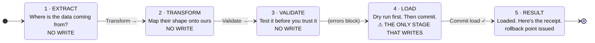

---

## 4A · ⚖️ THE PO'S LOAD-ORDER RULING (2026-08-21) — AND IT REVERSES r10 TWICE

Verbatim, at the moment CR-023 was being designed:

> "We we load premises - it will be only premises. at the transform screen - you
> can choose actual column you have from table; similarly when we upload Units we
> will upload unit - excel sheet will have details for premsies and plans. now
> problem is when unit are uploaded, both plans and premises should be in system
> so that we can map many to many correctly. we will not add meter or asset here
> when we are uploading units. When we upload assets at that time Units will be in
> system and we will upload assets."

**This is a ruling, not a preference, and it settles Q9 and half of §6 outright.**

### What it says

1. **A premises import loads PREMISES AND NOTHING ELSE.**
2. **The transform screen's `MAPS TO` list is the REAL target columns** — *"you
   can choose actual column you have from table"*. It is not a fixed list of
   labels; it is what the table actually has.
3. **A units import carries premise AND plan references**, and **both must
   already be in the system** before it runs, *"so that we can map many to many
   correctly"*.
4. **A units import creates NO meter and NO asset.**
5. **Assets are their own import, later, once units exist.**

### ⚠ Where it contradicts r10 — and the ruling wins

| r10 says | The PO ruled | Effect |
|---|---|---|
| Premises run: *"426 premises · **181 single-unit premises auto-create their unit**"* (stage 4 dry run AND stage 5 receipt) | *"it will be only premises"* | **The auto-create is REMOVED.** The dry-run line loses its second clause; the count is premises only. |
| Units run: *"Include meter IDs and service assignments and **we link them in the same pass**"*, and *"245 units · **245 meters linked** · 12 flagged for a missing meter"* | *"we will not add meter or asset here when we are uploading units"* | **The meter-linking pass is REMOVED**, with its two counters. `assets` is not called by a units load at all. |
| Stage 5 NEXT callout: *"Units are next. Import them from the Units tab, **or let single-unit premises create their own**."* | same ruling | The second clause goes; the callout says units are next, full stop. |

The standing instruction is that where the spec contradicts r10, **r10 is right**.
That instruction is about a STALE SPEC. **A PO ruling made today outranks both**,
and this document is where that is written down so the next agent does not "fix"
the design back to r10's copy.

### The ordering this creates

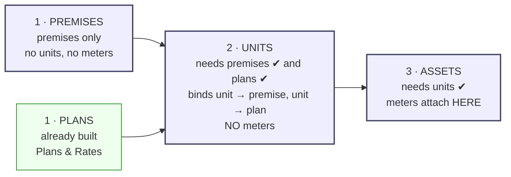

**The dependency is a PRECONDITION, not a suggestion**, and stage 3 is where it
is enforced: a units row whose premise is not on file, or whose plan is not on
file, is a validation failure with a sentence that says which. r10 already has
exactly this shape for units — its own reject reads *"Parent premise P-11902 was
not loaded"* → fix *"Load the premise first"*. **Extend that to plans.**

### ⛔ What the ruling does NOT settle

* **The cardinality of "many to many".** Premise→unit is one-to-many. Unit→plan
  is the one to pin down: a unit takes several services, and a plan is bound per
  service — so is the units sheet one row per unit with several plan columns, or
  one row per unit-service? **The sheet's shape depends on the answer.**
* **What a units row does when the premise exists but the plan does not** (or the
  reverse) — reject the row, or load the unit unplanned and flag it.
* **Whether the premises import may still create a unit when the operator asks
  for it explicitly** — the ruling removes the automatic behaviour; it does not
  say the door is locked.

### 4.1 · Stage 1 · EXTRACT — *"Where is the data coming from?"*

Four source cards, and **three of them are out of scope for CR-023 unless the PO
says otherwise** (⛔ see §8):

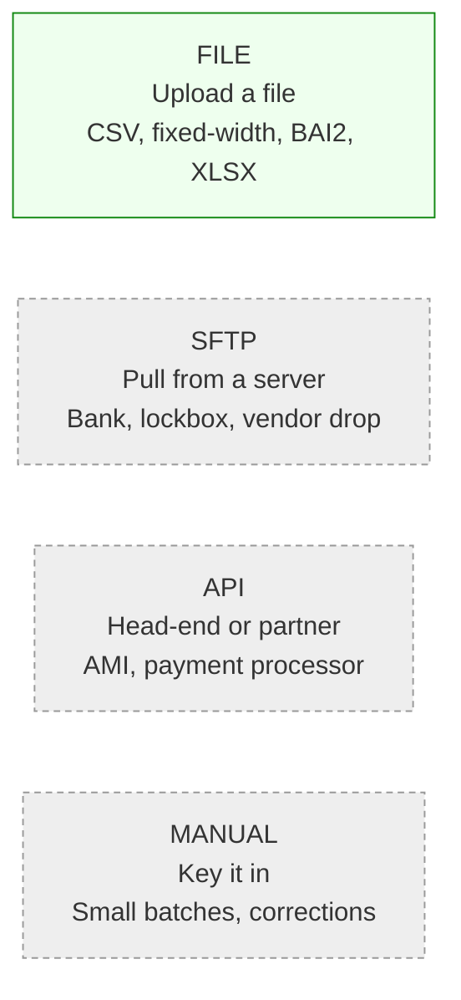

Then: dropzone showing `silvercreek_premises_2026.csv · 431 rows · 96 KB ·
SHA-256 c19a…4407`, and four fields — **Mapping template** (`Migration v2
(auto-detected)`), **Encoding & delimiter** (`UTF-8 · comma (detected)`),
**Loads into** (`Premises`), **Batch label (audit trail)**. A `DETECT` callout:
*"Header row recognised as Migration v2. You can still remap at the next stage."*
Actions: `Cancel` · `Transform →`.

### 4.2 · Stage 2 · TRANSFORM — *"Map their shape onto ours."*

Sub-line: *"Set it once and save it as a mapping template — every future run of
this import reuses it."* Header action on the whole runner: **Save mapping as
template**.

`SOURCE COLUMN | SAMPLE VALUE | MAPS TO (select) | TRANSFORM | status`

| Source | Sample | Maps to | Transform | Status |
|---|---|---|---|---|
| `PREMISE_ID` | P-10432 | Premise ID | Trim whitespace | Matched |
| `ADDR1` | 1408 Elm Street | Address line 1 | **Standardise to USPS** | Matched |
| `CITY` | Austin | City | Title case | Matched |
| `STATE` | TX | State | Uppercase | Matched |
| `ZIP` | 78704 | Postal code | **ZIP+4 split** | Matched |
| `PROP_TYPE` | DUPLEX | Premise type | **Code table lookup** | Matched |
| `UNIT_CNT` | 2 | Expected units | Integer | Matched |
| `SVC_AVAIL` | E,W | Services available | Split on comma | Matched |
| `OWNER` | Miller Prop LLC | Owner / manager | — | Matched |
| `LEGACY_KEY` | 88214 | **— ignore —** | — | **Ignored** |

Row handling, three checkboxes: *Drop exact duplicate rows* · *Keep the latest
row when a key appears twice* · *Skip rows with empty required fields rather than
rejecting them*.

`AFTER TRANSFORM`: **Rows in 431 · Duplicates dropped 3 · Rows forward to
validation 428.** Actions: `← Back` · `Validate →`.

⛔ **`Standardise to USPS` is an outside service.** So is any address
normalisation worth the name. This product has no such integration —
`04-docs/02-decisions/07-integrations.md` names none.

#### 4.2A · ⚠ THE COMPLETE PREMISES FIELD MAP — r10 MAPS NINE COLUMNS AND THE TABLE HAS FOURTEEN

**PO ask, 2026-08-21:** *"do we need more field to map; they can be optional but I
want to figure out all important field that we will need on premises consider what
design changes we did in plan and Rates and other"*.

Answer: **yes — six importable fields have no column in r10's mapping, one of them
was ruled into existence THIS WEEK by the Plans & Rates work, and r10 maps one
column that has nowhere to land.** Everything below is read from
`apps/metering/models.Premises` as it stands at 2.29.72, not from the design.

| # | Target field | Column | Req | In r10's map? | What a lane must know |
|---|---|---|---|---|---|
| 1 | **Premise ID** | `premise_no` | optional | ✅ `PREMISE_ID` | Tenant numbering series, **UNIQUE per tenant** (`uq_premises_tenant_premise_no`). This is the key stage 2's *"keep the latest row when a key appears twice"* operates on, and a repeat inside one file is a stage-3 error. Blank ⇒ auto-generate. |
| 2 | **Name** | `name` | optional | ❌ **MISSING** | A premises can carry a name as well as an address — *"Riverside Apartments"*. Migration files routinely have one. |
| 3 | **Address line** | `address_line` | **REQUIRED** | ✅ `ADDR1` | ⚠ **The ONLY non-null business column on the table.** A row without it cannot be created at all, so an unmapped `address_line` is a stage-2 refusal, not a stage-3 warning. |
| 4 | City | `city` | optional | ✅ `CITY` | |
| 5 | State | `state` | optional | ✅ `STATE` | |
| 6 | Postal code | `postal_code` | optional | ✅ `ZIP` | r10 transforms *"ZIP+4 split"* — one source column, two target values. The mapper must support that shape or the transform is a lie. |
| 7 | **⚠ INSIDE CITY LIMITS** | `inside_city_limits` | optional, **THREE-STATE** | ❌ **MISSING — AND THIS IS THE IMPORTANT ONE** | See the box below. |
| 8 | Premise type | `premises_type` → FK | optional | ✅ `PROP_TYPE` | Reference-data lookup (BR-MET-034). r10 warns and **defaults to Residential** on an unknown value — that is a WRITE decided by a warning, and it should be the PO's call, not the loader's. |
| 9 | Services available | `services_available` JSON | optional | ✅ `SVC_AVAIL` | ⚠ *"Split on comma"* is NOT enough. BR-MET-003 requires the list to be a **subset of the services the tenant has enabled** — a tenant that does not sell sewer must have `S` refused, not stored. |
| 10 | **Area / sub-area** | `area` → FK tenancy | optional | ❌ **MISSING** | BR-MET-071 (*"we wil tag them to premises"*). **One column answers both levels** — a premises tagged to a sub-area is by construction inside its parent. PRM-02 draws Area AND Sub-area as two selects, so the import must resolve a NAME to an id, and an unknown area is a decision: reject, create, or leave null. |
| 11 | Owner / manager | `owner_manager` | optional | ✅ `OWNER` | Free text today. PRM-02 renders it with a phone number (`Miller Property LLC · (512) 555-0184`) — the phone has no column. |
| 12 | **External reference** | `external_ref` | optional | ❌ **MISSING — and r10 THROWS THIS AWAY** | See the second box below. |
| 13 | **Status** | `status` | optional, defaults `active` | ❌ **MISSING** | `draft \| pending \| active \| inactive`. r10's own premises list shows a **Pending** row, and *"12 pending activation"* is in the page sub-line. A migration that cannot land rows as `pending` must land 428 live premises in one commit. |
| 14 | **Custom fields** | `custom_data` JSON | optional | ❌ **MISSING** | Tenant-defined field definitions (`tenancy.CustomField`, up to 10 active per entity). **Every legacy system has columns ours does not**, and this is where they go. Safe by construction: DB-17 forbids any money path from reading `custom_data`. The mapper should offer the tenant's OWN defined fields as targets, by name. |

**NEVER importable, and a mapper must not offer them:** `tenant` (set by the
session), `is_sample` (BR-TEN-013 — only this module's own sample path writes it),
`created_at`, `updated_at`, `deleted_at`.

> ### ⚠ #7 · `inside_city_limits` — THE FIELD PLANS & RATES CREATED THIS WEEK, AND THE ONE A BLANK CELL MUST NOT FILL
>
> The PO ruled it on 2026-08-21: *"On premises we will add this flag and during
> billing we will consider Account → Unit → Premises to consider it."*
> (`BR-RAT-101`), and `BR-RAT-102` then put the FACTOR on the plan.
>
> **It is deliberately three-state.** `True` inside · `False` outside · **`None`
> nobody recorded it.** `rating.resolution.money_factor` **REFUSES on `None`**
> rather than assuming, because either default is a silent pricing decision made
> on data nobody entered: assuming inside under-charges a customer the utility
> may be entitled to surcharge; assuming outside over-charges one who never
> agreed.
>
> **So the import consequence is sharp, and it cuts both ways:**
> * If the column is NOT mapped, all 428 premises land as `None` — and every
>   outside-city premises among them **cannot be priced at all** until somebody
>   edits it by hand. r10's own PRM-02 Overview *displays* the flag
>   (*"Inside city limits — no ×1.5 multiplier"*) while r10's import has no
>   column for it. **Read one screen, write another.**
> * If the column IS mapped, **an empty cell must stay `None`.** A CSV blank is
>   not `False`. The mapper needs an explicit three-value transform — and it is
>   the one field in the whole map where "skip rows with empty required fields"
>   and "default it" are both wrong.

> ### ⚠ #12 · `LEGACY_KEY` SHOULD MAP TO `external_ref`, NOT TO `— ignore —`
>
> r10's own mapping row reads `LEGACY_KEY · 88214 · — ignore — · Ignored`, and
> `Premises.external_ref` exists for exactly this (its comment says *"GIS ref"*).
>
> **Discarding the customer's own key costs three things**, and none of them is
> visible on the day of the migration: you can never **reconcile** our 428 rows
> against their source system; a **re-import** of the same file cannot match rows
> it already created, so it duplicates them; and when a customer asks *"what
> happened to property 88214"* there is no answer. **Recommendation: map it.**
> A tenant with a genuinely meaningless key can still choose `— ignore —`.

**AND ONE r10 COLUMN HAS NOWHERE TO LAND.** `UNIT_CNT · 2 · Expected units ·
Integer` — **`Premises` has no `expected_units` column** and the list's Units
figure is a COUNT of related rows. Two honest readings: it is a **transient
validation input** (r10's own stage-3 rule is *"Expected unit count is a positive
integer"*, and after the units import a reconciliation could say *"you said 2, we
loaded 2"*), or it is a **stored expectation** and needs a column. It must not be
mapped to a field that does not exist — that is `BR-MET-088`'s whole point.

**What Plans & Rates does NOT need from a premises row:** no plan, no rate
schedule, no customer class. `BR-RAT-108` derives the base from **service →
account type → meter size**; the account type is on the ACCOUNT and the plan is
on the UNIT (`Unit.rate_plan`). A premises carries the **jurisdiction** and
nothing else that prices.

### 4.3 · Stage 3 · VALIDATE — *"Test it before you trust it."*

Sub-line: *"Errors block the load. Warnings don't — but you should look at
them."* KPI strip: **ROWS CHECKED 428 · PASSED CLEAN 421 · ERRORS 2 (tinted) ·
WARNINGS 5.**

`RULES THAT RAN`: `RULE | SEVERITY | HITS | ACTION`

| Rule | Severity | Hits | Action |
|---|---|---|---|
| Address must geocode inside the service territory | **Error** | 2 | Reject row |
| No premise already on file at this address | Warning | 3 | Skip on load |
| Premise type exists in the lookup table | Warning | 2 | Default to Residential |
| Expected unit count is a positive integer | Pass | 0 | — |

Then the rejects: row `88` key `P-11902` *"Address falls outside the territory
boundary"* → fix *"Confirm and load anyway"*; row `214` key `P-12044` *"Street
name will not geocode"* → fix *"Correct the address"*.

⛔ **THE FIRST RULE CANNOT RUN. There is no geocoder and no service-territory
boundary anywhere in this product** — verified by grep across `06-backend/apps`
and `07-frontend/src`. It is r10's headline error rule and it is the one that
rejects rows.

#### 4.3A · ⚠ HOW VALIDATION RULES ARE BUILT — AND WHAT HAPPENS WHEN THEY CHANGE

**PO ask, 2026-08-21:** *"how we wil build validate rules … what is design; what if
later we have to change any rules or utilities want changes in rules per utility"*.

**The short answer: a rule is a DECLARED ROW, not an `if` statement — and every
run stores the rules AS THEY WERE when it ran.** Those two properties are what
make the rule set changeable without breaking anything already loaded.

##### The three tiers, and why the top one cannot be configurable

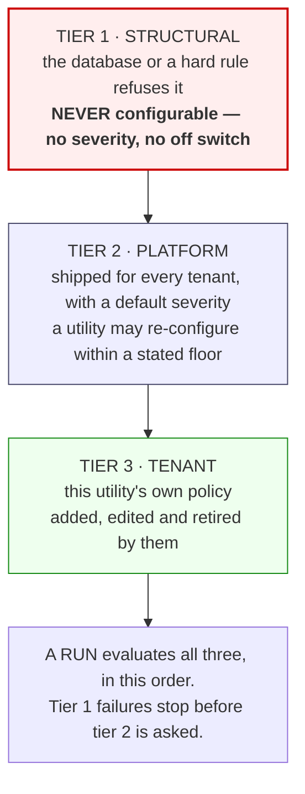

**Tier 1 · STRUCTURAL — not negotiable, and the list is short because it comes
from the schema and the hard rules, not from anybody's opinion:**

| Rule | Why it can never be switched off |
|---|---|
| `address_line` is present | The column is NOT NULL. A row without it cannot be created. |
| `premise_no` is unique in the tenant | `uq_premises_tenant_premise_no`. The database refuses the second one. |
| `services_available` ⊆ the tenant's enabled services | BR-MET-003. Storing a service the tenant does not sell produces a premises that can never bill correctly. |
| Every FK resolves — `premises_type`, `area` | A dangling id is a row that reads as broken on every screen. |
| The tenant is the session's tenant | Hard rule 1. Not a validation at all — it is never taken from the file. |

**Tier 2 · PLATFORM — shipped, and a utility may change severity and action
inside limits we state.** These are r10's four, plus the ones its map implies.

**Tier 3 · TENANT — the utility's own.** *"No premise outside our three ZIP
codes"*, *"every premise must carry an owner"*, *"the GIS ref is mandatory for
us"*. Same shape as tier 2, authored by them.

##### What a rule row holds

| Field | Example | Why |
|---|---|---|
| `code` | `PRM.ADDRESS_IN_TERRITORY` | Stable. Referenced by run results forever. |
| `sentence` | *"Address must geocode inside the service territory"* | **Customer-facing English, no ids** — the CR-016 no-internal-references rule applies to this screen like any other. |
| `severity` | `error` \| `warning` \| `pass` \| `off` | Configurable in tiers 2–3, fixed in tier 1. |
| `action` | `reject_row` \| `skip_on_load` \| `default_to` \| `flag_only` | What it DOES, stated separately from how bad it is. |
| `action_value` | `Residential` | Only for `default_to`. |
| `available` | `true` \| `false` | ⚠ see the geocoding box below. |
| `tier` | 1 \| 2 \| 3 | Decides who may edit it. |

**⚠ SEVERITY AND ACTION ARE TWO COLUMNS, DELIBERATELY.** r10's own table proves
why: *"Premise type exists in the lookup table · **Warning** · 2 · **Default to
Residential**"* is a warning that **performs a write the operator never asked
for**. Two premises silently become Residential and price as Residential. That
is a defensible policy and an indefensible default — so the pair is configurable
together, and a row it touched is **flagged on the receipt** so it can be found
later.

##### THE PRECEDENT: we already do exactly this for meter reads

`metering.ReadValidationSettings` is a **per-tenant validation configuration
table**, one row per tenant, carrying the thresholds each CONFIRMED rule states —
`high_pct 200`, `low_pct 25`, `days_flag_min 25` / `days_hard_min 20`,
`tou_sum_tolerance_pct 1`, and an estimation method beside them. It is the same
question — *how does this utility want its inbound data checked* — answered once
already.

⚠ **But it answers it as a WIDE ROW OF NAMED COLUMNS**, which works for a fixed
rule set and cannot express tier 3 at all: a utility cannot add a rule we did not
ship, because adding one means a migration. **Import rules need rows, not
columns.** Both shapes should exist and the difference is worth writing down
rather than discovering: reads have a fixed, finance-signed rule set; imports
have an open one.

##### What happens when a rule changes — the property that makes it safe

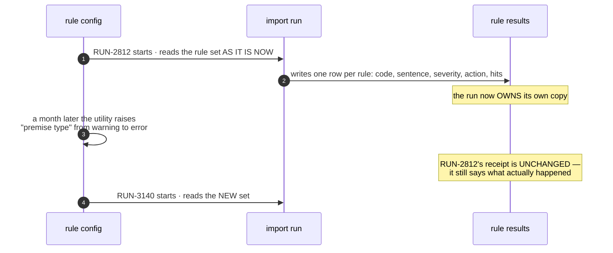

**Three consequences, and each one is a rule for the builder:**

1. **A run's results are STORED, never recomputed.** Re-deriving them from
   today's config would rewrite history: a receipt that said *"2 warnings"* in
   July would say *"2 errors"* in August, and the reader would have no way to
   know the run itself never changed. This is the same instinct as the
   locked-at-issue invoice snapshot.
2. **Changing a rule NEVER re-validates loaded data.** It applies to the next
   run. A utility that tightens a rule and wants the old rows checked is asking
   for a **report**, not a re-validation — and that is a different feature.
3. **A rule may be retired but its `code` is never reused**, because run results
   from years ago still name it.

##### ⚠ A RULE WE CANNOT RUN IS `available: false`, NOT A MISSING ROW

`PRM.ADDRESS_IN_TERRITORY` — r10's only ERROR — needs a geocoder and a service
territory, and **this product has neither**. The honest shape is the rule
declared, listed on the screen, and reported as *unavailable* with the reason,
rather than quietly absent.

**This is the stated-absence discipline applied to a rule**: a screen that lists
three rules where four were expected tells the operator nothing, and *"errors
block the load"* becomes a promise the product cannot keep — because with that
rule gone there are **no error-severity rules left at all** on a premises import.

### 4.4 · Stage 4 · LOAD — *"Dry run first. Then commit."*

Sub-line: *"This is the only stage that writes. Everything before it was
rehearsal."*

`DRY RUN · WHAT WILL BE WRITTEN` — Will create **426 premises** · Existing
records updated **2** · Rows rejected **2** · Scope affected **426 addresses** ·
Target **Premises**.

⚠ **r10 prints a second clause here — *"181 single-unit premises auto-create
their unit"* — and §4A's PO ruling REMOVES it.** A premises load creates
premises and nothing else. Do not restore it from the screenshot.

**Write mode**, segmented: `Insert new only` | `Insert & update` | `Replace the
batch`.

**Approval:** *"Approval is also required when exceptions exceed 5% of the batch.
This run is at 2 rejected of 428."*

Two checkboxes: *Create a rollback point before writing* · *Notify me when the
load finishes*. Actions: `← Back` · `Commit load ✓`.

⛔ Three figures here are **r10 copy, not signed rules**: the **5%** exception
threshold, **who** approves, and what **Replace the batch** does to rows that are
in the database but not in the file. The third is destructive and must not be
guessed.

### 4.5 · Stage 5 · RESULT — *"Loaded. Here's the receipt."*

`RUN-2812 · Aug 6, 2026 · 09:14:22 CDT · 18s`. KPI: **LOADED 426 · REJECTED 2
(tinted) · FLAGGED FOR REVIEW 5.**

Receipt, six fields in two columns: **SOURCE** (`silvercreek_premises_2026.csv ·
96 KB`) · **FILE HASH (SHA-256)** (`c19a…4407 · verified`) · **RUN BY** (`Alex
Reed · alex@silvercreek.example`) · **SESSION · IP** (`sess_2b41 ·
71.42.108.14`) · **MAPPING USED** (`Migration v2`) · **ROLLBACK POINT**
(`RB-2812 · available for 30 days`).

`NEXT` callout: *"Units are next. Import them from the Units tab."* ⚠ r10's
own copy adds *"or let single-unit premises create their own"* — **§4A removes
that clause with the behaviour behind it.**

Actions: **Go to Premises →** (primary) · `↓ Rejects CSV` · `↓ Run report PDF` ·
`Roll back this run`.

---

## 4B · THE UNITS IMPORT — SAME RUNNER, DIFFERENT SHEET

**Ruled 2026-08-21.** *"import units will be similar to import premises"* — one
runner, two targets. Everything in §4.1–§4.5 applies unchanged: same five stages,
same mapping table, same row-handling, same dry run, same receipt, same rollback.
**Only the field map, the rules and the preconditions differ.**

### 4B.1 · The sheet is ONE ROW PER UNIT

> *"One Unit one plan at a time it can have multiple services."* — PO, 2026-08-21

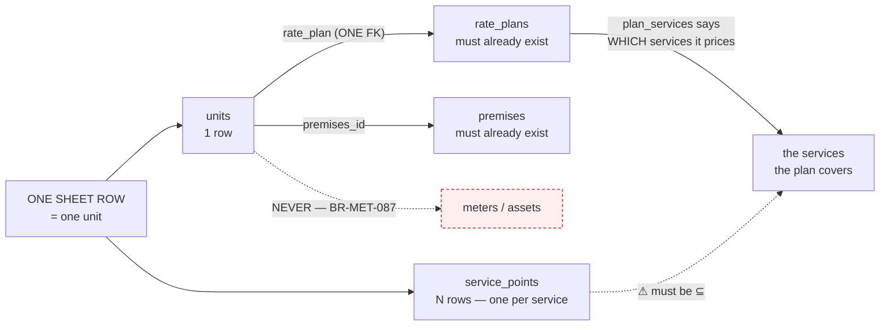

**The plan carries the services, so the unit does not have to.** That is why one
plan column is enough for a unit with three services, and why `Unit.rate_plan`
is a single FK and always was.

⚠ **ONE SHEET ROW WRITES TWO TABLES.** A unit row creates the `units` row **and
one `service_points` row per service listed**. Both are metering's own tables, so
no boundary is crossed — but the dry run must say so, or the operator is told
"245 units" and 700 rows appear.

### 4B.2 · The units field map

| # | Target field | Column | Req | Notes |
|---|---|---|---|---|
| 1 | **Premise reference** | `premises` → FK | **REQUIRED** | Not null. Matched on `premise_no` or address. **A premise not on file is a stage-3 rejection** — r10's own wording: *"Parent premise P-11902 was not loaded"* → *"Load the premise first"*. |
| 2 | **Unit label** | `label` | **REQUIRED** | Not null, and **unique within the premises** (`uq_units_tenant_premises_label`). `Unit A`, `Suite 200`, `Apt 101`. Two rows with the same label under one premise is an error, not a duplicate-drop. |
| 3 | Unit ID | `unit_no` | optional | **Unique per tenant** (`uq_units_tenant_unit_no`). The key "keep the latest row when a key repeats" operates on. Blank ⇒ auto. |
| 4 | Unit type | `unit_type` | optional | Reference-data rows (BR-MET-084) — five seeded, tenant-extensible. Code-table lookup, same shape as premise type. |
| 5 | Floor | `floor_label` | optional | |
| 6 | Floor area | `square_feet` | optional | Integer. PRM-02's Units tab draws a `SQ FT` column, so it is displayed as well as stored. |
| 7 | **Plan** | `rate_plan` → FK | optional | **ONE column, per BR-MET-092.** Must already exist — the second half of the precondition. |
| 8 | **Plan effective from** | `plan_effective_from` | optional | The *"at a time"* half. A migration that omits it makes every plan look like it began today. |
| 9 | **Services** | → `service_points` rows | optional | ⚠ **NOT a column on the unit.** Each service listed becomes a `service_points` row. Must be ⊆ the tenant's enabled services AND ⊆ what the unit's plan prices (BR-MET-092). |
| 10 | Route · Cycle | `service_points.route` / `.cycle` | optional | **Per service point, not per unit** — a unit's water and electric can read on different routes. PRM-03 shows `Route 3 · sequence 0142`. |
| 11 | Plan locked | `plan_locked` | optional | Gates plan changes behind a permission. |
| 12 | Vacancy billing | `vacant_standby_auto` | optional | BR-MET-094 — a vacant unit is billed automatically. |
| 13 | Custom fields | `custom_data` JSON | optional | As premises. |

**Never importable:** `tenant`, `is_sample`, timestamps, `deleted_at`.
**Never on this path:** any meter, any asset (`BR-MET-087`).

### 4B.3 · The units rules — tier 1 gains two the premises import does not have

| Tier | Rule | Severity | Action |
|---|---|---|---|
| **1** | Premise reference resolves to a premises on file | Error | Reject row |
| **1** | `label` present and unique within its premises | Error | Reject row |
| **1** | `unit_no` unique in the tenant | Error | Reject row |
| **1** | Services ⊆ the tenant's enabled services | Error | Reject row |
| **2** | **Plan reference resolves to a plan on file** | ⛔ unruled | reject, or load unplanned and flag |
| **2** | **Services ⊆ what the unit's plan prices** | ⛔ unruled | see below |
| **2** | Unit type exists in the lookup | Warning | default, or reject |
| **3** | the utility's own | — | — |

> ⛔ **THE SECOND ONE IS NEW AND IT ONLY EXISTS BECAUSE OF THE PLAN RULING.**
> A sheet row listing `E,W,S` against a plan that prices `E,W` describes a unit
> that **cannot bill sewer**. Neither half is wrong on its own — the services are
> real and the plan is real — so this is not a data error, it is a mismatch, and
> what to do about it is a decision: reject the row, load the unit and create only
> the service points the plan covers, or load all three and flag the unbillable
> one. **The third is the honest one and the most dangerous**, because the unit
> then looks complete on screen and silently under-bills.

---

## 4C · COMMON AREAS AND THE MASTER ACCOUNT — in scope, with a recommendation

> *"We will have to accomodate them."* — PO, 2026-08-21

**Recommended: a common area IS a `Unit`, flagged; a master account IS an
`Account` whose payer is the owner.** Neither needs a new table.

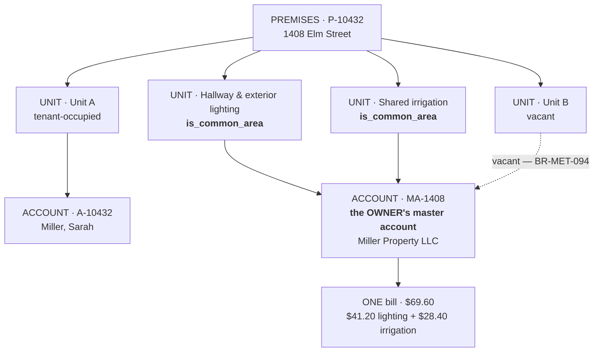

**Why a Unit rather than its own table.** Everything a common area needs already
works for units and for nothing else: meters attach to units, `service_points`
attach to units, reads, plans, routes, cycles and bill assembly all key off a
unit. **r10 agrees with itself twice** — PRM-02's tile reads `UNITS 3 + common`,
counting them alongside units, and its Assets tab puts `M-4109 · M-4110` in a row
whose UNIT column reads `Common`, occupying the unit slot. A separate table makes
every read path, every route membership and every bill assembler learn a second
shape for no capability we would not already have.

**Why the master account is not new either.** Accounts already attach to units,
so a master account attaching to a common-area unit needs no new relationship.
What it needs is a way to say *this account is the owner's*, and for **one master
account to cover several units** — `MA-1408` bills both common areas AND, per
BR-MET-094, the vacant Unit B.

⚠ **`master_account` today appears in exactly ONE file in the whole backend —
`apps/billing/final_bill.py` — and nowhere in `customers`, which owns accounts.**
That is the piece with no home, whichever shape wins.

⛔ **THE ONE THING NEITHER OPTION GIVES YOU FREE: `UNALLOCATED USAGE 3.1%`.** The
gap between a building's master meter and the sum of its unit meters is a
**computed figure over a premises**, not a property of a common area. It is the
sub-meter reconciliation r10's own callout describes — *"Sub-meter reconciliation
flags any gap between the master meter and unit meters"* — and nothing computes
it per premises today.

---

## 5 · THE DATA MODEL — and the precedent that already exists

**⚠ THE SINGLE MOST IMPORTANT FINDING IN THIS DOCUMENT: A STAGED IMPORT ALREADY
EXISTS IN THIS PRODUCT, AND IT IS NOT THE ONE ON SCREEN.** `metering`'s
`ReadImportBatch` / `ReadImportRow` implement exactly this shape for meter reads
— file name, **SHA-256 file hash**, a denormalised `counts` JSON that must
reconcile, `status` of `staged | validated | posted | discarded`, uploader,
session ref, IP, a cosigner, and a uniqueness constraint scoped to POSTED
batches so re-opening the wizard on the same file is allowed but a second post is
not. **CR-023 must GENERALISE that, not invent a second one.** A second staged
import is how two screens start disagreeing about what a run is.

Second finding: **`tenancy.ImportMapping` already exists** — the S8 reference
list `import_mappings`, *"saved ETL column mappings"* — and its own docstring
says the list ships empty and nothing writes it. That is the **Mapping template**
of stages 1 and 2, built and unwired.

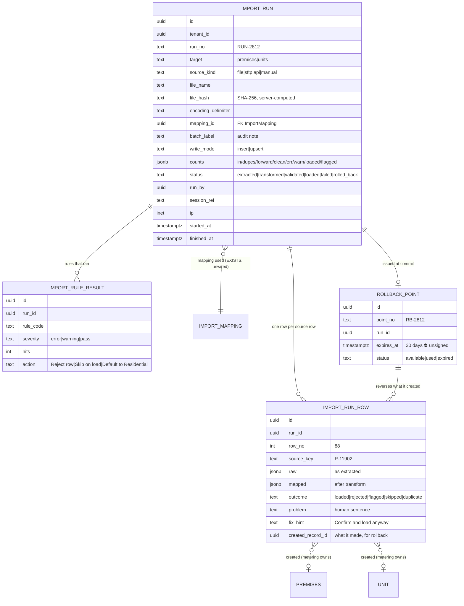

---

## 6 · THE LOAD — and the module boundary it must not cross

Hard rule: **cross-module writes are forbidden** (B8; B2 §2 names the reviewed
interface set). A premises import creates **premises and units** (metering) and
r10's units import *"links meters in the same pass"* (**assets**). So the loader
may not write those tables itself — it calls each module's own service.

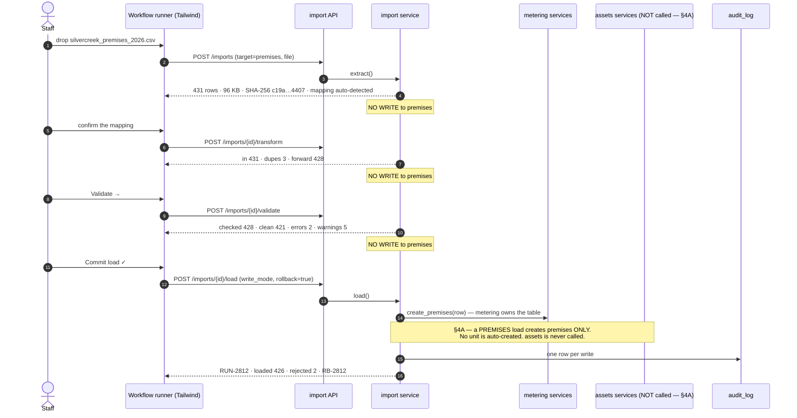

### 6.1 · Rollback

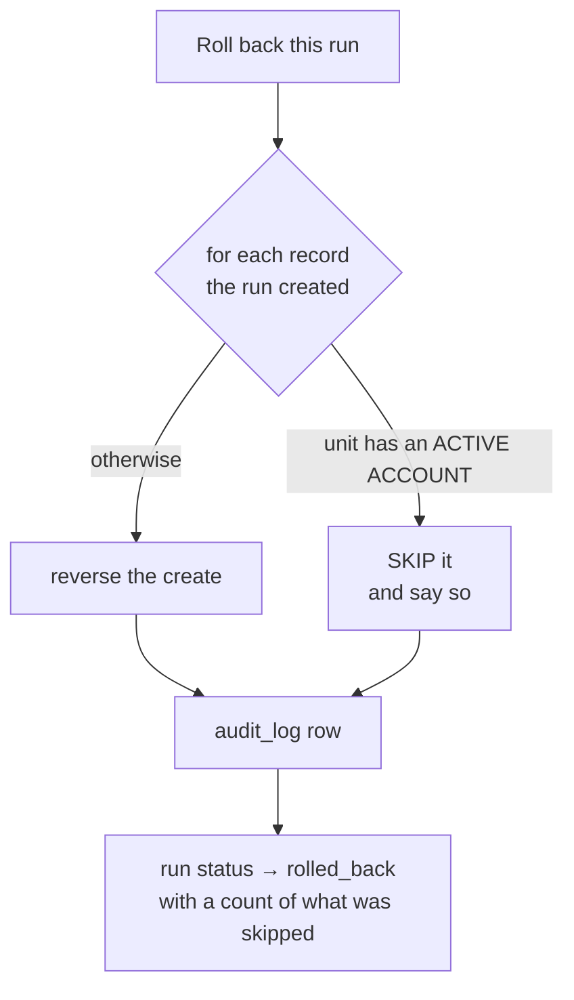

r10's own sentence is the rule: *"Rolling back reverses every premise and unit
the run created. Units with an active account on them are skipped."* ⛔ It does
not say what happens to a run that is **partly** reversed, nor whether the
rollback point survives it.

---

## 7 · WHAT IS ALREADY BUILT AND IS NOW WRONG

| Thing | State | CR-023 effect |
|---|---|---|
| `PremisesListPage.tsx` (649 lines) | own route, own head | becomes a TAB; head moves up |
| `UnitsListPage.tsx` (857 lines) | own route, own head | becomes a TAB; head moves up |
| `/premises/units` route | live | must keep working (deep links) — tab state in the URL |
| `PremisesDetailPage.tsx`, `UnitDetailPage.tsx` | live | header + tabs + actions to r10 — **not yet diffed** |
| `AddPremisesWizard.tsx` (892 lines) | live | keep; r10's PRM-07 also offers *bulk import* as a choice on step 1 |
| `UploadReadsWizard.tsx` | live, reads only | **the closest existing thing to WFL-01** — read it before designing |
| `ReadImportBatch` / `ReadImportRow` | live, reads only | **generalise, do not duplicate** |
| `tenancy.ImportMapping` | live, **written by nobody** | this IS the mapping template |
| `metering.css` | live | ⚠ rule 21 — no new classes; `g31` is AT its 891 ceiling |
| an ASSETS import | ✗ does not exist | §4A makes it the THIRD import, after units — its own CR, not this one |

### 7A · ⚠ A PREMISES IMPORT ALREADY EXISTS, AND CR-023 SUPERSEDES IT

Found while briefing the build, not during the analysis — which is the point of
step 0.

`POST /premises/imports` and `POST /premises/imports/commit` are **mounted, built
and used today** by `AddPremisesWizard`'s bulk path (US-MET-004). And the api
module's own docstring states the shape:

> *"the bulk path is `POST /premises/imports` + `POST /premises/imports/commit`
> (no staged id): US-MET-004 §5 states the preview is computed with **"no
> persistence in v1"**, so there is no batch row to address."*

**So the product has a TWO-STEP, STATELESS import where CR-023 specifies a
FIVE-STAGE, RECORDED one.** Every difference matters:

| Today (US-MET-004) | CR-023 |
|---|---|
| two steps: preview, commit | five stages |
| **no persistence** — nothing is stored between them | a run row from stage 1 |
| **no run id** | `RUN-2812`, addressable, listable |
| no receipt | file hash, who, session, IP, mapping |
| **no rollback** | a rollback point, 30 days |
| no rule results | the rules as they were |
| no saved mapping | `import_mappings`, the template |

**This is a SUPERSESSION, and it must be written as one.** US-MET-004 §5's *"no
persistence in v1"* is a signed statement being reversed — change-process step 2.
It is not a defect: it was a correct v1 decision and CR-023 is v2 of the same
feature.

**What the build must therefore do, and what it must not:**

* **Do NOT leave both.** Two import paths into `premises` is the shape that gives
  a customer two different answers about what happened to their file.
* **Do NOT delete the old one before the new one lands.** `AddPremisesWizard`'s
  bulk choice calls it, and PRM-07 step 1 still offers bulk import.
* The honest order is: build the recorded path, move the wizard's bulk choice
  onto it (`BR-MET-093` already rules that the unit wizard's bulk mode IS the
  runner — the same applies here), then retire the stateless pair in one commit
  that says what it is retiring.

---

## 8 · WHAT THE RULES DO NOT COVER — the questions, with the cost of guessing

| # | Question | Why it cannot be guessed |
|---|---|---|
| Q1 | **Where does the workflow runner live?** r10 puts every import in a `workflows` module; we have fourteen doc modules and none is Workflows. Work/Workflows scope is **OQ-249**, open. | Putting it in `metering` makes reads, payments, meters and rates imports each grow their own runner — the thing r10 explicitly unified. |
| Q2 | **Are SFTP, API and MANUAL sources in scope now, or is CR-023 file-only?** | Three of stage 1's four cards. Building all four is a different size of job. |
| Q3 | **`Standardise to USPS` — do we buy an address service, or drop the transform?** | It is an outside paid integration. Our integrations decision names none. |
| Q4 | **`Address must geocode inside the service territory` — where does the territory come from?** | This is r10's only ERROR rule and there is no geocoder and no territory boundary in the product. Without it, stage 3 has warnings and no errors, and *"errors block the load"* never fires. |
| Q5 | **Is 5% the exception threshold, and WHO approves?** | It is a gate on a write. A screen constant that no server enforces is BR-RAT-091 clause 2 all over again (DEF-435). |
| Q6 | **What does `Replace the batch` do to records in the database but not in the file?** | The destructive one. Delete, deactivate, or leave — three different products. ⛔ **CLOSED BY REMOVAL — CR-042, PO 2026-08-27:** *"in all imports - we need 2 option on step 1 insert, insert & update; replace option is not required"*. It was RULED first (BR-MET-099, 2026-08-21: deactivate, skip the occupied, never delete) and then the option was withdrawn from every import, so the question has no control to attach to. The behaviour is kept in `import_runs.py` and unreachable; **OQ-580** asks how a utility retires a premise it no longer serves. |
| Q7 | **Is the rollback window 30 days?** And does a partly-skipped rollback stay available? | Printed on the receipt as a promise to the user. |
| Q8 | **Is `Disconnect` a real fourth unit status** or r10 shorthand for a pending disconnect order? | It renders as a filled danger pill in the screenshot. |
| ~~Q9~~ | ~~Does the premises import auto-create units?~~ | **ANSWERED 2026-08-21 — NO.** §4A: *"it will be only premises"*. r10's 181 auto-created units are removed from the design. |
| Q10 | **What is the units sheet's SHAPE?** A unit takes several services and a plan is bound per service, so is it one row per unit with several plan columns, or one row per unit-service? | §4A says the sheet carries premise AND plan and that the mapping must be *"many to many correctly"* — and the two shapes need different files from the customer. |
| Q11 | **A units row whose premise exists but whose plan does not** — reject it, or load the unit unplanned and flag it? | Rejecting a whole migration for a missing plan is expensive; loading an unplanned unit means a unit that cannot bill. |

---

## 9 · UI CONSTRUCTION NOTES — Tailwind, and the traps

1. **Rule 21 is absolute here.** No new stylesheet class. `g31_declared_classes`
   holds the count at **891 against a ceiling of 891** — there is no headroom,
   and the gate fails on a rise.
2. **One table type** (B14). The three tabs are the same `DataTable` with
   different columns — not three tables.
3. **Row actions are icons from ONE vocabulary** (B14 rule 15, `g37` enforces).
   The Imports tab's trailing action is an icon and it **changes with row
   status** — it still needs an accessible name per row.
4. **Two button sizes only**, and destructive commits take the danger tier.
   `Commit load ✓` writes; `Roll back this run` reverses. Both qualify.
5. **Descriptions at 80%** (B14, amended from r10's 66%) — the three definition
   paragraphs use the tokened muted colour, not a hand-mixed one.
6. **Right-aligned numeric columns use tabular numerals** — r10 sets
   `font-feature-settings:tnum` on Units, In, Loaded, Rejected.
7. **Service letter squares** already exist as `serviceBadge()` /`ServiceTags` in
   the rating feature (built for DEF-441). **Reuse them.** A second badge
   component is a second vocabulary.
8. **Do not "fix" r10's duplicated import buttons** on the Imports tab (§3).

---

## 10 · SUGGESTED BUILD ORDER

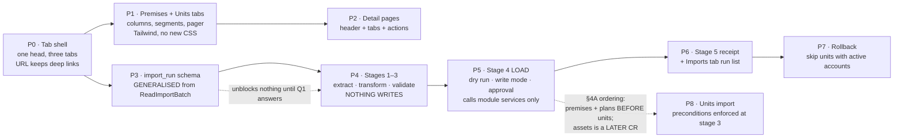

**P0–P2 are UI conformance and can start immediately.** P3–P7 wait on Q1 (where
the runner lives) and are shaped by Q4–Q7. P4 is safe to build ahead of the
answers **because nothing in stages 1–3 writes** — that is the property that
makes this design safe to build in halves.

---

# PART II · THE DELIVERY SPECIFICATION

*Everything below is what a lane needs to start: the screens, the endpoints, the
tables, the gaps, the seed changes, the test cases and the order. Requested by
the PO 2026-08-21: "I need Screen Inventory, I need endpoints, I need tables,
gaps, any changes to seed data, any other updates we have to TC, Test data, Test
cases … also implementation path; add everything in diagram".*

## 11 · SCREEN INVENTORY

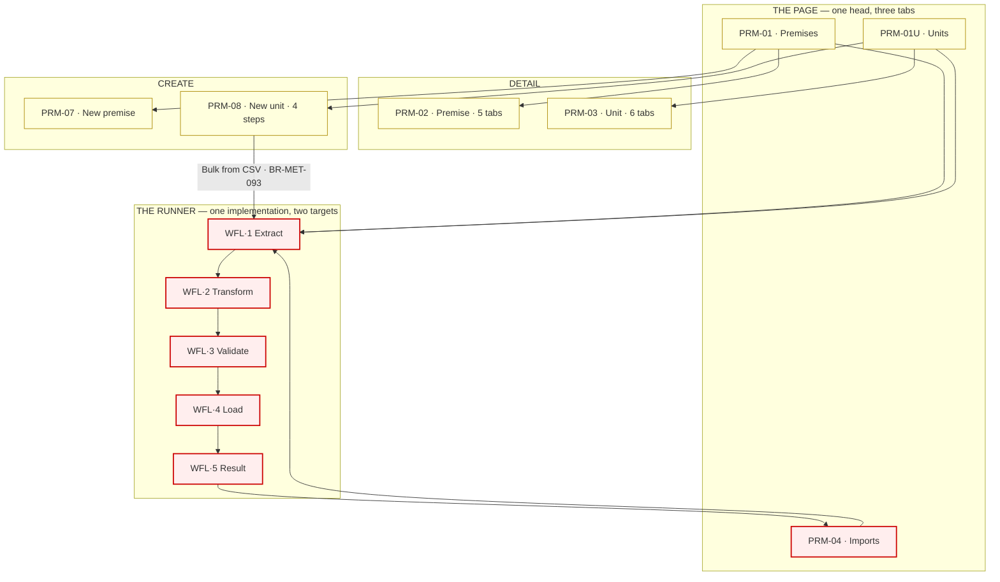

| Screen | Route | Today | CR-023 does |
|---|---|---|---|
| `PRM-01` Premises tab | `/premises` | own page | becomes a tab; head and summary move up |
| `PRM-01U` Units tab | `/premises/units` | own page | becomes a tab; **route must keep resolving** (deep links) |
| `PRM-04` Imports tab | `/premises/imports` | ✗ | new — run list + rollback callout |
| `PRM-02` Premise detail | `/premises/:id` | exists | 5 tabs to r10; 4 KPI tiles; Common areas tab is new |
| `PRM-03` Unit detail | `/premises/units/:id` | exists | 6 tabs to r10; Occupancy tab is new |
| `PRM-07` New premise | `/premises/new` | exists | step 1 gains the bulk-import choice |
| `PRM-08` New unit | ✗ verified | ? | 4 steps, 3 modes; `Bulk from CSV` opens the runner |
| `WFL-01.*` The runner | `/imports/:runId/:stage` | ✗ | new — **ONE implementation, `target` parameterised** |

## 12 · ENDPOINTS

**⚠ The stage endpoints are named for what they DO, and only one of them writes.**

| # | Method · path | Stage | Writes? | Answers |
|---|---|---|---|---|
| 1 | `POST /imports` | 1 | run only | file received; rows, bytes, SHA-256, detected mapping, detected encoding |
| 2 | `GET /imports/{id}/columns` | 2 | no | **the real target columns for `target`** (BR-MET-088) + the tenant's own custom fields |
| 3 | `POST /imports/{id}/transform` | 2 | run only | in / duplicates dropped / forward |
| 4 | `POST /imports/{id}/validate` | 3 | run only | checked / clean / errors / warnings + rule results + the reject list |
| 5 | `POST /imports/{id}/dry-run` | 4 | **no** | will create / will update / will reject / scope / target |
| 6 | `POST /imports/{id}/load` | 4 | ⚠ **YES — the only one** | run outcome + rollback point |
| 7 | `GET /imports/{id}` | 5 | no | the receipt |
| 8 | `GET /imports/{id}/rejects.csv` | 5 | no | the rejected rows, as a file |
| 9 | `POST /imports/{id}/rollback` | — | yes (reverses) | reversed count + **skipped count and why** |
| 10 | `GET /imports` | PRM-04 | no | the run list, filterable |
| 11 | `GET /import-mappings` · `POST` | 1–2 | yes | saved templates — **the table exists and nothing writes it** |
| 12 | `GET /import-rules?target=` | 3 | no | the rule set with tier, severity, action, `available` |
| 13 | `PATCH /import-rules/{code}` | — | yes | a utility re-configuring a tier-2/3 rule (BR-MET-090) |
| 14 | `GET /premises/{id}/common-areas` | PRM-02 | no | the common-area tab + the master account |
| 15 | `GET /units/{id}/occupancy` | PRM-03 | no | the occupancy timeline |
| 16 | `GET /premises/{id}/unallocated` | PRM-02 | no | ⛔ the 3.1% — **no source today** |

## 13 · TABLES

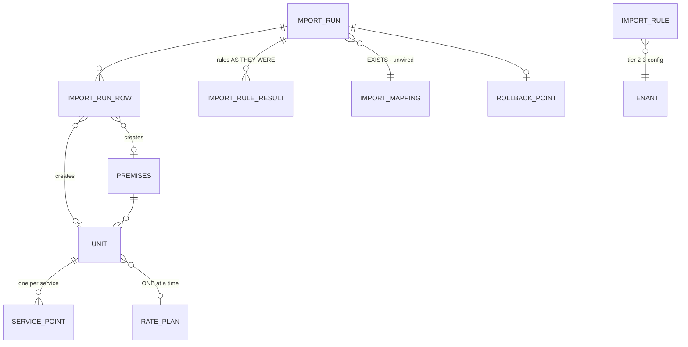

| Table | New? | Why |
|---|---|---|
| `import_runs` | **NEW** | generalised from `read_import_batches` — same columns, plus `target`, `write_mode`, `mapping_id` |
| `import_run_rows` | **NEW** | generalised from `read_import_rows`; adds `created_record_id` so rollback knows what to reverse |
| `import_rules` | **NEW** | tier, severity, action, `available` — per tenant for tiers 2–3 (BR-MET-090) |
| `import_rule_results` | **NEW** | **the run's own copy of the rules** — never recomputed |
| `rollback_points` | **NEW** | `RB-2812`, its expiry, its state |
| `import_mappings` | **EXISTS, UNWIRED** | `tenancy` · the mapping template. Ships empty, nothing writes it |
| `premises` | ALTER? | nothing required by CR-023 — all 14 fields exist |
| `units` | **ALTER** | `is_common_area` (recommended, §4C) |
| `accounts` | **ALTER** | a way to say *this is the owner's master account* — the piece with no home |
| `service_points` | no change | the units import writes rows here |
| `read_import_batches` | no change | **do not touch** — generalise beside it, migrate later |

## 14 · GAPS — what does not exist, ranked by what it blocks

| # | Gap | Blocks | State |
|---|---|---|---|
| 1 | **No geocoder, no service territory** | r10's ONLY error rule ⇒ *"errors block the load"* can never fire | absent |
| 2 | **No workflows module** | where the runner lives | OQ-249, open |
| 3 | **No `master_account` in `customers`** | common areas AND vacancy billing | one file, wrong module |
| 4 | **Nothing computes unallocated usage** | PRM-02's `3.1%` | no source |
| 5 | **Nothing evaluates eligibility** | PRM-03's *"Passes — residential…"* | DEF-404 |
| 6 | **A plan has no version history** | PRM-03's `Residential Standard · v2` | DEF-410 — Wave G building |
| 7 | **No USPS address service** | the *"Standardise to USPS"* transform | absent |
| 8 | **No `expected_units` column** | r10 maps `UNIT_CNT` to nothing | must not be mapped |
| 9 | `import_mappings` written by nobody | the mapping template | built, unwired |
| 10 | **Sewer-on-water printed as % of quantity** where the rule is % of charge | PRM-03 copy | **DEF-492** |

## 15 · SEED AND DEMO FIXTURE CHANGES

**Without these the Imports tab lands empty and PRM-02/PRM-03 render em-dashes.**

| # | Change | Why |
|---|---|---|
| 1 | **Three `import_runs`** — one loaded, one loaded, one failed validation | PRM-04 with no rows cannot be reviewed. r10 seeds exactly three |
| 2 | Their `import_run_rows` — including **2 rejects with problems and fix hints** | stage 3's reject list and the Rejects CSV |
| 3 | `import_rule_results` for each run | proves rules are stored, not recomputed |
| 4 | **One rollback point, unexpired** | the `↺` action needs a live target |
| 5 | **One `import_mapping`** — *"Migration v2"* | stage 1 auto-detect has nothing to detect against |
| 6 | **Common-area units on a premises** + a master account | PRM-02's Common areas tab, and `UNITS 3 + common` |
| 7 | **A vacancy in a unit's occupancy** | PRM-03's Occupancy tab and BR-MET-094 |
| 8 | **`inside_city_limits` set on some premises, LEFT NULL on others** | the three-state is invisible if every row is populated |
| 9 | A premises in `pending` status | the list's `Pending` pill and *"12 pending activation"* |

⚠ **Seeded runs must carry `is_sample`** so BR-TEN-061 can delete them, and must
be written **by metering's own sample path** — tenancy may not write them
(BR-TEN-013).

## 16 · TEST CASES AND TEST DATA

**Test data:** one CSV of 431 premises rows — 3 exact duplicates, 2 rows whose
premise type is not in the lookup, 1 row with **no address**, 1 row with a service
the tenant does not sell, 1 row with a **blank** `inside_city_limits`, and 1 row
repeating a `premise_no`. One CSV of 248 unit rows — 2 duplicates, 1 naming a
premise **not on file**, 1 naming a plan **not on file**, 1 listing a service its
plan does not price, 2 sharing a label under one premise.

| TC | Asserts | Why it exists |
|---|---|---|
| **TC-1** | Stages 1–3 write **nothing** — row counts in `premises`, `units`, `service_points` identical before and after | ⚠ **THE SAFETY PROPERTY OF THE WHOLE DESIGN.** Prove it RED by making transform write |
| TC-2 | A file's SHA-256 is computed **server-side** and matches the receipt | a client-supplied hash proves nothing |
| TC-3 | Transform reconciles: in − dropped = forward | r10's own three figures |
| TC-4 | `MAPS TO` offers only real columns + this tenant's custom fields (BR-MET-088) | a label with nothing behind it |
| TC-5 | A blank `inside_city_limits` cell stores **NULL**, not `False` | the three-state; the one field a default corrupts |
| TC-6 | `LEGACY_KEY` → `external_ref` round-trips | reconciliation against the source system |
| TC-7 | Row with no `address_line` is refused at stage 2, not 3 | the only non-null business column |
| TC-8 | Services not sold by the tenant are refused (BR-MET-003) | not merely split on a comma |
| TC-9 | A premises load creates **zero units** (BR-MET-085) | ⚠ the r10 reversal — prove no unit appears |
| TC-10 | A units load creates **zero assets** (BR-MET-087) | ⚠ the other reversal |
| TC-11 | A unit row creates 1 unit + N service points, and the dry run **says so** | one row, two tables |
| TC-12 | A units row whose premise is absent rejects, naming the premise | *"Load the premise first"* |
| TC-13 | A units row whose plan is absent behaves per the ruling | ⛔ needs the answer first |
| TC-14 | Services ⊄ the plan's services is caught (BR-MET-092) | the rule the plan ruling created |
| TC-15 | Two units sharing a label under one premise: the second rejects | `uq_units_tenant_premises_label` |
| TC-16 | `dry-run` and `load` report the **same** figures on the same run | a dry run that lies is worse than none |
| TC-17 | Changing a rule's severity does **not** change an old run's receipt (BR-MET-090) | ⚠ the history property |
| TC-18 | An unavailable rule is **listed** with its reason (BR-MET-091) | not silently absent |
| TC-19 | Rollback reverses created rows and **skips units with an active account**, reporting the count | r10's own sentence |
| TC-20 | Rollback after expiry refuses | *"available for 30 days"* |
| TC-21 | Re-uploading an identical file is allowed; committing it twice is not | the read-import precedent |
| TC-22 | Every write in a load emits `audit_log` | hard rule 7 |
| TC-23 | Tenant scoping — a run cannot see or write another tenant's rows | hard rule 1; RLS FORCE |
| TC-24 | `/premises/units` deep links still resolve after the tab restructure | 857 lines of screen behind it |
| TC-25 | Not one new stylesheet class (rule 21) | `g31` is AT its ceiling |

## 17 · IMPLEMENTATION PATH

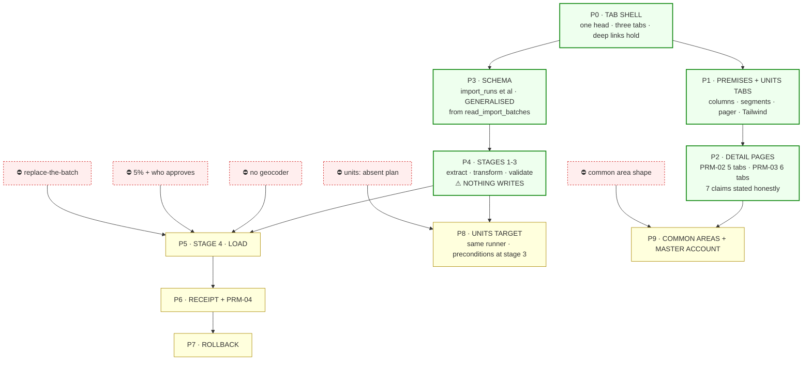

**Green starts today and needs nobody.** P0–P4 is the tab shell, both tables,
both detail pages, the schema and three of the five stages — and P4 is safe ahead
of every answer **because nothing in stages 1–3 writes**. That is a property of
the design, not a convenience.

**Amber waits on one line each**, and the questions are in §8 and §4B.3.

