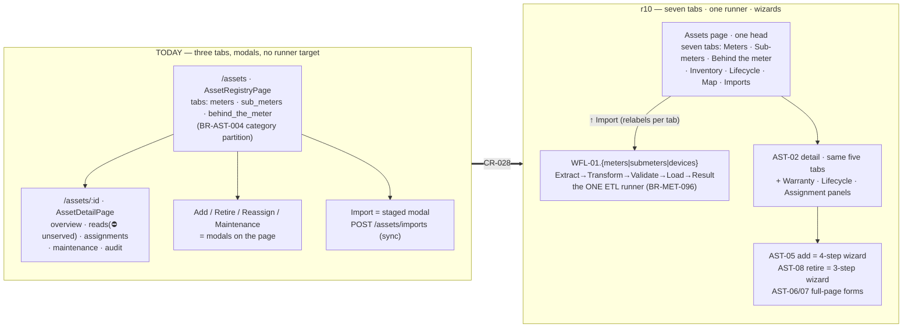
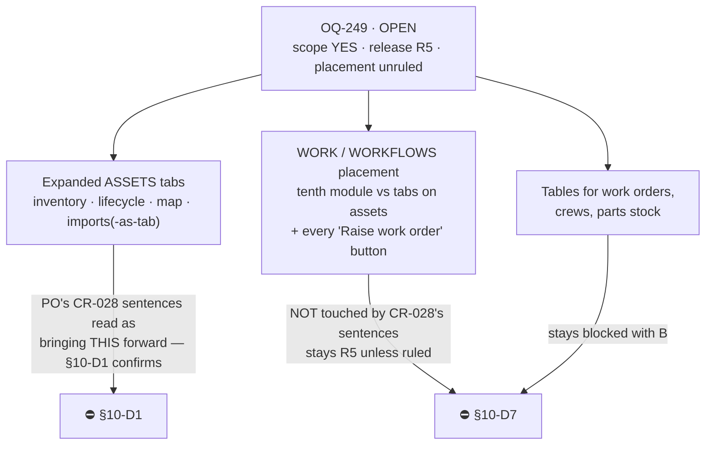
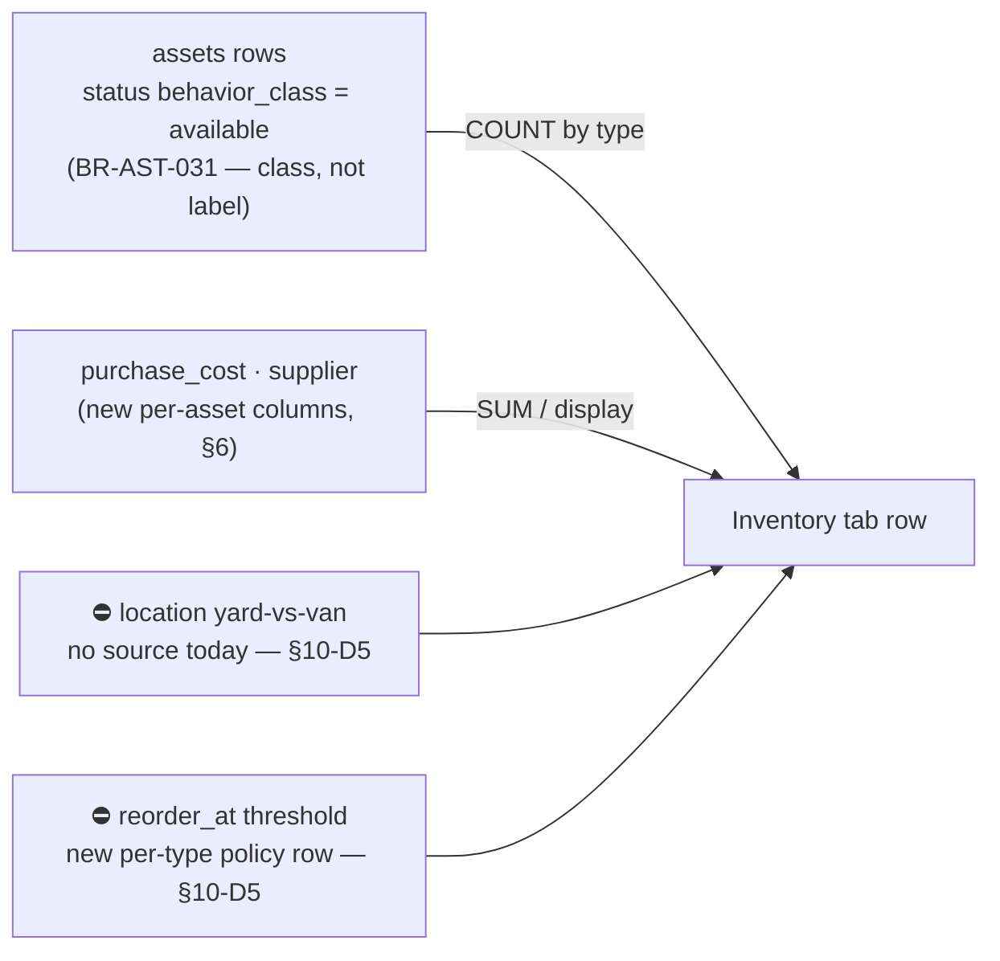
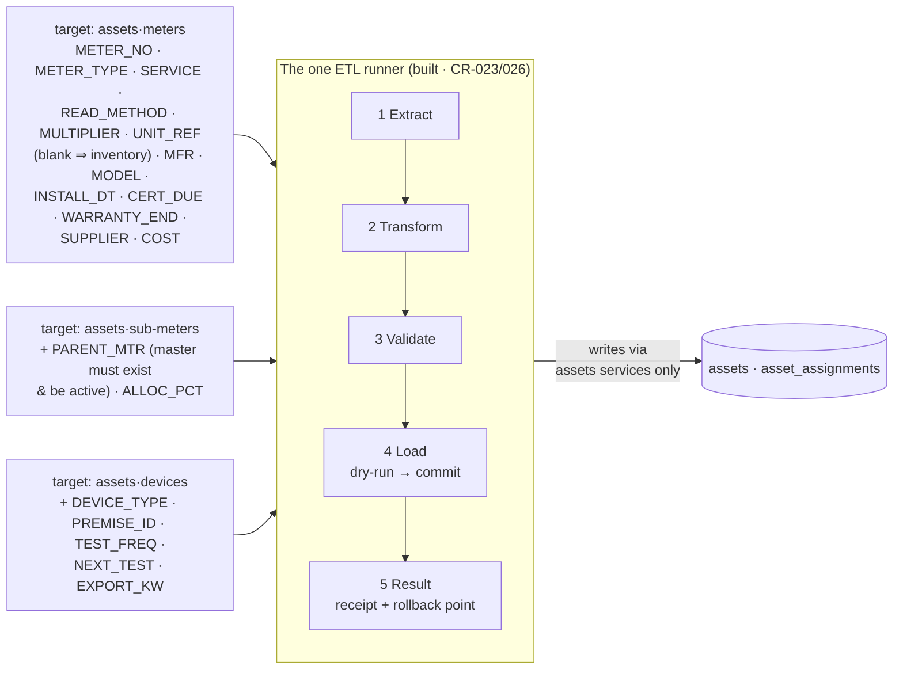
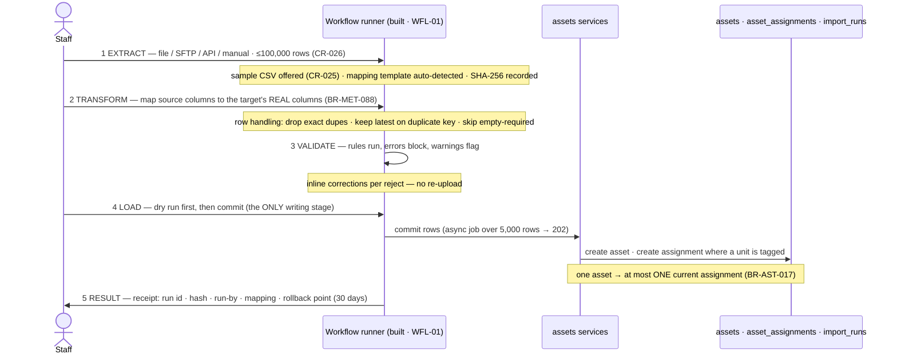
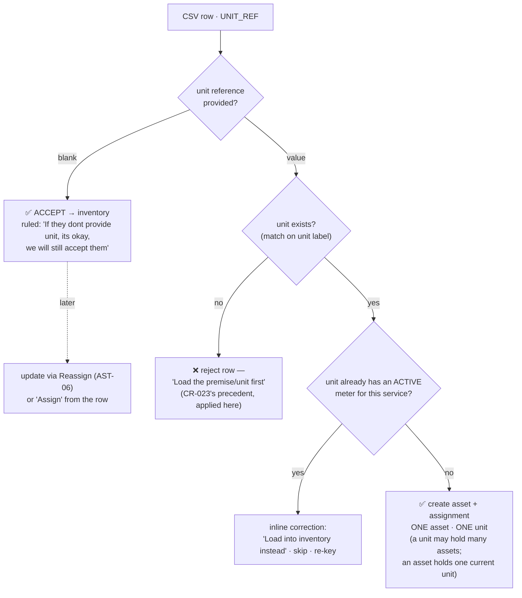
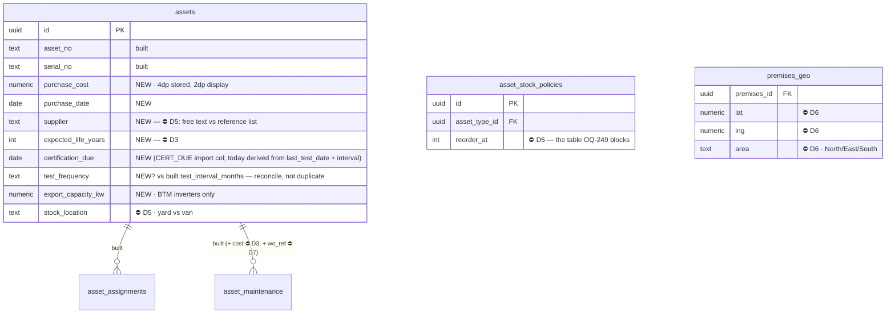

# B16 · CR-028 — Assets, seven tabs · THE DESIGN, IN DIAGRAMS

**Status: DRAFT FOR PO REVIEW · 2026-08-22 · v2.35.3**
**Authority:** fifteen r10 screenshots supplied by the PO 2026-08-22 (AST-01
Meters ×2 · Sub-meters · Behind-the-meter ×2 · Inventory · Lifecycle ×3 ·
AST-03 Map ×2 · WFL-01.meters stages 1–5), plus
`05-prototype/r10-2026-08-16/SMARTBillHub.dc.html` itself (AST-01…AST-08,
AST-05.1–4, and the three import payloads), plus three PO sentences quoted in
CR-028's record.
**Requirement:** `12-governance/11-change-requests.md` → CR-028.
**Binding UI law:** B14, and rule 21 — new UI is Tailwind, no custom CSS.

> **Nothing in this document decides an open question.** Where the rules ran
> out the gap is marked ⛔ and carries the question it is waiting on. A lane
> building from this file stubs those with `raise NotImplementedError("OQ-###")`.
> **§10 was the PO agenda — ALL TEN RULED 2026-08-22 (see §10 for each ruling);
> a ⛔ D-mark in §4–§8 now resolves to its §10 ruling, not to a block.** The
> only standing blocks are Work-side: OQ-249's Work half (two-word disabled
> controls, "Work R5") and OQ-326 (replace-the-batch semantics, stubbed).

---

## 1 · WHAT CHANGES — the shape of it, before any detail

Today Assets is a **built, tested, three-tab registry** (S49/AST-01) plus a
five-tab detail (S50/AST-02): `apps.assets` backend (2,223 test lines),
`AssetRegistryPage`/`AssetDetailPage` frontend (1,833 test lines). r10 draws
**seven tabs**, three import targets on the ETL workflow runner, and turns the
add/retire modals into wizards.

**The PO's own sentences are the contract** (CR-028 record, verbatim there):
seven tabs named in order; *"Each tab has landing page - table format. Import
for each entity, details view, Edit, Update etc"*.

---

## 2 · THE SCREEN MAP — every id, and which exist today

| r10 id | What it is | Today |
|---|---|---|
| AST-01 | Meters tab (KPI strip + table) | ✅ built (`?tab=meters`) — conformance gaps §4.1 |
| AST-01.sub | Sub-meters tab (own column set) | ◑ built as a type filter, not r10's column set — §4.2 |
| AST-01.btm | Behind-the-meter tab (device registry) | ◑ built as a type tab; r10 adds tariff/export columns — §4.3 |
| AST-01.inventory | Inventory tab (stock by type) | ❌ not built — ⛔ §10-D1 |
| AST-01.lifecycle | Lifecycle tab (certs · warranty · forecast) | ❌ not built — ⛔ §10-D1 |
| AST-03 | Map tab (Leaflet, 15 geocoded assets) | ❌ not built — ⛔ §10-D1, §10-D6 |
| AST-04 | Imports tab (run history + rollback) | ❌ not built (import exists as modal) — §4.7 |
| AST-02 | Asset detail, five tabs | ✅ built — Reads tab unserved (DEF-475), new panels §5.1 |
| AST-05.1–4 | Add an asset — 4-step wizard | ◑ exists as single modal — restructure ⛔ §10-D8 |
| AST-06 | Reassign (full-page form) | ✅ modal today |
| AST-07 | Log repair / maintenance | ✅ modal today |
| AST-08 | Retire — 3-step wizard w/ book value | ◑ modal today; step 3 is new finance scope ⛔ §10-D4 |
| WFL-01.meters.1–5 | Meters import on the runner | ❌ target not registered — §4.7 |
| WFL-01.submeters / .devices | Two more targets, same runner | ❌ — §4.7 |

S-IDs: S49/S50 cover registry+detail. **The four new tabs and the map have no
S-IDs; S61–S90 are reserved and unallocated — minting waits on §10-D1** (OQ-249
names exactly this).

---

## 3 · THE GATE — OQ-249, and what the PO's sentence does and does not settle

OQ-249 (2026-08-16, PO verbatim): *"Yes it is sensitive; we will build as
version 2 of the product; I ahve made the design ; but it is not part of R4 ;
it will be R5 ; you dont need to do anything right now"*. Its Blocks cell names
**"the new Assets tabs (btm · inventory · lifecycle · imports · map)"**, their
S-IDs, and any B2 table that would own a work order, a crew or a parts stock.

Today the PO said, starting CR-028: *"We are going to work on Assets now"* and
*"In Assets we have - Meters, SUb Meters, Behand The meter, Inventory,
Lifecycle, Map, Import."*

**Reading:** the tab-set sentence covers **(A)** and only (A). A reversal is
ruled, never inferred — §10-D1 asks it in plain English. **(B)** and **(C)**
stay R5: every work-order control on these screens renders
disabled-with-its-reason (BR-SHL-025) until Work exists — §8.

---

## 4 · THE SEVEN TABS — one pattern, per the PO

*"Each tab has landing page - table format. Import for each entity, details
view, Edit, Update etc."* Every tab: a table landing page under one shared page
head whose sub-line, import button and add button **relabel with the tab**
(r10: `↑ Import meters` / `↑ Import sub-meters` / `↑ Import devices`;
`+ Add asset` / `+ Add sub-meter` / `+ Add behind-the-meter asset`).

### 4.1 Meters (AST-01) — built; conformance deltas

r10 evidence: KPI strip (Meters in service **1,243** · 2 masters · 3 subs ·
84% AMI / Needs repair **14** · 6 with an open work order / In inventory
**115** / Past certification age **38**); columns Meter # · Type · Role ·
Service · Mult. · Assigned to · Installed · Status · eye-View; search chip
`All` + `+ Filter ▾` + column chooser; masters carry a `Master · N units` tag,
subs a `Sub → M-MASTER-12` role.

Deltas from the built page: the KPI strip (today two tabs carry explainer prose
where r10 draws a KPI grid — the DEF-527 residue of 2 that G14 prints as "the
PO's call"; **these screenshots are that call's evidence**, §10-D9), the Role
column, the Mult. column, master/sub role tags, and the "Needs repair … open
work order" sub-label (⛔ Work — render count without the WO clause until §10-D7).

### 4.2 Sub-meters (AST-01.sub) — its own column set, not a filtered clone

r10 columns: Sub-meter # · **Parent / master** · Service · Unit · **Last
read** (`2,140 kWh · Aug 3`) · Installed · Status · four icon actions
(View · Edit · Reassign · Retire). Caption: *"Sub-meters hang off a master
meter and bill their own unit."*

- **Last read** is DEF-592, already on file: `AssetRow` carries no last read;
  needs a metering-owned read summary on the list selector (same seam shape as
  `billable_asset_count` — read via service, never a cross-module join in SQL
  owned by assets).
- ⚠ **r10 internal bug — do not copy:** the Edit pencil calls
  `openAssetRepair` (the Log-repair screen), not an edit form. Edit opens edit.
  Recorded here so conformance testing doesn't "fix" us back to the bug.

### 4.3 Behind the meter (AST-01.btm) — device registry, and the money edge

r10: KPIs Devices **212** · Exporting devices **2** · Exported July
**2,296 kWh** · **Credited to bills $298.40**. Columns: Device # · Type ·
Premises · unit · Meter · Export capacity · Exported Jul · **Tariff** (`Net
metering · 1:1 credit`, `Buy-all / sell-all · $0.068`) · Next test · Warranty
(hidden by default) · Status. NET callout: *"export credits the customer's
bill under the device's tariff. Tariffs link to their rate schedules."*

Structure is buildable (device rows are assets of BTM-category types; CR-004
already seeded **Device types (BTM)**). ⛔ **The money is not:** "Credited to
bills", the tariff column and the callout collide with CONFIRMED BR-AST-025
(*this module never computes/stores/displays credit money*) and BR-RAT-018
(v1 bills solar/battery as **capacity charges**; kWh-netting credits deferred
v1.1). §10-D2. "Exported July kWh" is a quantity, not money — BR-AST-025
allows it (channel quantities are this module's data).

### 4.4 Inventory (AST-01.inventory) — a stock view, and mostly NEW data

r10: KPIs Uninstalled **115** · **$18,420 at cost** / On vans **26** · across
5 vehicles / Below reorder **2** / Aged over 12 months **9**. Table is
**aggregated by asset type**: Yard · On vans · **Reorder at** · **Unit cost**
· **Supplier** · Status (Healthy / At reorder / Below reorder). Footer:
`Raise reorder ✓` · `↑ Import stock count` · `Parts in Work →` (⛔ Work).

Counts and cost derive from asset rows. **Two facts have no home:** where an
uninstalled asset physically is (yard vs which van), and the per-type reorder
threshold. ⛔ §10-D5 — and OQ-249 explicitly blocks "a parts stock" table, so
D1 and D5 travel together.

### 4.5 Lifecycle (AST-01.lifecycle) — three derived tables + one finance panel

r10 sections: **Certifications & tests due** (Requirement `Annual test · state
mandated` / `Accuracy recertification` / `Interconnection inspection`; Status
Overdue / Due in 17 days / Scheduled / In date; wrench = Raise work order ⛔);
**Warranty & supplier** (by asset group: term, cover ends, under-warranty
count); **Age & replacement forecast** (avg age · expected life · past life ·
due within 12 mo · replacement cost; programme row **121 units · $15,842**);
sidebar **Cost to Finance** (Replacements YTD **$34,224** · Repairs YTD
**$8,140** · Depreciation Aug **$22,150** · *"Posts to 5300 O&M and 5400
Depreciation"*) and **Turn into work** (⛔).

What already exists to derive from: `test_interval_months` + `last_test_date`
(BR-AST-027), `warranty_end`, install_date, and CR-004's seeded
**Certification types**. What doesn't: `expected_life`, per-group replacement
cost source, and **everything in the finance panel** — depreciation is a
calculation nothing in this product performs, and "posts to 5300/5400" is a
journal line only the ledger posting service may write (hard rule 5).
⛔ §10-D3.

### 4.6 Map (AST-03) — geography the schema doesn't hold

r10: Leaflet 1.9.4 from unpkg CDN + Esri World Street Map tiles, Austin
coordinates on all 15 seeded assets; filters Type/Status/Service/**Area**
(North · East · South); legend Healthy / Needs attention / Master (hollow
ring); popup card (id, premise, last read, WO) → `Open details →`.

Needs: lat/lng (premises-level geocoding is the natural owner — a meter is
where its premises is; premises carry addresses today, coordinates nowhere),
an `area` concept, and a tile source. ⛔ §10-D6: self-hosting vs third-party
tiles is a data-egress decision (every pan sends tenant asset locations to
Esri), and geocoding addresses needs a service we don't have.

### 4.7 Imports — a tab of runs + three targets on the ONE runner

This is the part the repo has already ruled, and the r10 screens agree with
the rulings:

- **BR-MET-096:** one workflow runner; new imports arrive as **TARGETS (two
  dict entries and a model each), never as new pipelines.**
- **CR-023 §4A:** the assets import is a third import **gated on units** —
  units shipped 2026-08-22, so the precondition is MET.
- **CR-026:** 100,000-row cap, `ASYNC_ROW_BAR = 5_000` → 202 + job. The PO
  named Assets in the widening sentence verbatim.
- **CR-025:** sample CSV at stage 1, header + one worked row.

r10 confirms **three targets**: `Assets · meters`, `Assets · sub-meters`,
`Assets · devices` — each with its own field map, validation rules and
per-row inline corrections (WFL-01.meters.3: *"Fix the rejects here — no need
to re-upload"*, e.g. row 588 "Unit U-10688-A already has an active electric
meter" → "Load into inventory instead").

Key behaviors from the screenshots, each already consistent with signed law:
linking on `UNIT_REF` in the same pass is **this module writing its own
assignment rows** (unlike CR-023's forbidden metering→assets write — here
assets is the target, so the boundary holds); blank unit ⇒ inventory; dry run
before commit; receipt with file hash, run-by, mapping name, rollback point
(*"RB-2851 · available for 30 days"*; AST-04 callout: *"Meters already
carrying reads are kept and reported"* on rollback). Write mode **Replace the
batch** is on screen and its destructive semantics are OQ-326 — ⛔ stub until
ruled. `COST → Purchase cost · Decimal(10,2)` on screen — **stored to 4
decimals regardless** (hard rule 2); the transform label is display, §10-D10
confirms.

The **Imports tab** itself (AST-04) is a run-history table (Run · Source ·
Started · By · In · Loaded · Rejected · Status · Roll back / Fix rows) —
a filtered view of the runner's `import_runs` for the three assets targets.

### 4.7a · The import, in detail — RULED 2026-08-22 (BR-AST-045)

⛔ **STAMPED 2026-08-27 (`CR-046` wave H4) — THREE THINGS BELOW THIS LINE NO LONGER
DESCRIBE THE PRODUCT. `BR-AST-045` ITSELF IS UNTOUCHED; ITS TWO DIAGRAMS ARE NOT.**

The §4.7b field map already carries its own three stamps for `BR-AST-049`. §4.7a's
two diagrams were not stamped with it, and they are the part a reader looks at
first — a picture is read before the prose that corrects it.

1. ⛔ **THE PER-ROW FLOWCHART IS MISSING ITS FIRST DECISION ENTIRELY.** It begins at
   *"CSV row · UNIT_REF"*, so it draws a world in which the only question a meter
   row asks is about its unit. Under `BR-AST-049` / `BR-AST-051` **the first
   question is about the METER**: *does this row name a meter already on file?*
   — **no → the `asset` series issues the number, inside the write**; **yes →
   REJECT in *Insert new only*, UPDATE THE DETAILS in *Insert & update***. The PO
   drew that order themselves: *"2.2 Does this row name a meter already on file?
   if yes - ( in case of insert - reject it | in case of Insert & Update = update
   the details), if no ( generate new meter number using settings -> numbers for
   meter), assing this unquie number and upload the record - this is happy path"*.
   **The four standalone upload pages (`CR-046` wave G) draw the corrected flow and
   are what to read.**

2. ⛔ **`Q2{"unit exists? (match on unit label)"}` IS NARROWER THAN WHAT IS BUILT,
   AND THE LABEL ALONE IS NO LONGER AN IDENTITY.** `BR-MET-404` (PO 2026-08-27:
   *"premsies and unit name - not just unit name that combination is unique"*)
   makes the identity the **pair**, `premises + label`; `unit_ref` resolves three
   ways — the unit's number, the premises and unit together, or the label alone —
   and matching on the label by itself across two buildings would find the OTHER
   building's `Apt 3B` and, under *Insert & update*, quietly rewrite it.

3. ✅ **`Q1{"unit reference provided?"} → blank → ACCEPT → inventory` IS UNCHANGED
   AND MUST NOT BE "FIXED".** It was reversed and un-reversed inside one exchange
   on 2026-08-27 (`BR-AST-045`, re-stamped that day; `OQ-840`). All twelve
   unit-less rows of r10's 1,262-row `meter_fleet_2026.csv` still load.

⚠ **AND ONE STAMP ON §4.7b's "STAMPED AT BUILD" BLOCK BELOW, WHICH HAS ITSELF GONE
STALE:** *"on-file duplicate numbers are a WARNING+skip (upsert re-imports must
work)"* was `DEF-543`'s correct reading of a constraint that has since moved.
`CR-042` put the write-mode choice on **step 1**, so stage 3 now knows it — and
`AST.NUMBER_ON_FILE` is an **ERROR in *Insert new only*** and informational in
*Insert & update*, per `CR-046` C1. The upsert re-import that block was protecting
is exactly the *Insert & update* case, which still works.

The PO ruled it in-session, verbatim in CR-028's record: **the import tags
assets to units in the same pass — one asset, one unit — and a blank unit is
accepted, not rejected.** Tailwind UI, the built runner, 100,000-row volume,
all confirmed in the same exchange. The process, end to end:

And the **per-row unit-tagging decision**, the part the ruling settles:

The cardinality reads both ways and only one way is constrained: **an asset
has at most one current unit** (the partial-unique index
`uq_asset_assignments_current` already enforces it); a unit holds many assets
(electric meter + water meter + backflow + …), bounded only by *one active
meter per service* (the r10 validation rule, which is what keeps billing
unambiguous).

### 4.7b · Import detail — fields · rules · UI · endpoints · tables (PO ask, same day)

PO verbatim: *"As part of details design - we need process diagram; import -
process diagram , field details, rules, UI details, End points, DB tables."*
Rendered in the CR-028 design artifact; recorded here as the buildable spec.

⛔ **THE FIELD MAP BELOW IS STAMPED WHERE `BR-AST-049` (PO 2026-08-27) DIVERGES
FROM IT — three rows, read this before the table.**

1. **`METER_NO`→Meter number is REVERSED.** The PO ruled that a meter's number
   is issued by the tenant's numbering settings and is never taken from an
   uploaded file — *"here we should not allow usse to fill in Asset ID - we have
   number system set in the settings, we shoudl call that function and get
   unique number and assign it"*. The `asset_no` column stays in the template
   and means *"an EXISTING meter number — leave blank for a new meter"*; the
   `METER_NO` / `METER #` / `DEVICE_NO` header aliases now auto-map to
   `external_ref`, because on a migration file those cells hold the OLD
   system's numbers.
2. **Two columns this table does not list are now offered:** `SERIAL_NO` (the
   manufacturer's serial — the ruling's own safety argument rests on the file
   supplying it, and until 2026-08-27 no assets template offered it at all) and
   `EXTERNAL_REF` (the utility's own legacy reference, `UNIQUE` per tenant and
   a lawful alternate match key).
3. **`PARENT_MTR` is UNCHANGED and must not be "fixed"** — the master must be
   on file already, so the number cited is one we issued.

**Fields — meters target** (source → target, from the r10 field map):
`METER_NO`→Meter number (trim/upper, tenant-unique) *(SUPERSEDED 2026-08-27 →
BR-AST-049: `METER_NO`→`external_ref`; the meter number is issued, not read)* ·
`METER_TYPE`→lookup
(BR-AST-043) · `SERVICE`→E/W/… · `READ_METHOD`→lookup · `MULTIPLIER`→int,
default ×1 w/ warning · `UNIT_REF`→**match on unit label, blank = inventory
(BR-AST-045)** · `MFR`/`MODEL` · `INSTALL_DT`→ISO · `CERT_DUE`→ISO (**new
column**) · `WARRANTY_END`→ISO (column exists) · `SUPPLIER` (**new column**;
list-vs-free-text = §10-D5) · `COST`→purchase cost, stored 4dp (§10-D10,
**new column**) · unmapped columns → explicit "— ignore —".
**Sub-meters target adds** `PARENT_MTR` (master must exist & be active),
`ALLOC_PCT` (blank = metered, not allocated). **Devices target adds**
`DEVICE_TYPE` (lookup), `PREMISE_ID` (devices may attach at premises level),
`TEST_FREQ`/`NEXT_TEST` (lifecycle calendar), `EXPORT_KW` (inverters only).
**A fourth target, `assets_stock` (Inventory tab's "Import stock count"), is
PROPOSED, not extracted** — r10 draws its button but never its file; the map
derived from the tab's columns (`ASSET_TYPE` lookup · `SERVICE` · `YARD_QTY` /
`VAN_QTY` ints ≥0 · `REORDER_AT` · `UNIT_COST` 4dp · `SUPPLIER`) and its rules
(type-in-lookup E · whole-number counts E · count-vs-known-assets difference
W→review, **a count never silently creates or deletes assets** · supplier
known W) wait on §10-D1 and §10-D5. Lifecycle and Map have no imports of
their own — four targets is the complete set.

> **STAMPED AT BUILD (AST-W3, 2026-08-22):** devices' "type in lookup
> (W→Other)" shipped as a structural **ERROR** — `assets.type` is a non-null
> FK and no "Other" type is seeded; silently defaulting a type would be the
> OQ-329 shape. Also: on-file duplicate numbers are a WARNING+skip (upsert
> re-imports must work), in-file duplicates an ERROR — DEF-543's lesson.

**Rules** (errors block, warnings flag): meters — number unique (E→reject),
unit exists & no active meter for this service (E→reject / "load into
inventory instead"), multiplier positive int (W→default ×1), cert date future
(W→flag test due), meter type in lookup. Sub-meters — parent exists & active
(E), number unique (E), sub total ≤ master (W→review), unit same premises as
master. Devices — premises exists (E), type in lookup (W→Other), next-test
present when frequency set (W→derive from install date).

**UI per stage** (Tailwind, B14 r21): 1 Extract — four source cards (file
built), drop zone w/ name·rows·size·SHA-256, sample CSV (CR-025), mapping
auto-detect, encoding/delimiter, "Loads into", batch label. 2 Transform —
map table w/ Matched pills + ignore, row handling (drop exact dupes · keep
latest on twice-seen key · skip empty-required), after-transform tally, save
mapping as template. 3 Validate — KPI row, rules-that-ran, fix-rejects-inline
table, rejects CSV, re-run just the rejects. 4 Load — dry-run summary, write
mode (insert-new / insert-update / replace-the-batch ⛔ OQ-326), approval when
exceptions > 5% of batch, rollback-point + notify options, Commit. 5 Result —
receipt (run id · duration · counts · file+hash · run-by/session/IP · mapping
· rollback point, 30 days), NEXT note, Go-to-Assets / rejects CSV / report
PDF / roll back.

**Templates (BR-AST-048, PO-confirmed 2026-08-22):** each target seeds ONE
system default mapping template into `import_mappings` (tenancy's list, the
SET-04 screen), GENERATED from the target contract — the same source as the
sample CSV, so they cannot drift. Tenant saves are copy-on-write beside the
defaults; auto-detect: exact header match, tenant beats default, ties to
most-recently-used. W3-T8.

**Endpoints — the runner's, unchanged** (`apps/metering/api.py`): `POST
/imports` (new `target` values `assets_meters · assets_submeters ·
assets_devices` joining `IMPORT_TARGETS`), `GET /imports/sample?target=`,
`GET /imports/{run}/columns`, `POST …/transform`, `POST …/validate`, `POST
…/dry-run`, `POST …/load` (**the only writer**), `GET /imports/{run}` (CR-026
poll) + `…/receipt`, `POST …/rollback`. Async over `ASYNC_ROW_BAR = 5_000` →
202 + `import_run_progress`.

**Tables**: `import_runs` / `import_run_rows` / `import_run_progress` exist
(gain three target values); `assets` gains certification-due · supplier ·
purchase-cost (· export-capacity for devices) columns; `asset_assignments`
receives the unit tag at stage 4 under its existing current-row unique index.
Ownership per B2 r4 (metering owns, assets services write); the old
single-shot `/assets/imports` path migrates onto the runner per CR-026's
"existing single-shot import paths migrate onto the runner" — **and the PO has
now ruled it for assets explicitly (BR-AST-046, verbatim in CR-028's record):
the import modal converts to the workflow on every tab, the import's name
matching its tab.** No second pipeline survives.

### 4.8 · The per-tab contract — screens · tables · endpoints · DRIFT (PO ask, same day)

PO verbatim: *"I also want every tab detail page - detailing thats where we
are drifting lot; also list tables along with screens , APIs, and endpoits."*
Drift named per tab because unnamed drift is exactly how PRM-02/03 went wrong
(CR-027). Rendered fully in the CR-028 artifact; the contract:

| Tab | Endpoints | Tables | DRIFT today |
|---|---|---|---|
| Meters (AST-01) | `GET /assets?f.tab=meters` · `POST /assets` · `GET·PATCH·DELETE /assets/{id}` · `POST …/retire·/reassign·/maintenance` — all exist | `assets` · `asset_assignments` + 4 lookups | KPI strip is explainer prose (D9) · Role + Mult. columns missing · master/sub role tags missing · WO sub-label ⛔ D7 |
| Sub-meters (AST-01.sub) | `GET /assets?f.tab=sub_meters` — rows need parent + last-read summary via metering seam | `assets` (parent_asset_id ✔) · `asset_assignments` · `meter_reads` (seam, RO) | Filtered clone of Meters columns, not r10's own set · no last read (DEF-592) · r10's Edit→repair bug NOT copied |
| Behind the meter (AST-01.btm) | `GET /assets?f.tab=behind_the_meter`; export qty via reads seam; tariff cell only under D2(b), served by rating | `assets` (+`export_capacity_kw` NEW) · `meter_reads` export channel (seam) | No KPI strip · export/tariff/next-test columns missing · all money ⛔ D2 |
| Inventory (AST-01.inventory) | `GET /assets/stock` NEW (aggregate by type) · `PUT /assets/stock/policies` NEW | `assets` (+`stock_location` ⛔ D5) · `asset_stock_policies` NEW (⛔ D1+D5 — the "parts stock" table OQ-249 parked) | Does not exist; risk = building before D1/D5 |
| Lifecycle (AST-01.lifecycle) | `GET /assets/lifecycle` NEW (certs due · warranty groups · age forecast, one call) | `assets` (interval/last-test ✔; + cert-due, supplier, cost, expected-life NEW) · `asset_maintenance` · Certification types lookup (seeded) | Does not exist; finance sidebar has no lawful engine ⛔ D3 |
| Map (AST-03) | `GET /assets/geo` NEW · tiles per D6 | premises + `lat·lng·area` NEW; geocoding ⛔ D6 | Does not exist; third-party tiles = data egress ⛔ D6 |
| Imports (AST-04) | `GET /imports?target=assets_*` · full runner set · `POST …/rollback` — all exist | `import_runs · import_run_rows · import_run_progress` — exist | Import is a modal → ruled to the workflow, tab-matched names (BR-AST-046) |
| Details (AST-02) | `GET /assets/{id}` · `GET …/reads` **to serve** (DEF-475) · `…/assignments` · `GET·POST …/maintenance` · `GET /audit-log?f.entity=asset:{id}` | `assets · asset_assignments · asset_maintenance` · `meter_reads` (seam) · `audit_log` (RO) · account chain via customers seam | Warranty + Lifecycle panels missing (columns arrive with this CR) · Reads tab placeholder · maintenance raw ids (filed) · Cost column's posting half ⛔ D3 |

Inventory rows are aggregates — r10 draws no per-row detail for them; their
assets are reached through the type tabs filtered to Inventory status.

**AMENDED same day — the drift column is now MEASURED (deployed v2.34.0
screenshots, PO-supplied):** registry title "Asset registry" (r10: "Assets");
one "Bulk import" button (→ BR-AST-046 tab-named workflow imports); "+ Add
meter" (r10: "+ Add asset"); columns Asset/Meter type · Read method · UoM
where r10 draws Role · Service; multiplier `1.000000` (r10 `×1`); status
"Installed/Active" (r10 "Active"); raw dates; sub-meters and BTM are filtered
clones. Detail W-5000: Classification panel repeated above every tab (not in
r10); three Overview panels absent; assignment "By" a raw UUID; Maintenance
caption-only; **Audit tab renders a LINK — PO confirmed inline rows verbatim
(*"it is showing asset speific audit details there itself" · "We did that in
Cr23"*): the DEF-579 pattern applies to assets identically.** Deployed extras
backed by rules (Select column, Download CSV) are KEPT. The full r10 AST-02
spec was put to the PO line-by-line in the artifact and stands confirmed
subject to their corrections.

---

## 5 · BEYOND THE TABS — detail and the four flows

### 5.1 Detail (AST-02) — same five tabs, three new Overview panels

Built tab set matches r10 exactly (`overview · reads · assignments ·
maintenance · audit`). New on Overview: **Assignment** panel with the live
chain Premises → Unit → Account (BR-AST-039, CONFIRMED — buildable),
**Warranty & supplier** panel (needs §6 columns), **Lifecycle** panel (age ·
expected life · certification due · replacement forecast — forecast needs
§10-D3's expected-life ruling). The **Reads tab** draws Date · Reading ·
Import · Export (net) · Source · Status — this is US-AST-005, deliberately
unserved until now (DEF-475); with the W2 reads tables live, `GET
/assets/{id}/reads` becomes buildable, rendering BR-AST-029's two typed
records per net cycle as the Import/Export columns. The Maintenance tab adds
**Work order** and **Cost** columns (cost ⛔ §10-D3's O&M posting sentence; WO
⛔ §10-D7).

### 5.1b · ONE detail template, EVERY kind (PO ask, 2026-08-22)

PO verbatim: *"this si required on sub meters, devices, investory everything -
add detaisl for this in diagram."* Design: **one AST-02 template — five tabs,
three panels — opened by every asset kind; content varies by kind, structure
never.** Kind matrix (rendered fully in the artifact):

- **Sub-meter**: kicker `SUB-METER · SM-8801 · AMI`; sub-line names its
  master (`Sub → M-MASTER-12 · Vega Apts`); Specifications add Parent/master
  (link) + allocation share; Assignment panel states the master's premises.
- **Device (BTM) — MODELED, r10 draws no device detail (PO: *"prototype has
  worng information … mdoel the details based on what we did for meter and
  sub meter"*).** Two shapes, both full-specced in the artifact for PO
  confirmation: **(A) plain device** (BF-3301 backflow): FOUR tabs — Overview
  · Assignment history · Tests & maintenance · Audit — **no Reads tab at
  all** (a dead tab is Premises-style drift); new **Test & certification
  panel** (requirement · last test · next due · Log test) feeding the
  Lifecycle calendar; specs without multiplier/register/UoM/read-method
  (BR-AST-044 refusal); header buttons Reassign · **Log test** · Retire.
  **(B) exporting inverter** (PV-1204): FIVE tabs — an **Export tab replaces
  Reads**, showing the LINKED NET METER's export records read-only ("Measured
  by M-4310 · net →"), never a device-stored read; specs add linked net meter
  (FK link) + export capacity. Flows: Add wizard step 2 swaps metering
  numbers for device type/linked meter/capacity/cadence; **Log test** sets
  last-test and computes next due; reassign premises-level, no final read;
  retire is two steps for non-measuring (+ D4's book value); retiring a
  linked inverter clears the link and flags the meter's pairing for review.
- **Inventory asset**: same template; sub-line **"In inventory ·
  unassigned"**; Assignment panel shows Inventory + **Assign →**; Reads "no
  reads yet"; age counts from purchase. **Path from the Inventory tab:** a
  stock line (an aggregate) drills to the filtered list of that type's
  uninstalled assets; each row opens this template — no second detail screen
  exists anywhere.
- Warranty/Lifecycle panels, assignment history, maintenance and inline
  Audit are identical for all kinds.

### 5.2 The four flows — wizards and forms

> **AMENDED 2026-08-22 — NO FLOW IS A MODAL (PO: *"as per r10 - it is not
> modal"*).** r10 draws all four as full-page screens: AST-05 add wizard ·
> AST-06 reassign form · AST-07 repair form · AST-08 retire wizard. Today's
> modals (`AssetLifecycleModals.tsx`) convert to full-page screens; D8's
> wizard restructure now covers the whole set.

- **Add (AST-05.1–4):** Identity → Specification → Assignment → Lifecycle.
  Steps 1–3 are today's modal fields re-paged (incl. BR-AST-026 numbering:
  r10's UNIQUE callout matches `suggest_asset_no`). Step 4 (supplier ·
  purchase cost · warranty term · expected life · certification cadence) is
  new capture, §6. Replacing the ratified single modal with a wizard is a
  structure change on a shipped surface — §10-D8.
- **Reassign (AST-06):** matches BR-AST-022 (final-read checkbox) — but r10
  draws only the checkbox, no value input; the value field is a known design
  gap (EP-AST-03 GAP, deliberate). WO checkbox ⛔ §10-D7.
- **Log repair (AST-07):** matches BR-AST-018/038 + adds **Estimated cost**
  and *"Post the cost to O&M 5300"* ⛔ §10-D3.
- **Retire (AST-08):** steps 1–2 match BR-AST-021/030 + replacement +
  estimated-billing warning. **Step 3 · Book value** (purchase $164.00 ·
  accumulated depreciation $19.83 · remaining **$144.17** · write-off to 5400
  / warranty claim / hold) is a depreciation engine + a journal entry —
  ⛔ §10-D4, same family as D3.

---

## 6 · THE DATA-MODEL DELTA — what `assets` must newly hold

Ownership unchanged: **metering owns the tables (B2 r4), `apps.assets` hosts
them, every write goes through assets services.** No new module.

Not drawn on purpose: work orders, crews, tariff-on-device (the NET callout
says *"tariffs link to their rate schedules"* — that link, if it survives D2,
is a **rating**-owned association reaching assets by FK, per B2 §2's reviewed
interface set, never an assets-owned copy of a tariff).

---

## 7 · THE MONEY MAP — every dollar on these screens, classified

| Figure on screen | What it is | Verdict |
|---|---|---|
| Unit cost $118–$412 · Inventory "$18,420 at cost" · detail "Purchase cost $164.00" | Stored purchase cost, displayed / summed | ✅ buildable once the column exists (stored 4dp, shown 2dp — hard rule 2; §10-D10) |
| Replacement cost $10,266 / $5,576 · programme $15,842 | count × unit cost forecast | ◑ arithmetic on stored costs — buildable with D3's expected-life ruling |
| **Credited to bills $298.40** · tariff `1:1 credit` / `$0.068` | Billing credit money on an assets screen | ⛔ BR-AST-025 + BR-RAT-018 — §10-D2 |
| **Depreciation Aug $22,150** · "Posts to 5300 O&M and 5400 Depreciation" · Repairs YTD $8,140 · Replacements YTD $34,224 | A depreciation engine + GL postings | ⛔ hard rule 5 (only the ledger posting service writes journal lines) — §10-D3 |
| Retire book value: $19.83 accum. dep. · **$144.17 write-off** · $8.00 salvage | Same engine, per-asset | ⛔ §10-D4 |
| Maintenance cost $31.00 / $88.40 · "Lifetime maintenance $119.40" | Cost captured on a maintenance row | ◑ capture+display is a column; the *"posts to O&M 5300"* sentence is D3 |
| Retire "48 kWh · roughly $12.24" | A bill estimate inside an assets flow | ⛔ rating math outside rating — display only if rating serves it; else drop. Folded into D2 |

---

## 8 · THE WORK-ORDER COUPLING — one posture everywhere

WO touchpoints on these screens: Meters KPI sub-label ("6 with an open work
order") · Lifecycle wrench "Raise work order" · "Turn into work" panel ·
Inventory "Parts in Work →" · Add step 3 / Reassign / Repair / Retire WO
checkboxes · map popup WO-#### lines · Maintenance tab Work order column.

**Posture until OQ-249's Work half is ruled (§10-D7): every one renders
disabled with its reason (BR-SHL-025), none is hidden** — hiding them would
misrepresent r10, disabling them tells the truth: *"Work arrives in R5."*

---

## 9 · THE BUILD AS TASK WAVES (supersedes the five slices — PO ask 2026-08-22: *"convert all items build items into tasks and combine tasks logically and convert them into waves"*)

**AST-W1 · Registry to r10 (6 tasks):** T1 KPI grids replace explainers
(D9/D2) · T2 Meters columns+tags+title · T3 Sub-meters own columns + last
read (DEF-592) + real Edit · T4 BTM device columns, no money (D2) · T5
tab-matched import buttons → runner (BR-AST-046) · T6 deployed display fixes
(×1, Active, dates).
**AST-W2 · Details for every kind (8 tasks):** T1 SCHEMA FIRST — valuation +
certification columns, one migration, HUMAN-REVIEW-PENDING · T2 header to
r10 · T3 three Overview panels, classification panel removed · T4 Reads tab
served (DEF-475) · T5 Audit inline (CR-23 pattern) · T6 names not UUIDs ·
T7 maintenance table w/ WO+Cost (captured, not posted) · T8 device detail
per the Item-3 model (4-tab plain / 5-tab inverter+Export).
**AST-W3 · Imports on the runner (6 tasks):** T1 three targets registered ·
T2 unit tagging at load (BR-AST-045, the 1,262→1,255/1,243/12 worked case) ·
T3 sample CSVs · T4 Imports tab + rollback · T5 legacy modal path retired ·
T6 100k/async proven.
**AST-W4 · Full-page flows & valuation (5 tasks):** T1 add wizard (D8,
not-modal ruling) · T2 reassign + log repair/test to full pages, next-due
computation · T3 retire 3-step w/ recorded book-value treatment (D4;
2 steps for non-measuring) · T4 valuation on the record (D3) · T5 cert
defaults per type (BR-AST-027) driving next-due.
**AST-W5 · New tabs (4 tasks):** T1 Inventory counts-&-costs (D5) + drill ·
T2 Lifecycle three lists + Asset value sidebar (no GL) · T3 Map (geo columns,
geocoder recorded w/ worked address, endpoint, tab) (D6) · T4 the "Work R5"
two-word disabled sweep (D7).

**AMENDED (PO: *"You will have to update test cases and test data as well ;
seed data as well include them in tasks and then start waves and complete
waves"*):** **AST-W0 · Seed & test data runs FIRST** — T1 seed to the r10
fixture shape (masters+subs+reads · net meter w/ export records · all five
BTM device types w/ test schedules, warranty, purchase costs · aged inventory
· **trash carts on units, closing DEF-496's seed gap** so 3 × $15.00 = $45.00
finally walks) · T2 per-target import CSV fixtures covering every rule + a
100,000-row synthetic. And one tests-first task per wave: W1-T7 registry
suite · W2-T9 detail + reads-endpoint suites · W3-T7 target rule tests off
the fixtures · W4-T6 ratified-figure tests ($144.17 goes RED on drift) ·
W5-T5 endpoint tests + seeded coordinates. **36 tasks. Build authorized and
STARTED 2026-08-22.**

**Parallelism (PO asked):** three lanes start immediately — W1, W2, W3 —
plus an optional fourth on W5-T3's premises groundwork; W4 waits on W2-T1's
schema; W5-T1/T2/T4 wait on W4's valuation. Beyond four lanes the shared
files (endpoints client, i18n catalogs) become the constraint. Standing on
every wave: r11 2c/2d (tests first, guards RED first, clicked proof),
write-back, and a version bump the screen shows.

### The superseded five-slice plan, kept for the record

1. **Conformance on the built three tabs** — KPI strips, Role/Mult columns,
   sub-meter column set + last read (DEF-592), BTM non-money columns, row
   actions. Needs: D2 (to know what the BTM strip shows), D9.
2. **Detail additions** — Assignment/Warranty/Lifecycle panels, Reads tab
   (US-AST-005 via DEF-475's filter fix), maintenance cost capture.
3. **The three import targets + Imports tab** — on the runner per §4.7.
   Needs: D10 confirmed; OQ-326 stubbed.
4. **Inventory + Lifecycle tabs** — after D1, D3, D5.
5. **Map** — after D1, D6. **Wizard restructure** — after D8.

Everything in slices 1–3 stands on CONFIRMED rules today; slices 4–5 are
gated. Journeys, TCs and story amendments route through r11 per story.

---

## 10 · THE PO AGENDA — **ALL TEN RULED 2026-08-22** (one PO message, verbatim in CR-028's record)

> Ruled the same day they were put. Per-row: the question as asked, then
> **RULED:** the answer and its consequence. Tests asserting the ratified
> figures land with each build slice.
>
> **D1 RULED — "Yes — bring them into this CR."** Inventory, Lifecycle, Map,
> Imports-as-tab are in scope now; OQ-249's Assets half superseded (row
> amended), Work half untouched.
> **D2 RULED — "Build the tab without the credit KPI & tarif."** BTM ships 3
> KPIs; no $298.40, no Tariff column; BR-AST-025/BR-RAT-018 stand.
> **D3 RULED → BR-AST-047.** Depreciation method optional, cost optional,
> life calculable, buy + present value computed on the device record; no
> finance link, future-linkable by design.
> **D4 RULED → BR-AST-047.** Retire keeps step 3: compute book value, record
> the operator's treatment choice; posts nothing; future finance link noted.
> **D5 RULED — "Launch with counts & costs only."** No vans, no reorder
> thresholds, no `asset_stock_policies` table, stock-count import deferred.
> **D6 RULED — third-party tiles accepted + a geocoder to be picked** (the
> selection is an engineering decision recorded at build; premises gain
> lat/lng/area).
> **D7 RULED — disabled with a TWO-WORD reason:** "Work R5".
> **D8 RULED — restructure to the wizard now** (US-AST-002 shape amended at
> build).
> **D9 RULED — draw the KPI grids** — closes the DEF-527 residue-of-2 call.
> **D10 RULED — confirmed**, stored 4dp.
>
> The original agenda as put, for the record:

- **D1 · Scope.** On Aug 16 you ruled the new Assets tabs are *"version 2 …
  R5 ; you dont need to do anything right now."* Today you sent their
  screenshots and named all seven tabs. **Confirm: Inventory, Lifecycle, Map
  and the Imports tab come into scope NOW, superseding the R5 deferral for
  Assets tabs only?** (Work itself stays R5 — see D7.)
- **D2 · Money on the Behind-the-meter tab.** The tab shows **"Credited to
  bills $298.40"** and a tariff column. Our signed rules say assets never
  displays credit money, and v1 bills solar as a **capacity charge** — kWh
  credit math was deferred to v1.1. **Pick one:** (a) build the tab without
  the credited-$ KPI and tariff column for now; (b) show the tariff **name**
  only (a label from Plans & Rates, no math); (c) bring kWh credit math
  forward — a rating-module change far bigger than this CR.
- **D3 · The Lifecycle finance panel.** It shows **Depreciation Aug $22,150**
  posting to GL **5300/5400**. We have no depreciation engine, and only the
  ledger service may write journal lines. **Is depreciation real scope now, or
  does the panel ship without the finance sidebar** (certs, warranty and
  forecast tables still built)? Also needed here: is **expected life** a
  per-type default you set (e.g. AMI meter = 20 years), like test intervals?
- **D4 · Retire step 3 (book value).** Retiring M-4021 shows write-off
  **$144.17** to 5400. Same engine as D3 — **ship retire as steps 1–2 now and
  add step 3 when D3 lands?**
- **D5 · Inventory stock facts.** "On vans 26 · across 5 vehicles" and
  "Reorder at 40" have no data source — no van list, no reorder thresholds.
  **Do we add a per-type reorder threshold + a yard/van location field now, or
  does the tab launch with counts and costs only** (Yard = everything
  uninstalled)? And is **Supplier** a reference list you manage, or free text?
- **D6 · The map.** r10 loads street tiles from Esri's public server — every
  pan sends your asset locations to a third party — and no premises has
  coordinates yet (someone must geocode addresses). **Accept third-party tiles
  + pick a geocoding source, or defer the Map tab until we choose a
  self-hosted option?**
- **D7 · Work-order buttons.** These screens have ~10 "raise a work order"
  controls; Work is R5 by your ruling. **Confirm: render them disabled with
  the reason "Work arrives in R5" — not hidden, not built.**
- **D8 · Add-asset wizard.** r10 replaces today's one-modal Add (shipped,
  tested) with a 4-step wizard whose step 4 captures cost/warranty/life.
  **Restructure now, or keep the modal and add the step-4 fields to it until
  slice 4?**
- **D9 · KPI strips.** Two Assets tabs still show explainer prose where r10
  draws a 4-card KPI grid (the "residue of 2" our gate prints every run as
  your call). Your screenshots show the grids. **Confirm: drop the prose,
  draw the KPI grids.**
- **D10 · Import COST precision.** r10's transform labels purchase cost
  `Decimal(10,2)`. Our money law stores 4 decimals, displays 2 ($164.00 stays
  $164.00 on screen either way). **Confirm storage follows the money law, the
  screen label notwithstanding.**

~~If any of D1–D8 is not ruled this session, it is minted as an OQ~~ — **moot:
all ten were ruled the same session.** No CR-028 OQs exist. The one selection
left to engineering: WHICH geocoder (D6 accepted the category); record it in
the decision log at build with its worked example (an address → lat/lng).

---

## 11 · r10 INTERNAL BUGS — recorded so conformance doesn't copy them

1. Sub-meters **Edit pencil opens the repair screen** (`openAssetRepair`),
   not an edit form.
2. Pagers are copy-paste artifacts: "1–50 of 1,247" on a 3-row Imports table
   and on the maintenance history; Meters pager says 1,247 while its KPI says
   1,243.
3. The Add wizard computes per-kind titles ("Add a sub-meter") that are never
   rendered — the generic title always shows.

Per the standing law: where spec contradicts r10, r10 wins — but where r10
contradicts **itself**, the self-consistent reading is taken and noted here.

4. **AMENDED AT BUILD (AST-W4): r10's retire book-value figures are
   arithmetically unreachable.** $164.00 over 20 years, installed Mar 12 2024,
   as-of Aug 16 2026 gives **$19.82 accumulated / $144.18 remaining**
   ($164.00 × 29/240 whole months); r10 prints $19.83/$144.17, which needs
   29.02 elapsed months — no whole-month, whole-day or 365.25-day derivation
   reaches it. The product pins ITS formula by test (a change goes RED) and
   the one-display-cent delta is on the PO agenda for a glance, never fudged.
