# B18 · CR-030 — Consumer onboarding, eight tabs · THE DESIGN, IN DIAGRAMS

**Status: DRAFT FOR PO REVIEW · 2026-08-23 · v2.40.3**
**Authority:** **twenty-five prototype screenshots supplied by the PO 2026-08-23**
— the eight tabs (ACC-01 list ×2 · REQ-01 ×2 · NCT-01 ×2 · MVI-01 ×2 · MVO-01 ×2
· TRF-01 ×2 · DSC-01 ×2 · ACC-02) and the account detail (**ACC-01 detail ×10**,
one per tab plus two scroll states) — which draw the **eight-tab Accounts page
and the nine-tab account detail as built in the design canvas**; plus the four design analyses produced in the working session of
2026-08-22 (the Accounts brief, the front-door analysis, the consumer-onboarding
document with its industry benchmark, and eight Claude Design instruction sets),
held outside the repo at the PO's instruction (*"dont write all these into
repo"*) and carried here; plus the shipped code at `4471f64`.
**Requirement:** `12-governance/11-change-requests.md` → CR-030.
**Binding UI law:** B14, and **rule 21 — new UI is Tailwind utilities and adds
no class to a stylesheet.**

> **Nothing in this document decides an open question.** Where the rules ran out
> the gap is marked ⛔ and carries the question it is waiting on. A lane building
> from this file stubs those with `raise NotImplementedError("OQ-###")`.
> ~~**§10 is the PO agenda — eleven decisions, none of them ruled yet.** Six of
> them are the OQs CR-030 minted (OQ-346…OQ-351); five are new here and are
> marked **D1–D5**.~~ ⚠ **CORRECTED 2026-08-24 (write-back lane, after the PO's
> twelve-ruling message).** Two things were wrong. **The pointer:** the PO agenda
> is **§12**, not §10 — §10 is UI conformance. **The count:** **FIVE of the six
> minted OQs ARE NOW RULED** — OQ-346 → BR-CUS-082, OQ-347 → BR-CUS-081,
> OQ-348 → BR-MET-104, OQ-349 → BR-CUS-083, OQ-350 → BR-MET-105 — and only
> **OQ-351 is still open**, asked on 2026-08-24 and awaiting the detail the PO
> promised (*"i will give you details"*). The five **D1–D5** decisions remain
> unruled. Every ⛔ below that names a ruled OQ is corrected in place and dated;
> a ⛔ that still stands says so.

> **⚠ THE PROTOTYPE IS NOT IN THE REPO.** The twenty-five screenshots come from
> the Claude Design canvas. `05-prototype/r10-2026-08-16/SMARTBillHub.dc.html` is
> byte-identical to its 2026-08-16 state and draws **two** Accounts tabs, not
> eight. So for this CR the screenshots are the authority and r10 is the
> *previous* reference — the reverse of the usual posture. **Every screenshot
> claim in this document is stamped `[shot]`** so a later reader can tell what
> was seen from what was inferred.

---

## 1 · WHAT CONSUMER ONBOARDING IS — and why the product has no front door

Onboarding is everything between *"somebody wants service"* and *a live account
that bills correctly*. It is one process with three endings, and the product
today implements only the endings.

**Three reasons it is the process that matters most.** It is where the customer
record is created, and every duplicate, every mis-spelled name and every
unmatched deposit for the next ten years is created here or not at all. It is
where the obligations attach — the service agreement, the deposit terms, the
assistance programme with its recertification date, the medical protection that
stops a disconnect. And it is the utility's slowest promise: a new connection
takes weeks, during which the only thing the customer has is what somebody told
them on the phone.

### 1.1 What is missing, stated as one sentence

**There is no record of a request for service.** The `service_request` number
series has been in the numbering catalog since CR-005 (`06-backend/core/numbering.py`
line 100, default `SR-{YY}-{0000}`) and **nothing in the product allocates one.**
A form and a driving licence sit on a desk until somebody has time.

### 1.2 The twelve costs, grouped by where they bite

| # | Problem | What it costs |
|---|---|---|
| **Nothing receives the request** ||
| 1 | The paper is the system | If it is lost there is no record it arrived |
| 2 | Nobody can say what is pending | No answer to *"what came in this week?"*; backlog is invisible until a customer complains |
| 3 | The customer has nothing to quote | No reference, no status. Every follow-up call starts from the beginning |
| 4 | Refusals leave no trace | Someone turned down for arrears at a previous address simply reapplies |
| **The customer cannot be pinned down** ||
| 5 | The same person entered three times | The landlord with fourteen units appears fourteen times, and *"all accounts for this customer"* shows one |
| 6 | Deposits collected twice | **$153.50** sits on a closed account and is never carried across |
| 7 | Discounts start months late | Assistance evidence arrives with the application and has nowhere to attach until an account exists |
| **The money and the work are out of step** ||
| 8 | Connection charges have no bill to sit on | The developer owes **$14,390.00** and is free text on a premise, not an account |
| 9 | Field work and billing drift apart | A meter set with no account behind it, or an account against a unit whose meter never arrived |
| 10 | Nothing tracks what is outstanding on a build | Twenty-five units, seven jobs, four done — which four lives in a crew's head |
| **The customer is never told** ||
| 11 | No welcome, no agreement, no receipt | The first document they get is a bill |
| 12 | Every question is a phone call | Which is one or two people who are also doing the billing run |

### 1.3 The shape of the change

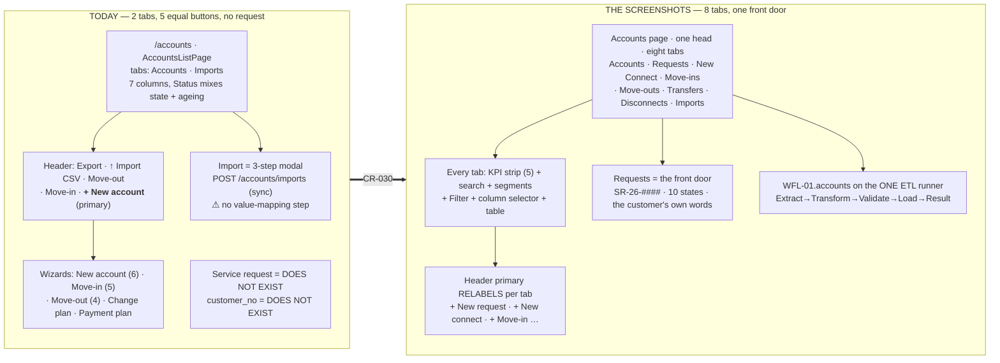

**The premise that is reversed, in one line.** Today work starts by *creating an
account*; `+ New account` is the primary button. After this CR work starts by
*logging a request*, and the account is an outcome.

---

## 2 · THE PROCESS WE BUILD

### 2.1 Six channels, one record

The design goal is that all six produce **the same row**, because the moment they
do not the utility has two backlogs and can see neither.

| Channel | What arrives | Who keys it | Release |
|---|---|---|---|
| Counter · paper form | A completed form plus documents | Clerk, customer present | v1 |
| Phone | Nothing — the clerk fills the form while talking | Clerk | v1 |
| Email | A scanned form or free text with attachments | Clerk, from the inbox | v1 |
| Walk-in with documents | No form, just the person and their paperwork | Clerk, guided by the intake screen | v1 |
| Developer submission | A site plan and a unit schedule | Clerk, bulk intake path | v1 |
| Customer portal | A self-served form with uploads | Nobody — the customer | **Later — out of scope** |

**The consequence of the portal being out of scope:** the request must be
**raiseable by a clerk on somebody's behalf from day one**, and the portal must
be nothing more than a sixth way to create the same row. If the portal were the
primary path, five of the six channels would have no home.

> **PO correction, 2026-08-22, verbatim — this is what the intake form must be:**
> *"we need to build this based on how consumer will fill the form, name,
> address, service requried etc, like someone will fill the request from customer
> portal - you take the form and then save it and then open it for process thats
> when you perform rest of the activities and based on decision allow utility
> clark to open new connection request or move-in request and we need to keep
> them conencted"*
>
> Three separate things follow, and conflating them is what the first attempt got
> wrong:
> **(a) THE APPLICATION** — the customer's words, in customer language. It never
> asks the applicant to choose between *new connection* and *move-in*.
> **(b) THE RECORD** — saved as submitted, and **never overwritten by
> processing**. What the clerk concludes is written beside it, not over it.
> **(c) THE PROCESSING** — clerk work, on a different screen, after the save.
> **The SYSTEM classifies**, by resolving the address (§2.3).

### 2.2 The three combinations

| Case | Combination | True at the start | Exists at the end |
|---|---|---|---|
| **A** | New connection · 1 premise · 1 unit | A plot and an applicant. No premise, unit, meter or account | 1 premise · 1 unit · its meters · a plan · usually 1 account |
| **B** | New connection · 1 premise · many units | A developer, a site plan and a unit schedule | 1 premise · N units + common area · meters · plans · **usually 0 accounts** |
| **C** | Move-in · 1 account · 1 unit | Premise, unit and meters exist; the unit is vacant | 1 account, live, billing from the start date |

**The distinction the whole design turns on:** A and B *create infrastructure*;
C *attaches a person to infrastructure that already exists*. A place and a person
are separate things — a unit can be built, metered and priced with nobody in it.
**Cases A and B may finish with no customer at all. That is correct, not
incomplete.**

### 2.3 Seven stages — five of them identical for all three cases

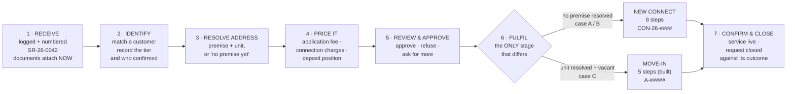

**Stage 3 is the classifier, and it is the load-bearing idea.** The applicant
types an address. If it resolves to an existing vacant unit, the request is a
**move-in**. If it resolves to nothing, it is a **new connection**. If it
resolves to a unit that already has a live account, it is neither and the clerk
is told so. **The applicant is never shown the words.**

### 2.4 Where the request meets the account — the link chain

> ⛔ **CR-032 STAMP — 2026-08-25. EVERY *"energise"*, *"energised"*, *"Partly
> energised"* AND *"energisation"* IN THIS DOCUMENT IS THE WORD THE SCREENS DRAW,
> AND IS NO LONGER THE PRODUCT'S WORD.** PO ruling: *"instead of energise can we
> use activated"*. *Energise* is **electric jargon** and the platform seeds TEN
> services — water is turned on, gas is lit, broadband is provisioned, trash is
> scheduled, sewer is connected. The shipped tokens are **`activated`** and
> **`partly_activated`**; the columns are `activated_at` and `target_activation`.
>
> **The prose here is left as drawn ON PURPOSE.** Rewriting a quotation to match a
> later ruling destroys the evidence that the ruling changed something. **Read the
> code's constants for the product; read this document for the drawing.**
>
> ⚠ **THIS STAMP WAS MISSING FOR HALF A DAY AND CR-032's OWN RECORD CLAIMED IT WAS
> HERE (DEF-686).** That record's landed table read *"Docs: 5 — each stamped
> rather than rewritten"* while `grep -rn "CR-032" 04-docs/` returned nothing and
> this file still held every occurrence unmarked. A claim of a stamp is not a
> stamp — hard-won law 1, committed by the person who wrote the law into the
> commit message.


The PO's requirement, verbatim: *"we need to keep them conencted"*.

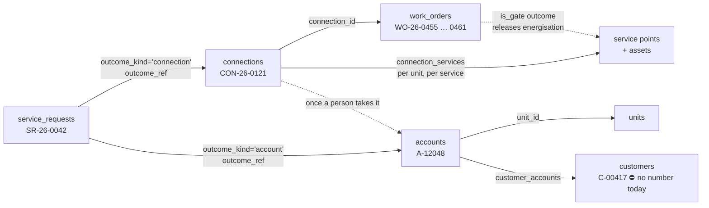

**Navigable in both directions, and that is a build requirement, not a nicety.**
From a request: *what did this become?* From an account: *where did this come
from, who approved it, and on what evidence?* Today the second question has no
answer at all.

### 2.5 Two structural gaps this exposes

| Gap | Evidence | Consequence |
|---|---|---|
| **No customer number** | 23 series in `numbering.py`; `customer` is not among them. `customers` has no `customer_no` | Every carry-forward, offset and *"their other accounts"* claim rests on a clerk matching a **name** |
| **No request object** | `SERVICE_REQUEST = "service_request"` exists in the catalog and nothing allocates from it; latest customers migration is `0012` | The front door is a desk |

**Both are cheap now and expensive later** — they are additive migrations before
production data and a backfill after it. That is why they are W0 and W3.

---

## 3 · THE SCREEN MAP — every id, and which exist today

| Screen | What it is | Today |
|---|---|---|
| **S17** | Accounts list | ✅ built — 7 columns, 2 tabs, 5 equal buttons. §5.1 |
| **S21** | Account detail | ✅ built — §5.2 adds *other accounts* + danger tier |
| **S18** | New Account wizard (6 steps) | ✅ built — **unchanged by this CR** |
| **S19** | Move-in wizard (5 steps) | ✅ built — steps 3, 4, 5 widened §5.5 |
| **S20** | Move-out wizard (4 steps) | ✅ built — steps 3, 4 widened §5.6 |
| **S68** | **Account import wizard — *upload → stage → value-map → review → commit*** | ◑ **built as a 3-step modal that never had the value-map step.** §5.9 — this is the A1 spec the runner finally satisfies |
| **S22** | Account action modals (incl. disconnect notice) | ◑ notice modal only; no ladder, no list. §5.8 |
| **S81** | Accounts → **Imports tab** (run history + rollback) | ❌ — §5.9 |
| **S17.2** | ⛔ **RE-POINTED 2026-08-26 (CR-035 · AMENDMENT 1)** — was *"Accounts → Waiting on tab"*. The tab is withdrawn; the id now names **the parked-drafts panel pinned on each of the five flow tabs**, which is where the same behaviour lives. **Not deleted and not renumbered** — the behaviour kept its home rather than disappearing, so the id keeps its owner (`US-CUS-031`) and G25 keeps its coverage | ✅ **built** `2.51.0`, **folded in** the same day — see §4's amendment. A **sub-id**, because D1's band is exhausted and allocating S115+ is the PO's |
| **S82** | `WFL-01.accounts` — accounts on the ONE ETL runner | ❌ — §5.9 |
| **S83** | Requests tab — list | ❌ — §5.3 |
| **S84** | Service request — detail (7 tabs) | ❌ — §5.3 |
| **S85** | New request — **the applicant's form** | ❌ — §5.3 |
| **S86** | New Connect tab — list | ❌ — §5.4 |
| **S87** | New Connect — 8-step wizard | ❌ — §5.4 |
| **S88** | Connection detail | ❌ — §5.4 |
| **S89** | Transfers tab — list + 5-step wizard | ❌ — §5.7 |
| **S90** | Disconnects tab — list + ladder + 5-step wizard | ❌ — §5.8 |
| *unnumbered* | Identity match · quote builder · review-and-approve · work-order detail · work-order templates · form definitions | ❌ — **no ids left**, see D1 |

> ⛔ **D1 · THE RESERVED SCREEN BAND IS EXHAUSTED BY THIS CR.** A1 reserves
> **S61–S90**; S61–S71 went to the 2026-08-08 addenda, S72 is deliberately
> skipped (EP-IDN-01 rides OQ-078), S73–S74 are EP-LED-06, and S75–S80 are the
> CR-004 reference lists. **Ten slots remain and this CR needs sixteen.** The ten
> above are proposals; the six unnumbered screens need a new band. S91–S114 are
> taken by design r8+, so the next free ground is **S115**. Allocation is the
> PO's, never a lane's.

> **S68 is the find worth stating plainly.** A1 has specified the accounts import
> as **five steps including a value-map** since 2026-08-08. The product shipped a
> three-step modal. BR-CUS-052 requires the mapping step and it was never built —
> so putting accounts on the ETL runner is not new scope, it is **S68 being
> satisfied for the first time.** Filed as a defect in its own right (§11).

---

## 4 · THE UNIFORM TAB CONTRACT — the PO's own sentence

> **PO, 2026-08-23, verbatim:** *"each tab has - list view {table + search +
> filter + table colume selector} , detail view ( header, action buttons, tabs,
> audits}, each has add button and its wizard or form"*

**One shape, eight times.** This is the single most valuable line in the CR: it
turns eight features into one template with eight parameterisations, exactly as
BR-MET-096 turned five import targets into one runner.

> ✅ **SUPERSEDED THE SAME DAY — CR-035 · AMENDMENT 1, PO 2026-08-26. THERE ARE
> EIGHT TABS AFTER ALL, AND THIS DOCUMENT WAS RIGHT.** Verbatim: *"We dont need
> seperate tab for this - this will be directly on each request Request,
> Connect, Move IN move Out, Trasnfr, Disconnect - seperate queue not
> reequired"*, then **"yyes"**.
>
> **The behaviour did not go away — its HOME changed.** A parked draft now
> appears on the tab for **its own kind of work**: a `ParkedDraftsPanel` pinned
> above each of the five flow lists (`07-frontend/src/features/customers/
> parkedDrafts.tsx`), and on **Requests** the `waiting_on` column that list has
> carried since it was built. So every *"eight tabs"* in this file — §1's
> subtitle, §2's `R0` node, §5's heading, §12's TC-UI rows and the walkthrough —
> is **correct as written and needs no reading-around**.
>
> **What the PO saw, and why they were right:** a parked service request stays
> in the Requests list with its waiting-on value beside it (B19 §12.2 — park
> *"moves no state"*). The separate tab was the inconsistency, not the fix. It
> also dissolves the mine-versus-everyone question: BR-SHL-048's *"the clerk's
> own 'Waiting on' list"* meant **there and nowhere else**, never a filter.
>
> ⚠ **THE ASYMMETRY IS THE WHOLE RISK, AND IT IS DRAWN RATHER THAN ASSERTED.**
> A parked service request is the SAME ROW, annotated. A parked move-in,
> move-out, transfer, disconnect or new connect is **not a row at all** — no
> account, no occupancy, nothing committed, which is precisely why
> `wizard_parks` had to exist. So on the five flow tabs the surface shows two
> different KINDS of thing, and the draft is drawn as the different kind it is:
> pinned above the list, dashed border, a `Draft` badge, the reason, the note,
> the reminder and the **age** — and **outside the table entirely**, so the
> list's count stays the server's record count. The parked figure is stated
> separately, in words, on the panel (*"1 parked · not started yet"*).
>
> **What is knowingly lost:** one place answering *"what is waiting, across
> everything?"*. With six surfaces a clerk covering the desk opens six. If that
> turns out to matter, the honest home is the **Dashboard**, not a ninth tab.
>
> **The paragraph below is the ruling it replaced, kept because it is the record
> of what was built on 2026-08-26 and withdrawn the same day.**
>
> ⛔ **AMENDED 2026-08-26 (CR-035) — THERE ARE NINE TABS, NOT EIGHT, AND THE
> NINTH IS `Waiting on`.** This document was written on 2026-08-23 and shipped
> its eight-tab count three days before `wizard_parks` existed; **it could not
> have drawn a surface for a store that had not been built**, so the count is
> stale rather than wrong-headed and is stamped here rather than quietly
> rewritten. Every other *"eight tabs"* in this file — §1's subtitle, §2's
> `R0` node, §5's heading, §12's TC-UI rows and the walkthrough — predates the
> same ruling and is to be read as **eight plus Waiting on**.
>
> **What it is.** CR-035 step 6 row 5: *"one 'Waiting on' surface with the
> reason, the note, the reminder date and the **age**, which is the only thing
> that stops a draft sitting forever."* It lists **parked wizard drafts** for
> the five flows that can now park (move-in · move-out · transfer · disconnect ·
> new connect), at `/{tenant}/accounts?tab=waiting-on`.
>
> **Why HERE and not somewhere else.** Five of the eight tabs above are exactly
> those five flows, and each of their header primaries **is** a wizard that can
> now park — *the place a clerk resumes work is the place they started it*.
> **BR-SHL-048 rules the alternatives out rather than merely losing to them:** a
> parked draft may not surface on the unit, the premises or the account, so S21
> and every premises surface are forbidden by the ruling itself; and folding it
> into **Requests** would say a draft is a service request, which is the
> `Option B` the PO was shown and did **not** choose.
>
> **Where it does NOT meet §4.1's five parts, and why each is a refusal rather
> than an omission.** ① **no KPI strip** — the only figures worth a tile are
> true of the whole store while the payload answers for a page ·
> ② **no search, no segments, no `+ Filter`** — the CR-035 contract serves
> neither `q` nor `sort`, and BR-SHL-010 says an undeclared capability is not
> rendered; **the column selector ▥ IS present** · ③ the table and its footnote
> are §4.1's, unchanged · ④ **no header primary**, and it is the one part that
> can never apply: a row arrives here only by a clerk pressing `Park` **inside**
> a wizard, so a `+ New …` button would have to invent a destination and answer
> *which of the five?* — it renders **disabled with that reason** (BR-SHL-025) ·
> ⑤–⑧ **no detail view at all** — a row `Resume`s into another screen's wizard,
> so there is no header, no action stack and no audit tab of its own.
>
> **Screen id:** `S17.2` — **re-pointed 2026-08-26 to the pinned panel, not a
> tab** (A1 addendum). **Story:** `US-CUS-031`,
> `04-docs/05-modules/03-customers/06-epics/EP-CUS-11-waiting-on.md`.
> **Rule:** BR-SHL-048. **Landed in `2.51.0`.**

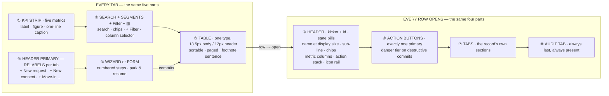

### 4.1 The parts, specified once

| # | Part | Binding rule | Specification |
|---|---|---|---|
| ① | **KPI strip** | B14 r2 | **Exactly five** `[shot]`, left to right, each `LABEL` (12px uppercase, ink-45) · figure (display size) · caption at 80% (B14: descriptions at 80%, amended from r10's 66%). A figure that needs a decision is drawn in the accent |
| ② | **Search** | BR-SHL-010 | One input. Placeholder **names every field it searches**, comma-separated, ending `…` `[shot]` |
| ② | **Segments** | B14 r6 | Chips, `All` first and selected by default, accent fill on the active one `[shot]` |
| ② | **Filter** | B14 r6 | `+ Filter ▾` — a dropdown, never inline controls |
| ② | **Column selector** | B14 r7 | The ▥ glyph at the strip's right end `[shot]`. **Every tab has one** — PO 2026-08-23 |
| ③ | **Table** | B14 r20 | ONE table type. Body **13.5px**, headers **12px uppercase**, sort glyph on every sortable header `[shot]`. Square corners |
| ③ | **Footnote** | B14 r12 | One sentence under the pager saying **why this sort** — e.g. *"Sorted by age, oldest first — the oldest thing waiting is the thing to look at."* `[shot]` |
| ④ | **Header primary** | B14 r4, BR-SHL-044 | **Exactly one primary**, and it **relabels with the tab** `[shot]`: `+ New account` · `+ New request` · `+ New connect` · `+ Move-in` · `+ Move-out` · `+ Transfer` · `+ Start a disconnect` · `↑ New import`. `Export` sits beside it as secondary |
| ⑤ | **Detail header** | B14 r2 | Kicker `ACCOUNT A-10432` + state pills · name at display size · sub-line · service chips with meter numbers · **three metric columns** · action stack · **icon rail** `[shot]` |
| ⑥ | **Actions** | B14 r4, r9 | One primary; destructive commits in the **danger tier** |
| ⑦ | **Tabs** | B14 r6 | The record's own sections |
| ⑧ | **Audit** | Hard rule 7 | **Always last, always present.** `TIMESTAMP · USER · ACTION · OBJECT · DETAILS` `[shot]` |
| ⑨ | **Wizard** | §4.2 | Numbered steps, park and resume |

### 4.2 Park and resume — the PO's practicality requirement

> **PO, verbatim:** *"many times it is not necessary that workflos will complete
> in 1 go - utility user will have field dependecies or oprational depedancies -
> in those cases how do you handle it - we might have to process from step 1 to 2
> and stap there and save that much work completed"*
>
> And the ruling on how: *"We will keep wizard only that way it is easy for
> utility user to undratdn"*

**So this is folded INTO the wizard model, not layered over it as a case object.**

| Element | Specification |
|---|---|
| **Save point** | Every step boundary. Advancing writes the step's payload; leaving does not discard it |
| **Park** | A secondary `Park` beside the footer primary. Asks for a **reason from a fixed list** and an optional note |
| **Park reasons** (9) | `waiting on the customer` · `waiting on documents` · `waiting on a deposit` · `waiting on a payment` · `waiting on inspection` · `waiting on a permit` · `waiting on materials` · `waiting on site access` · `waiting on a third party` |
| **Resume** | The row reopens the wizard **at its furthest incomplete step** `[shot: MVI-01 footnote — "A row reopens the wizard at its furthest incomplete step"]` |
| **Progress in the list** | A `STEP` column drawn as `2 of 5` over a five-segment bar `[shot: MVI-01, MVO-01, TRF-01]` |
| **Waiting on** | A `WAITING ON` column holding the park reason in plain words — `documents`, `permit`, `materials`, `inspection`, `site access`, `third party`, `payment`, `scheduled date` `[shot: REQ-01, NCT-01]` |
| **Draft identity** | A parked job that has not yet created its account shows `— draft` in the account column, in italic `[shot: MVI-01 rows 3 and 5]` |

### 4.3 What a wizard must NOT do

* **Never hold money in a parked step.** A deposit taken is a payment row, not
  wizard state — a container restart must not lose it.
* **Never renumber steps.** Move-in stays **five**, move-out stays **four**
  (CR-030 step 2: no step is renamed, added or removed).
* **Never park past the commit step.** Once the account exists the wizard is
  done; anything after that is an action on the record.

---

## 5 · THE EIGHT TABS, ONE AT A TIME

> ✅ **EIGHT, AND STILL EIGHT — CR-035 · AMENDMENT 1 (PO 2026-08-26).** This
> note read *"NINE SINCE 2026-08-26"* for a few hours. The ninth `Waiting on`
> tab was struck by the PO the same day (*"seperate queue not reequired"*) and
> the parked drafts moved onto the five flow tabs below as a pinned panel. **No
> §5 section is owed for them**: the panel is an annotation on the tab it rides,
> not a tab of its own, and it is specified in §4's amendment above.

**Presented in tab-strip order** `[shot]`, which is the order a user reads them.
**The build order is different** — the PO ruled 2026-08-23 that Imports is built
first, then the Accounts tab, then the account detail. §9 sequences the work.

```
Accounts │ Requests ⁴² │ New Connect ⁷ │ Move-ins ³ │ Move-outs ⁵ │ Transfers ² │ Disconnects ⁹ │ Imports
```

**The superscript count is part of the tab** `[shot]` — seven of the eight carry
a live count; **Imports does not**, because a completed import is not open work.

---

### 5.1 · ACCOUNTS — the register `[shot: ACC-01 ×2]`

**What it is.** Every account the utility has, live and closed. The only tab that
is a *register* rather than a *worklist* — which is why its default segment is
`All`, not `Open`.

#### 5.1.1 KPI strip — five, and each one is a different question

| Label | Figure | Caption | Derivation |
|---|---|---|---|
| `ACCOUNTS` | **1,247** | *live and closed* | `count(accounts)` |
| `OUTSTANDING` | **$184,320** | *across all ageing* | Σ open invoice balances — **not** `accounts.balance`, which is a cache (B2) |
| `PAST DUE 60+` | **18** | *oldest 184 days* | derived from open invoices, BR-CUS-016 |
| `CLOSED THIS YEAR` | **64** | *final bill issued* | `closed_at` within the year |
| `PENDING ACTIVATION` | **9** | *no bill can be raised yet* | `status = pending`, BR-CUS-018 |

> ⚠ **Three of the five cannot be computed today — but two of them are unblocked
> by W1, not by billing (corrected 2026-08-23, §5.9.3a).** `OUTSTANDING`
> **$184,320** is GT-16's frozen batch tie-out **$184,320.55**, and `PAST DUE 60+`
> is a bucket-derived count: both become computable the moment the opening-balance
> importer runs, because `reporting.ar_positions` gains a per-account AR position
> on its first call. Only the *oldest 184 days* caption still needs billing's
> open-invoice position. The
> shipped S17 header roll-up already reports this absence rather than drawing a
> zero (BR-CUS-016's derived-never-stored rule). **Do not let the KPI strip
> reintroduce a fabricated figure** — hard-won law 1.

#### 5.1.2 The table — and the one column that splits

| Column | Today | After | Note |
|---|---|---|---|
| `ACCOUNT` | ✅ `10432` | unchanged | `[shot]` shows bare digits, no `A-` prefix on this tab |
| `NAME` | ✅ | unchanged | `Ridge Coffee Co.` carries a **`4 accounts` sub-link** in the accent `[shot]` — this is BR-CUS-054's customer link finally surfacing on the list |
| `PREMISE` | ✅ | unchanged | `500 Main · 200` |
| `SERVICES` | ✅ | unchanged | Square service chips `E W S G B`, `+3` overflow chip `[shot]` |
| `BALANCE` | ✅ | unchanged | Right-aligned, tabular. `$542.10` in the accent when 60+ past `[shot]` |
| `LAST BILL` | ◑ | unchanged | `Jul 15`. `—` when none |
| **`STATUS`** | ⚠ **mixes two things** | **split** | Today one column shows `Pending` beside `30d past`. `[shot]` draws **`STATUS`** = `Active` · `Marked disconnect` · `Pending activation` · `Vacation hold` |
| **`AGEING`** | ❌ | **NEW** | `Current` · `30d past` · `60+ past` · `—`. **Derived, never stored** (BR-CUS-016) |

**Search placeholder** `[shot]`: *"Account #, customer #, name, address, or meter #…"*
— ⛔ **it names `customer #`, which does not exist.** That is OQ-free but it is
W0: the placeholder is a promise the schema cannot keep until `customers.customer_no`
lands. **Do not ship the placeholder before the column.**

**Segments** `[shot]`: `All` · `Current` · `30d past` · `60+ past`.
**Footnote:** *"Showing 1–8 of 1,247"* with `Rows per page 50` and first/prev/
page-of/next/last controls `[shot]`.

#### 5.1.3 Tables · endpoints · what is missing

| Kind | Item | State |
|---|---|---|
| Table | `accounts` | ✅ exists — `unit_id`, `account_no`, `status_id`, `account_type_id`, `kind`, `balance` (cache), `deposit_on_file`, `opened_at`, `closed_at` |
| Table | `customers`, `customer_accounts` | ✅ exist (migration 0005) — ❌ **no `customer_no`** |
| Endpoint | `GET /accounts` | ✅ served |
| Endpoint | `GET /accounts?ageing=` | ❌ the four segments need a server-side ageing filter |
| Endpoint | `GET /accounts` KPI block | ◑ roll-up served; three of five figures unavailable |

#### 5.1.4 Test cases

| TC | Given | When | Then |
|---|---|---|---|
| TC-ACC-1 | 1,247 accounts, 18 at 60+ | the tab loads | five KPI tiles render; the three billing-derived ones state their absence, never `$0.00` |
| TC-ACC-2 | an account `pending` with a 30-day-old invoice | the row renders | `STATUS` = `Pending activation` **and** `AGEING` = `30d past` — two cells, never one |
| TC-ACC-3 | `Ridge Coffee Co.` linked to 4 accounts | the row renders | a `4 accounts` sub-link; following it filters to that customer |
| TC-ACC-4 | an account with **8** services | the row renders | five chips and a `+3` overflow chip, never eight chips wrapping. ⚠ **CORRECTED 2026-08-24 (CR-030 W2):** this row said *"an account with 6 services"*, and 6 − 5 = 1, not 3 — the `[shot]`'s `+3` needs **eight**. The overflow chip renders the REMAINDER, so the fixture is what was wrong, not the chip. |
| TC-ACC-5 | segment `60+ past` pressed | the list refetches | the URL carries the segment and a reload restores it (BR-SHL-011) |
| TC-ACC-6 | tenant B is signed in | `GET /accounts` | zero of tenant A's 1,247 rows (hard rule 1) |
| TC-ACC-7 | `customer_no` not yet migrated | the search placeholder renders | it does **not** offer `customer #` |

#### 5.1.5 Seed data required

`1,247` accounts is a **demo figure, not a seed target.** The seed needs the
*shapes*, one row each: `Active/Current` · `Active/30d past` · `Active/60+ past`
(accent balance) · `Marked disconnect` · `Pending activation` (balance reads
*awaiting*, `LAST BILL` = `—`) · `Vacation hold` · a multi-service account with
`+3` overflow · a customer with **4 linked accounts**. **Eight rows** `[shot]`.

---

### 5.2 · ACCOUNT DETAIL `[shot: ACC-01 detail ×10]`

**The tab strip is already conformant** — `ACCOUNT_TAB_IDS` ships the nine tabs
in the screenshot's order (`AccountDetailPage.tsx:175`). **The drift is inside
the tabs and in the header furniture.**

#### 5.2.1 The header — element by element

| Element | `[shot]` | Today |
|---|---|---|
| Back link | `← Accounts` | ✅ |
| Kicker | `ACCOUNT A-10432` (12px uppercase, accent) | ✅ |
| State pills | `▪ Active` · `▪ Autopay on` | ◑ status pill ✅; **autopay pill ❌** |
| Name | `Miller, Sarah` at display size | ✅ |
| Sub-line | `1408 Elm Street · Unit A · Austin, TX 78704 · Since Feb 2024` | ◑ premise ✅; **`Since Feb 2024` ❌** |
| Service chips | `▪ ELECTRIC · M-4021` `▪ WATER · M-4022` | ❌ **service chips carrying the meter number are not drawn** |
| Metric col 1 | `BALANCE` **$247.30** / *Due Aug 25* | ◑ balance ✅ (cache, caveated); **due date ❌** — needs billing |
| Metric col 2 | `PLAN` **Residential Standard** / *$30.50/mo base* | ❌ **BR-CUS-029: the plan snapshot has no table.** The unit's plan is NOT substituted |
| Metric col 3 | `LAST ACTIVITY` **ACH payment** / *Aug 6 · 07:15* | ❌ needs payments |
| Action stack | `Record payment` (primary) · `Adjust` · `Move-out` | ◑ move-out ✅ as a link; the other two ❌ |
| **Icon rail** | **seven glyphs**: ✉ · 🖨 · $ · ⇄ · ⚡ · 🗓 · ✎ | ✅ **BUILT 2026-08-24** (task 3.2 · BR-SHL-045 · `AccountIconRail.tsx`) — r10's seven, in r10's order, each naming itself |

> ✅ **D2 · RULED 2026-08-24 → `BR-SHL-045`. BUILT the same day (task 3.2).**
> The PO was shown three presentations and chose **_"Seven icons, label appears
> on hover"_**, over a two-icon-plus-menu reduction and over icons with words
> beneath. **The seven, in `[shot]` order, and what each one DOES** — the answer
> a picture could not give: ✉ **Send statement** · 🖨 **Print bill** ·
> $ **Issue credit** · ⇄ **Change plan** · ⚡ **Disconnect notice** ·
> 🗓 **Payment plan** · ✎ **Add note**. They are the prototype's own seven-item
> secondary rail, unchanged, so nothing is invented.
>
> ⚠ **AND THE "SEVEN VERSUS TEN" WAS NEVER A MISSING THREE**, which is the part
> this block got wrong. The ten in `AccountDetailPage.tsx:37`'s docstring are
> these seven **plus** Record payment, Adjust and Move-out — and those three are
> the **action stack** in the row above (task 3.3, already built). No feature is
> lost; three move out of the rail into worded buttons. The docstring has been
> corrected in the same commit.
>
> ⚠ **ONE THING IS BUILT BEYOND THE LITERAL WORDS, deliberately: the label is the
> button's ACCESSIBLE NAME, which hover happens to reveal** — a real `aria-label`
> and `title`, keyboard-reachable and announced to a screen reader. Hover is a
> mouse; a tooltip alone would leave a touch user guessing between two glyphs,
> and **one of the two sends a disconnect notice**. That glyph takes B14's danger
> tier, so the destructive one is told apart by colour and not only by shape.
> Nothing renders enabled that has no endpoint (BR-SHL-025): four of the seven
> are disabled today and each carries its owning module's own reason.
>
> ⚠ **THE PROPOSAL THIS BLOCK OFFERED WAS NOT ADOPTED, and it is kept here
> because the gap is instructive.** It read: *"✉ contact · 🖨 print statement ·
> $ record payment · ⇄ transfer · ⚡ actions overflow · 🗓 schedule · ✎ edit."*
> Two of those seven are not the same KIND of control as the rail's (Record
> payment is the page's one primary; an "actions overflow" is a menu, not an
> action), and a lane building from the proposal would have shipped a rail that
> reads plausibly and does something different from the drawing. **Read the
> markup, not the prose** — the seven above are transcribed from
> `SMARTBillHub.dc.html` at byte offset ~167k.

#### 5.2.2 The nine tabs — content, and the drift in each

| Tab | `[shot]` content | Today | Gap |
|---|---|---|---|
| **Overview** | Left: `Recent bills` (BILL # · CYCLE · USAGE · AMOUNT · STATUS) + `All bills →`; `Usage trend · last 12 months` bar chart + `Details →`. Right rail: **Customer** (name · email · phone · `DOB: 04/12/1987 · ID: DL ****4218`) · **Mailing address** (*Same as service*) · **Payment method** (`ACH · Chase •••• 4021`, *Autopay on · Bank verified*, `→ Update method`) · **Deposit & credit** (On file `$150.00` / Interest accrued `$3.20` / Credit tier `A`) · **Portal access** (*Last login 3 days ago*, *Paperless: On · SMS: On*) | ◑ panels exist and **state their absences** | Recent-bills panel ❌ · usage-trend chart ❌ · `→ Update method` ❌ · interest `$3.20` ❌ (BR-CUS-057, no column) · credit tier `A` ❌ (BR-CUS-058, computed, no computer) · portal figures ❌ (BR-CUS-028: **not fabricated in v1**) |
| **Bills** | search *"Search bills or cycles…"* · All · +Filter · ▥ · columns BILL # · CYCLE · ISSUE DATE · DUE DATE · USAGE · SUBTOTAL · TAX · TOTAL · STATUS. `Draft (in run)` pill on `BL-2608-018320` | ◑ embeds billing's S30 scoped by `f.account_id` | the endpoint is contracted and **unserved**; `Draft (in run)` state ❌ |
| **Payments** | search *"Confirmation #…"* · `+ Record payment` primary · DATE · METHOD · CONFIRMATION · APPLIED TO · AMOUNT · STATUS. A deposit row `DEPO-4218 · Deposit · $150.00 · Held` | ❌ | whole tab; **and the deposit appearing as a payment row with `Held`** is a modelling claim to confirm |
| **Usage** | segments `Electric` `Water` `All` · chart *Electric usage · 24 months (kWh)* + `Compare to neighbors →` · KPI strip **AVG/MONTH 628 kWh · PEAK 842 kWh (Jul 2026) · LOW 412 kWh (Feb 2026) · YOY +8.2% · WATER AVG 3.42 kgal** | ❌ | whole tab. ⛔ `Compare to neighbors` is a **feature nobody has specified** — D3 |
| **Meters** | METER # · SERVICE · TYPE (`AMI · Itron OpenWay CENTRON`) · INSTALL DATE · MULTIPLIER · LAST READ · LAST READ DATE · STATUS (`Healthy`). Below: **`Meter M-4021 · Read log`** with `Export` — DATE · READ · USAGE · SOURCE · NOTES (`Partial cycle`) | ◑ | **must be re-specified against the post-CR-028 assets model** (CR-030 step 4 correction 2). The nested read log ❌ |
| **Adjustments** | `+ New adjustment` · DATE · ADJUSTMENT # · REASON · APPLIED TO · AMOUNT (`−$42.50`) · APPROVED BY | ❌ | whole tab |
| **Documents** | `+ Upload document` · DOCUMENT (accent, `↓` prefix) · TYPE (`System` · `Contract` · `KYC` · `Payment` · `Correspondence`) · DATE · UPLOADED BY · SIZE | ❌ | whole tab — **and this is where a request's documents carry over to** (§5.3) |
| **Notes** | search · All · +Filter · ▥ · `+ Add note` · **cards**, not rows: title (bold) · `date · author` right-aligned · body | ✅ built (US-CUS-015) | ⚠ **built as a table; the screenshot draws cards.** A real conformance drift |
| **Audit** | TIMESTAMP · USER · ACTION · OBJECT · DETAILS. Rows include `Account created` → *Move-in · Unit U-10432-A · Plan: Residential Standard* | ◑ | `USER` distinguishes `System` from `Sarah Miller (portal)` — a **portal actor** the identity model does not have |

#### 5.2.3 Test cases

| TC | Given | When | Then |
|---|---|---|---|
| TC-ACD-1 | any account | the header renders | nine tabs in the ACC-01 order, `Audit` last |
| TC-ACD-2 | `plan_snapshot_unavailable: "BR-CUS-029"` | the PLAN column renders | it states the absence and its rule — it does **not** show the unit's plan |
| TC-ACD-3 | an account with no interest column | Deposit & credit renders | *not recorded* + BR-CUS-057 — never `$0.00` |
| TC-ACD-4 | an account with autopay off | the header renders | **no** `Autopay on` pill (absence is not a grey pill) |
| TC-ACD-5 | `?tab=meters` deep link | the page loads | it opens on Meters; an unknown tab falls back to Overview without erroring |
| TC-ACD-6 | a note exists | the Notes tab renders | a **card**, with title, date · author and body — not a table row |
| TC-ACD-7 | an adjustment of `−$42.50` | the Adjustments tab renders | the minus sign is present and the figure is not re-signed by the formatter |

#### 5.2.4 Seed data required

One account (`A-10432 · Miller, Sarah`) carrying: 6 bills incl. one `Draft (in run)` ·
6 payments incl. a `DEPO-4218` deposit at `Held` · 2 meters (`M-4021` AMI electric,
`M-4022` AMR water) with 4 reads each, one flagged *Partial cycle* · 3 adjustments
with 3 distinct reasons and 2 approvers · 5 documents across all five types ·
3 notes · 7 audit rows spanning `System`, a staff user and a portal actor.
**That single account is the demo.**

---

### 5.3 · REQUESTS — the front door `[shot: REQ-01 ×2]`

**What it is.** One numbered record per application, whatever channel it arrived
by, holding everything needed to decide and everything decided.
**This is the object the product does not have.**

> ⚠ **THE SCREENSHOT WIDENS THE SCOPE, AND THIS IS THE MOST IMPORTANT FINDING IN
> THE DOCUMENT.** The design work of 2026-08-22 had the request routing to **two**
> outcomes — new connection or move-in. `[shot]`'s `TYPE` column draws **five**:
> `MOVE-IN` · `NEW CONNECTION` · `TRANSFER` · `DISCONNECT` · `MOVE-OUT`.
> **The request is the front door for every job, not only for onboarding.** That
> is the right shape — a customer ringing to say they are leaving is as much an
> application as one ringing to arrive — but it means §2.3's stage 6 fans out to
> **six** fulfilment paths, and it means the Requests tab's count (42) is a
> superset of the other six tabs' counts (7+3+5+2+9 = 26 open jobs, plus 16 not
> yet routed). **The arithmetic must hold on screen or the tabs contradict each
> other.**

#### 5.3.1 KPI strip

| Label | Figure | Caption |
|---|---|---|
| `OPEN` | **42** | *not yet turned into a job* |
| `WAITING ON CUSTOMER` | **6** | *documents or a deposit* |
| `OLDEST WAITING` | **15 days** | *SR-26-0039 · waiting on documents* |
| `APPROVED, NOT STARTED` | **4** | *no job opened yet* |
| `REFUSED THIS MONTH` | **3** | *with a reason on record* |

**`APPROVED, NOT STARTED` is the one that earns the tab.** It is the queue that
today has no name: decided, and nobody has begun.

#### 5.3.2 The list `[shot]`

* **Search:** *"Request #, name, address, phone, or email…"*
* **Segments:** `All` · **`Open`** (default) · `Waiting on customer` · `Approved` · `Closed`
* **Columns:** `REQUEST` · `TYPE` · `APPLICANT` · `ADDRESS` · `RECEIVED` · `AGE` · `WAITING ON` · `STATE`
* **`AGE`** renders in the **accent past a threshold** — `15d` and `11d` are accent, `5d` and below are not `[shot]`. ⛔ **The threshold is not derivable from a picture.** Proposal: 7 days. **D4.**
* **`ADDRESS`** carries the shape of the job, not just a street: `500 Main St · 25 units` · `901 Hillside → 2201 Cedar` · `14 Willow Bend (new plot)` `[shot]`
* **Pager:** *"Showing 1–8 of 42 (filtered from 118)"* — the segment's count **and** the unfiltered total
* **Footnote:** *"Sorted by age, oldest first — the oldest thing waiting is the thing to look at."*

#### 5.3.3 The lifecycle — ten states

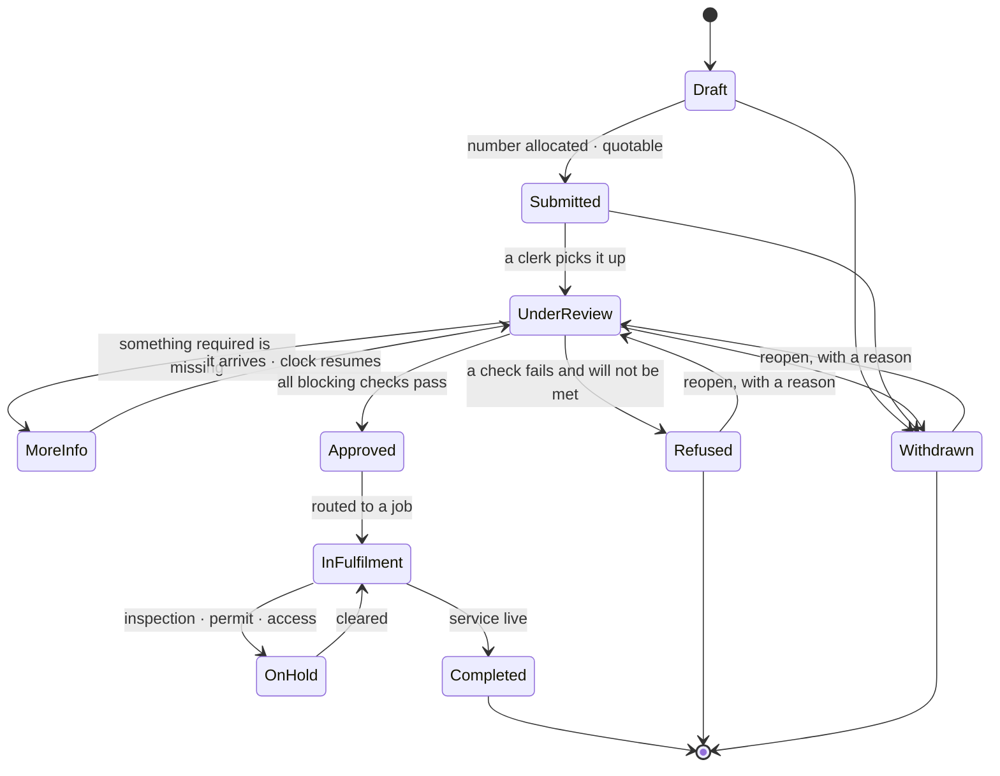

| State | Entered when | Who moves it on | What is allowed |
|---|---|---|---|
| `Draft` | A clerk starts keying, or a portal form is part-filled | intake rights | Edit everything. **No number promised to the customer yet** |
| `Submitted` | Intake completed | Clerk | **Number is fixed and quotable.** Documents can still be added |
| `Under review` | A clerk picks it up | Clerk, supervisor | Identity match · document check · quote · arrears check |
| `More info needed` | Something required is missing | Clerk | Reason visible to anyone answering the phone. **Clock pauses** |
| `Approved` | All blocking checks pass | Clerk or supervisor **by threshold** | Approver, timestamp and basis recorded |
| `In fulfilment` | Routed to a job | System | Links to the connection or account. Progress visible |
| `On hold` | Fulfilment stalled | Clerk | Reason on the face of the record. Returns to `In fulfilment` |
| `Completed` | Service is live | System | Terminal. Outcome recorded |
| `Refused` | A blocking check fails and will not be met | **Supervisor** | Terminal, **kept not deleted.** Reason from a list + free text |
| `Withdrawn` | The applicant pulls out | Clerk | Terminal, kept. Any paid application fee per policy |

**Why `Refused` is kept and not deleted:** cost #4 — *someone turned down for
arrears at a previous address simply reapplies.*

#### 5.3.4 The intake form — the PO's correction, built in

**Three separate things, and conflating them is what the first attempt got
wrong** (§2.1). The form below is **(a) the application**, in the customer's
words. It never asks the applicant to pick between utility terms.

| Group | Fields | Note |
|---|---|---|
| **Header** | request no · type · channel · received date · received by · priority | Number allocated **at submission** from the existing `service_request` series, `SR-{YY}-{0000}` |
| **Applicant** | person or company · name · DOB or registration no · ID type and number · phone · email · preferred language · postal address | Matched against existing customers; **the match tier and who confirmed it are stored** |
| **Acting for** | self · landlord · agent · builder · executor — **plus authority evidence** | An agent applying on someone's behalf is common and **currently unmodelled** |
| **Location** | address **as given** · resolved premise · resolved unit · `no premise yet` flag | **This resolution is the classifier** (§2.3) |
| **Services** | which of the ten · requested start or energisation date | Limited to what the premise can deliver, once resolved |
| **Eligibility** | assistance programme claimed · household size · evidence | **Never blocks service** — only the discount |
| **Money** | quote lines · application fee · deposit position · billed-to party | Every line a charge code; **no free amounts** |
| **Decision** | outcome · approver · timestamp · reason code · notes | Written on approve, refuse or withdraw |
| **Outcome** | connection reference · account number · date service went live | Written by fulfilment |

**Type-specific blocks:** *new connection · single* — plot/parcel ref, property
type, unit count (1), site contact, access notes. *new connection · bulk* — unit
schedule (typed or uploaded), unit count, phase, site plan, common-area services,
target energisation per phase. *move-in* — unit, move-in date, occupancy evidence,
prior address, prior account if known.

> **`address_as_given` is never overwritten by `premise_id`.** The customer's own
> words are the record; the clerk's resolution sits beside them. That is
> requirement (b) from §2.1 and it is a column, not a convention.

#### 5.3.5 Detail view — header, actions, seven tabs

| Region | Contents |
|---|---|
| **Header** | Kicker `REQUEST SR-26-0042` · state pill · type pill · applicant name at display size · address · age · assigned to · quote total · **what it is waiting for** |
| **Primary actions** | `Approve ✓` · `Ask for more` · `Refuse` **(danger tier)** |
| **Icon rail** | ✎ edit · ✉ contact the applicant · 📎 attach a document · $ raise the quote · ⚡ assign · 🖨 print the form |
| **Tabs** | `Summary` · `Applicant` · `Location & services` · `Documents` · `Fees` · `Decision` · **`History`** |

#### 5.3.6 Documents

| Document | Typical requirement | Attaches at |
|---|---|---|
| Proof of identity | Required, all types | Intake |
| Proof of address / occupancy | Required for move-in | Intake |
| Tenancy agreement or deed | Required for move-in | Intake |
| Authority to act | Required when acting for someone else | Intake |
| Site plan / unit schedule | Required for a bulk connection | Intake |
| Assistance evidence | **Optional — gates the discount, not the service** | Any time before approval |
| Signed service agreement | Produced by us, signed by them | After approval |
| Completion paperwork | Where field work is done outside our system | During fulfilment |

**Rules.** Each item is **required or optional per tenant**. A required item
missing puts the request in `More info needed` **rather than blocking silently**.
Documents captured here **carry over to the account** when one is created — they
land in the Documents tab of §5.2 and **nothing is re-uploaded**. Retention
follows the customer-record window.

> ⛔ **OQ-351 — what must a request capture before it can be approved?** Which
> documents are mandatory is regulator- and utility-specific. A tenant-set
> checklist, or a fixed one? **The `required_flag` column exists either way; what
> is blocked is the SEED.**
> ⚠ **ASKED 2026-08-24 AND STILL OPEN — AWAITING PO INPUT, NOT UNASKED.** Put to
> the PO in the twelve-ruling message of 2026-08-24; the answer was *"i will give
> you details"*, which is a promise of input and **not a ruling** — neither the
> tenant-set checklist nor the fixed list was chosen. **No lane picks a list.**
> The next agent chases the promised detail rather than re-raising the question.

#### 5.3.7 Tables

| Table | Columns | State |
|---|---|---|
| `service_requests` | tenant · request_no · type · channel · state · priority · received_at · received_by · assigned_to · customer_id · match_tier · match_confirmed_by · **address_as_given** · premise_id · unit_id · no_premise_flag · requested_start · acting_for · decision · decided_by · decided_at · reason_code · outcome_kind · outcome_ref · closed_at | **NEW** |
| `service_request_items` | request_id · line_no · unit_label · unit_type · services · target_date · resulting_unit_id | **NEW** — one row per unit on a bulk request |
| `service_request_documents` | request_id · doc_type · name · size · storage_ref · uploaded_by · uploaded_at · required_flag · verified_by | **NEW** |
| `service_request_fees` | request_id · charge_code_id · basis · quantity · unit_amount · amount · currency · waived_flag · waive_reason · invoice_ref · paid_at | **NEW** · money **4 dp**, percentages **6**, display **2** (PO re-sign 2026-08-22) |
| `service_request_events` | request_id · at · actor · from_state · to_state · note | **NEW** — append-only |
| `service_request_form_templates` | tenant · request_type · version · field definitions · document checklist · active_from | **NEW** — one definition, three renderings (screen · PDF · later the portal) |

**All tenant-scoped with RLS `FORCE`.** `service_request_fees` **never posts to
the ledger itself** — it hands over to billing, which owns invoices (hard rule 5).

#### 5.3.8 Endpoints

| Endpoint | Purpose |
|---|---|
| `GET /service-requests` | List — search, filters, segments, sort, paging |
| `POST /service-requests` | Create a draft |
| `GET /service-requests/{id}` · `PATCH` | Detail; edit while the state allows |
| `POST /service-requests/{id}/submit` | **Allocates the number**, fixes channel and date |
| `POST /service-requests/{id}/assign` | Assign to a user |
| `POST /service-requests/{id}/match-customer` | Link a customer; records tier and confirmer |
| `POST /service-requests/{id}/resolve-address` | Bind premise and unit, or mark no-premise — **the classifier** |
| `GET\|POST /service-requests/{id}/fees` · `POST …/fees/{lineId}/waive` | The quote, and waivers with a reason |
| `GET\|POST /service-requests/{id}/documents` | List and attach |
| `POST /service-requests/{id}/request-info` | To `More info needed`, with the reason |
| `POST /service-requests/{id}/approve` · `/refuse` | Threshold-checked; reason required on refuse |
| `POST /service-requests/{id}/route` | Opens fulfilment; returns the connection or account reference |
| `GET /service-requests/{id}/events` | The History tab |
| `GET /service-request-forms/{type}` | The form definition |
| `GET /service-requests/{id}/form.pdf` | The printable form |

#### 5.3.9 Test cases

| TC | Given | When | Then |
|---|---|---|---|
| TC-REQ-1 | a draft with no number | `POST …/submit` | a number is allocated from `service_request`, `SR-26-####`, gapless within the tenant |
| TC-REQ-2 | the same draft submitted twice | the second call | **idempotent** — one number, not two (hard rule 6's discipline) |
| TC-REQ-3 | an address matching a vacant unit | `resolve-address` | type resolves to `move-in`; the applicant was never asked |
| TC-REQ-4 | an address matching nothing | `resolve-address` | `no_premise_flag` set; type resolves to `new connection` |
| TC-REQ-5 | an address matching a unit with a **live** account | `resolve-address` | **refused with that reason** — neither type; the clerk is told |
| TC-REQ-6 | a clerk edits the resolution | after resolve | `address_as_given` is **byte-identical to submission** |
| TC-REQ-7 | a required document missing | `approve` | refused; state moves to `More info needed`, not a silent block |
| TC-REQ-8 | a clerk under the approval threshold | `approve` | refused; a supervisor may |
| TC-REQ-9 | `refuse` with no reason | the call | refused — reason is required |
| TC-REQ-10 | a refused request | `reopen` | allowed with a reason; the refusal **stays in `service_request_events`** |
| TC-REQ-11 | `route` on an approved move-in | the call | a connection or account reference comes back and `outcome_ref` is set **both ways** |
| TC-REQ-12 | tenant B | `GET /service-requests` | none of tenant A's rows |
| TC-REQ-13 | segment `Open`, 118 total | the list renders | *"Showing 1–8 of 42 (filtered from 118)"* |
| TC-REQ-14 | a request aged 15 days | the row renders | `AGE` in the accent (D4's threshold) |

#### 5.3.10 Seed data

**Eight requests, exactly the `[shot]` set** — because it is the only fixture
that demonstrates all five types and six states at once:

| Request | Type | Applicant | Address | Received | Age | Waiting on | State |
|---|---|---|---|---|---|---|---|
| SR-26-0039 | Move-in | Osei, Grace | 3450 Oak Ridge Dr | Aug 08 | 15d | documents | More info needed |
| SR-26-0043 | New connection | Ridge Property LLC | 500 Main St · **25 units** | Aug 12 | 11d | — | In fulfilment |
| SR-26-0047 | Transfer | Park, Jenna | 901 Hillside → 2201 Cedar | Aug 18 | 5d | — | Under review |
| SR-26-0042 | New connection | Okonkwo, David | 14 Willow Bend (new plot) | Aug 19 | 4d | payment | Under review |
| SR-26-0048 | Disconnect | Ridge Coffee Co. | 500 Main · 200 | Aug 20 | 3d | third party | Under review |
| SR-26-0045 | Move-in | Kwan, Michael | 88 Pine Vista | Aug 21 | 2d | — | Approved |
| SR-26-0044 | Move-in | Alvarez, Rosa | 1408 Elm St · Unit A | Aug 22 | 1d | — | Submitted |
| SR-26-0046 | Move-out | Thompson, R. | 88 Pine Vista | Aug 23 | 0d | scheduled date | Submitted |

**The fixture is cross-wired on purpose** and every lane must preserve it:
SR-26-0043 → `CON-26-0117` (§5.4) · SR-26-0044 → the `Alvarez, Rosa` draft
move-in (§5.5) · SR-26-0046 → the `Thompson, R.` move-out (§5.6) · SR-26-0047 →
the `Park, Jenna` transfer (§5.7) · SR-26-0048 → the `Ridge Coffee Co.` shortfall
(§5.6). **That is what *"we need to keep them conencted"* looks like in seed data.**

---

### 5.4 · NEW CONNECT `[shot: NCT-01 ×2]`

**What it is.** Fulfilment for cases A and B. **Creates infrastructure; may
finish with no account.**

#### 5.4.1 KPI strip

| Label | Figure | Caption |
|---|---|---|
| `OPEN` | **7** | *service being established* |
| `WAITING ON INSPECTION` | **2** | *nothing can pass until they attend* |
| `PARTLY ENERGISED` | **3** | *some services billing, some not* |
| `UNITS AWAITING ENERGISATION` | **42** | *across the 7 open builds* |
| `OLDEST` | **19 days** | *CON-26-0119 · waiting on permit* |

**`UNITS AWAITING ENERGISATION` = 42 across 7 builds** — the metric that makes a
25-unit job visible as 25 units of risk rather than one row.

#### 5.4.2 The list `[shot]`

* **Search:** *"Connection #, premise, address, applicant, or request #…"*
* **Segments:** `All` · `In progress` · `Waiting` · `Partly energised` · `Done`
* **Columns:** `CONNECTION` · `PREMISE` · `UNITS` · `SERVICES` · `ORDERS` · `TARGET` · `WAITING ON` · `STATE`
* **`ORDERS`** is drawn as **`5 of 9` over an accent progress underline** `[shot]` — not a percentage, not a bar alone. The fraction is readable; a bar is not.
* **Footnote:** *"Sorted by target date, soonest first — the next thing due is at the top."*

#### 5.4.3 The connection record

**A connection does not finish when the button is pressed.**

`Draft` · `Requested` · `In progress` · `Partly energised` · `On hold` ·
`Energised` · `Cancelled` — **with a status per service**, because electric can
be billing while gas waits on its pressure test. `[shot: CON-26-0126 · E W G ·
3 of 9 · Partly energised]`

#### 5.4.4 The eight steps

| # | Step | Note |
|---|---|---|
| 1 | Scope & mode | Prefilled from the approved request |
| 2 | Premise | Prefilled |
| 3 | Units | **Collapses to one row for a single unit** — a house is a fast path through the same screen, not a second wizard |
| 4 | Services | Family-specific payload per service (§5.4.5) |
| 5 | Work plan | The proposed orders, batched (§8) |
| 6 | Plans & rates | |
| 7 | Charges | **From the request's quote — not re-priced** |
| 8 | Review & request | |

#### 5.4.5 The four service families — what "installation" means

| Family | Services | Captured | Orders | **Gate** |
|---|---|---|---|---|
| **Metered** | Electric · Water · Gas · Thermal | meter no · type · size · multiplier · initial read · route | 1–4 | Meter set — **except gas, which gates on the light-up** |
| **Derived** | Sewer | no meter; which service it derives from, and the % | 0–1 | The water service it derives from |
| **Capacity** | Solar · Battery | capacity in kW/kWh · paired net meter · interconnection approval | 1–4 | **Permission to operate** |
| **Flat** | Trash · Storm water · Broadband | **a service characteristic**: container count and size · impervious area · speed tier | 0–1 | Delivery, activation or assessment recorded |

> ~~⛔ **OQ-348 — family 4 has nowhere to keep its number.** The asset model knows
> meters and behind-the-meter electrical devices. There is **no place for a
> container count, an impervious area or a speed tier.** The rate engine can
> price them — flat and capacity models exist — but **nothing stores the number
> that drives the price.** Proposal: `service_characteristics` on the service
> point — a typed key, value and unit a rate can read. **Blocking for trash,
> storm water and broadband; the other seven services can be built without it.**~~
> ✅ **RULED 2026-08-24 — OQ-348 IS CLOSED → BR-MET-104.** PO, verbatim:
> *"(a) a characteristic on the service point - we ahve it on unit"*. The typed
> characteristic is taken **and its location is the UNIT, not the service point**,
> following `metering.Unit.square_feet` — a physical fact about the unit that
> pricing reads. Tenant-extended asset types are rejected: a wheelie bin is not an
> asset. **Trash, storm water and broadband are no longer unpriceable for want of
> a home.**
> ⚠ **ONE THING THE RULING DOES NOT SETTLE, AND W6 MUST SETTLE IT BEFORE IT
> WRITES A MIGRATION: HOW MANY characteristics, and in what shape.** The ruling
> fixes WHERE the number lives, not how many there are. A single unit may take
> **trash AND storm water AND broadband at once** — three characteristics, three
> units of measure (container count, impervious area, speed tier). Unit-level
> therefore means **either a column per service on `units`** — a schema that grows
> with the service catalogue, ten services today — **or a value table keyed by
> unit-and-service.** `square_feet` is one column because there is one of it; the
> flat services are not. **This is task 6.9a in §11 W6 and it precedes task 6.1's
> migration.** Nothing here chooses it.

#### 5.4.6 Tables · endpoints

| Table | Columns | State |
|---|---|---|
| `connections` | tenant · connection_no · request_id · premise_id · state · mode · target_energisation · energised_at · created_by | **NEW** |
| `connection_services` | connection_id · unit_id · service · state · **gate_order_id** · energised_at | **NEW** — the per-service status |
| `work_orders` | tenant · order_no · connection_id · type · scope · service · unit_id · asset_id · blocked_by · state · outcome · external_ref · completed_at · attachment_ref | **NEW** · series **already in the catalog** |
| `work_order_templates` | tenant · service · sequence · name · scope · skill · est_duration · **is_gate** | **NEW** |
| `service_characteristics` | unit_id · service · key · value · unit_of_measure | **NEW** · ✅ **OQ-348 RULED 2026-08-24 → BR-MET-104: the characteristic lives on the UNIT.** ⚠ **The SHAPE is still open** — this row draws the value-table reading; a column-per-service on `units` is the alternative, and **W6 task 6.9a settles it before the migration is written** |
| `premises` · `units` · `assets` | written **through their owning modules' services**, never directly | EXISTS |

| Endpoint | Purpose |
|---|---|
| `POST /connections` | Create from an approved request |
| `GET /connections` · `GET /connections/{id}` | List and detail with per-service status |
| `POST /connections/{id}/units` | Bulk-create from a pattern or an uploaded schedule |
| `POST /connections/{id}/services` | Assign per unit, family-specific payloads |
| `GET\|POST /connections/{id}/work-orders` | The proposed plan, and edits |
| `POST /work-orders/{id}/complete` | Outcome · date · reference · attachment |
| `POST /connections/{id}/assets` | Install or link, including bulk number assignment |
| `POST /connections/{id}/energise` | **Per service — refused unless the gate has passed** |
| `GET /work-order-templates` | Per-service defaults, tenant-editable |

#### 5.4.7 Test cases

| TC | Given | When | Then |
|---|---|---|---|
| TC-NCT-1 | an approved single-unit request | `POST /connections` | steps 1–3 prefilled; step 3 shows **one** row |
| TC-NCT-2 | a 25-unit schedule | `POST …/units` | 25 units **and 7 work orders**, not 76 (§8) |
| TC-NCT-3 | gas at meter-set complete, light-up not done | `POST …/energise?service=gas` | **refused** — the gate is the light-up |
| TC-NCT-4 | electric energised, gas not | the row renders | `Partly energised`, and electric bills while gas does not |
| TC-NCT-5 | a work order outcome `failed` | recorded | a follow-up order is raised **and** the connection goes `On hold` |
| TC-NCT-6 | sewer with no water service on the unit | step 4 | refused — sewer derives from water |
| TC-NCT-7 | trash selected | step 4 | ~~⛔ `NotImplementedError("OQ-348")` — the characteristic has no home~~ ⚠ **CORRECTED 2026-08-24 — OQ-348 IS CLOSED (BR-MET-104):** the container count is **captured against the UNIT** and the step advances. The stub goes. **Where** it is stored (a `units` column vs a value table) is W6 task 6.9a and does not change this case's expectation |
| TC-NCT-8 | a connection with 0 of 7 orders | the row renders | `Requested`, `0 of 7`, no progress fill |
| TC-NCT-9 | tenant B | `GET /connections` | none of tenant A's |

#### 5.4.8 Seed data — the eight `[shot]` rows

| Connection | Premise | Units | Services | Orders | Target | Waiting on | State |
|---|---|---|---|---|---|---|---|
| CON-26-0110 | 3450 Oak Ridge Dr | 1 | E W | 5 of 5 | Aug 14 | — | Energised |
| CON-26-0119 | 77 Foundry Row | 1 | E W G | 5 of 9 | Sep 08 | permit | **On hold** |
| CON-26-0121 | 14 Willow Bend | 1 | E W | 2 of 5 | Sep 15 | materials | In progress |
| CON-26-0126 | 8 Quarry Lane | 1 | E W G | 3 of 9 | Sep 22 | inspection | Partly energised |
| **CON-26-0117** | **500 Main Street** | **25** | E W S T **+1** | **5 of 7** | Sep 30 | inspection | Partly energised |
| CON-26-0128 | 240 Sable Court | 1 | E W | 2 of 5 | Oct 02 | — | Partly energised |
| CON-26-0124 | 12 Harbour View | 1 | E W B | 0 of 7 | Oct 12 | — | Requested |
| CON-26-0122 | Kestrel Park ph. 2 | 12 | E W S | 1 of 6 | Nov 01 | site access | In progress |

**`CON-26-0117` is the batching proof and must stay in the seed exactly as it is:
25 units, 5 services, and SEVEN orders.** A lane that produces 76 has broken §8.
It links back to `SR-26-0043`.

---

### 5.5 · MOVE-INS `[shot: MVI-01 ×2]`

**What it is.** Fulfilment for case C — attaching a person to infrastructure that
already exists. **Built, and amended here.** Five steps, and **no step is
renamed, added or removed** (CR-030 step 2).

#### 5.5.1 KPI strip

| Label | Figure | Caption |
|---|---|---|
| `OPEN` | **3** | *taking over live service* |
| `STARTING THIS WEEK` | **1** | *within 7 days of today* |
| `WAITING ON DOCUMENTS` | **1** | *nothing moves until they arrive* |
| `DEPOSITS TO CARRY OVER` | **1** | *money moving from a closed account* |
| `OLDEST` | **6 days** | *Alvarez, Rosa · started Aug 17* |

**`DEPOSITS TO CARRY OVER` is cost #6 made visible** — the money the utility
already holds and would otherwise collect twice.

#### 5.5.2 The list `[shot]`

* **Search:** *"Customer, unit, address, account #, or request #…"*
* **Segments:** `All` · `Scheduled` · `In progress` · `Waiting` · `Done`
* **Columns:** `ACCOUNT` · `CUSTOMER` · `UNIT` · `MOVE-IN DATE` · `STEP` · `READS` · `DEPOSIT` · `STATE`
* **`ACCOUNT` reads `— draft` in italic** where the wizard has not yet created one `[shot: rows 3 and 5]`
* **`STEP`** is `2 of 5` over a **five-segment bar**, filled to the reached step `[shot]`
* **`DEPOSIT`** carries a sentence, not a number alone: `waived` · `on first bill` · `carried $153.50` (**accent**) · `collected $150.00` · `—`
* **Hover** on a completed row: *"Completed — opens at the review step"* `[shot]`
* **Footnote:** *"Sorted by move-in date, soonest first. A row reopens the wizard at its furthest incomplete step — a move-in is short enough that the wizard is the record."*

> **That footnote is the ruling on §4.2 rendered as copy.** *"the wizard is the
> record"* — there is no separate case object. It is the PO's *"We will keep
> wizard only"* stated on screen.

#### 5.5.3 The five steps, and what changes

| # | Step | What it does | Change |
|---|---|---|---|
| 1 | **Find unit** | Search by address, unit or meter. **Vacant and reserved only** | Prefilled from the request |
| 2 | **Customer** | Search first, create as fallback. Shows their other accounts and any deposit on a closed one | **Match already done on the request** — this becomes a confirmation |
| 3 | **Start & read** | Every meter, sub-meter and behind-the-meter device at the unit, **then** a reading per billable meter | ⚠ **WIDENED — today it shows reads only.** Filed as a **DEFECT**, not a change: BR-CUS-021 and the S19 contract both assume the clerk can see what is installed |
| 4 | **Plan & deposit** | Plan **with its rate schedules, charge codes, taxes and a worked month**; eligibility panel; deposit with carry-forward | **WIDENED — today it shows a plan name and one figure.** This half is a CHANGE: no signed rule requires rate detail |
| 5 | **Review** | Read-back, consequence box, **and a "what we'll send" panel** | Send panel added |

> ⚠ **Step 3 must be re-specified against the POST-CR-028 assets model.** CR-030
> step 4, correction 2: the design was drafted at 2.29.7 and CR-028 reshaped the
> assets surface at 2.35.x. **Do not draw step 3 from this document's ancestor.**

#### 5.5.4 The rules that govern it

| Rule | Statement |
|---|---|
| **One account per unit** | At most one live account per unit, **ever**. A unit with a live account is **refused, never silently taken over** |
| **Plan comes from the unit** | An override **updates the unit** — the two never disagree. Recorded with who, when, from→to and why |
| **Deposit carry-forward** | From a prior closed account of the **same customer**. **Requires a strong identity match, because money moves** |
| **Billing start** | Service start date with calendar-day proration, or next cycle. **Prorated periods get proportionally smaller tier thresholds — say so on screen** |
| **Same-day move** | The outgoing account pays the move day; the incoming starts **the next day from the same reading**. No gap, no double bill |
| **Autopay** | **Recorded, not executed**, in this release (BR-CUS-059). The screen must not imply money will be taken |
| **Reading below the prior** | **Does not block.** Raises a meter exception and says so |

#### 5.5.5 Tables · endpoints

| Item | State |
|---|---|
| `accounts` · `service_agreements` · `account_documents` | ✅ unchanged |
| `account_discounts` — account · programme · **status** (`pending verification` \| `active`) · evidence_ref · recertify_on · granted_by | ⚠ **CORRECTED 2026-08-27 (DEF-675) — NOT NEW, AND BUILDING IT AS DRAWN WOULD HAVE SHOWN A CUSTOMER A DISCOUNT AND BILLED THEM IN FULL.** All six facts already have columns, in **`discount_enrolments`**, built 2026-08-19 under CR-013 part 3: `account_id` · `discount_id` → `discounts` · `verification_status` · `discount_enrolment_documents.reference` · `recertification_due_on` · `enrolled_by_user_id`. ⚠ **AND THE BILL RUN READS ONLY ONE OF THEM** — `rating.discount_services.discount_rules_for_account` reads `discount_enrolments` and nothing else. A second grant table would have produced an eligibility panel showing a subsidy, a rising enrolment count, a green suite — **and the customer billed the full amount, every month, silently.** Use `discount_enrolments`. |
| `POST /accounts` · `GET /accounts/{id}` | ✅ unchanged |
| `GET /units/{id}/assets` — everything at the unit, grouped meters / sub-meters / behind-the-meter | **NEW** — step 3 needs it |
| `GET /units/{id}/pricing` — plan, rate schedules with blocks, charge codes, taxes, **one worked month** | **NEW** — step 4 needs it |
| `GET /customers/{id}/deposit-position` — refundable deposit on any closed account | **NEW** |
| `GET /discount-programmes` | **NEW** |

#### 5.5.6 Test cases

| TC | Given | When | Then |
|---|---|---|---|
| TC-MVI-1 | a unit with a live account | step 1 search | it is **not selectable**, and the reason is shown |
| TC-MVI-2 | a returning customer with **$153.50** on a closed account | step 4 | the carry-forward is **offered**, and the DEPOSIT cell reads `carried $153.50` in the accent |
| TC-MVI-3 | a **weak** identity match | step 4 | carry-forward is **refused with its reason** — money never moves on a weak match |
| TC-MVI-4 | a unit with 2 meters + 1 sub-meter + 1 PV inverter | step 3 | **all four listed, grouped**; a reading is asked for the billable meters only |
| TC-MVI-5 | a prorated first period | step 4 | tier thresholds are shown **scaled**, and the screen says they are |
| TC-MVI-6 | a reading below the prior | step 3 | accepted, **a meter exception is raised**, and the screen says so |
| TC-MVI-7 | autopay ticked | step 5 | the copy says **recorded**, never *"we will collect"* |
| TC-MVI-8 | parked at step 2 | reopening the row | opens at step 2 with step-1 payload intact |
| TC-MVI-9 | a same-day move | both wizards | outgoing pays the move day, incoming starts next day **from the same reading** — no gap, no overlap |
| TC-MVI-10 | a plan overridden at step 4 | commit | **the unit's plan is updated too**, with actor, timestamp and from→to |

#### 5.5.7 Seed data — the five `[shot]` rows

| Account | Customer | Unit | Date | Step | Reads | Deposit | State |
|---|---|---|---|---|---|---|---|
| A-12039 | Baptiste, Marie | 2201 Cedar Ln | Aug 18 | 5 of 5 | taken | waived | Done |
| A-12041 | Reyes, Antonio | 12 Harbour View | Aug 20 | 5 of 5 | taken | on first bill | Done |
| **— draft** | **Alvarez, Rosa** | 3450 Oak Ridge Dr | Aug 26 | **2 of 5** | — | **carried $153.50** | In progress |
| A-12048 | Kwan, Michael | 88 Pine Vista | Sep 01 | 3 of 5 | due | collected $150.00 | Scheduled |
| **— draft** | **Osei, Grace** | 500 Main · 210 | Sep 08 | **1 of 5** | — | — | Waiting |

The two drafts are the park-and-resume proof. `Alvarez, Rosa` links to
`SR-26-0044`; `Osei, Grace` to `SR-26-0039` (`More info needed`, waiting on
documents — which is exactly why her move-in is `Waiting` at step 1).

---

### 5.6 · MOVE-OUTS `[shot: MVO-01 ×2]`

**What it is.** Four steps, built, and **widened at steps 3 and 4**. This is where
the product currently loses money.

#### 5.6.1 KPI strip

| Label | Figure | Caption |
|---|---|---|
| `OPEN` | **5** | *customers leaving* |
| `LEAVING THIS WEEK` | **1** | *within 7 days of today* |
| `FINAL READS DUE` | **2** | *nothing settles without one* |
| `SHORTFALLS TO DECIDE` | **1** | *the deposit does not cover it* |
| `REFUNDS TO PAY` | **1** | *money leaving the building* |

#### 5.6.2 The list `[shot]`

* **Search:** *"Customer, account #, unit, address, or request #…"*
* **Columns:** `ACCOUNT` · `CUSTOMER` · `UNIT` · `MOVE-OUT DATE` · `STEP` (of **4**) · `FINAL READ` · `SETTLEMENT` · `STATE`
* **`FINAL READ`**: `taken` (green) · `due` · **`estimated`** (amber) · `—`
* **`SETTLEMENT`**: `refunded $88.40` · `refund $11.20` · `settles exactly` · **`SHORT $175.20`** (accent, bold) · `—`
* **Footnote:** *"Sorted by move-out date, soonest first. **A shortfall is shown in the accent because it needs a decision — nothing settles itself.**"*

#### 5.6.3 The defect this tab exists to fix

> **Filed as a DEFECT, not a change** (CR-030 step 1): *"Move-out closes without
> deciding the shortfall or the unit's occupancy. **BR-CUS-030 stops dunning at
> close, so an unrecovered balance goes silent.** That is a money-losing
> behaviour, not a missing feature."*

**The worked case, and it is the fixture:** outstanding **$328.70**, deposit and
interest **$153.50**, **short by $175.20**. ~~Today the account closes, dunning
stops, and $175.20 goes quiet.~~ ⚠ **CORRECTED 2026-08-24 — that is the DEFECT,
and it is now ruled out of existence.** OQ-346 is **CLOSED → BR-CUS-082** (PO,
verbatim: *"(b) continue, ladder restarts"*): the **$175.20 is still chased after
the close**, and the dunning ladder **restarts from TIER 1** rather than resuming
the tier it had reached. **BR-CUS-030's `dunning stops` clause is superseded for
the closed-with-balance case** and carries its dated supersedes line; it still
holds for an account that closes owing nothing. A closed account **cannot be
escalated to disconnection** — there is nothing left to disconnect — so the
restarted ladder is a **collections** sequence, not a service one. **W7 owns its
shape.**

#### 5.6.4 The shortfall decision — four options, one disabled

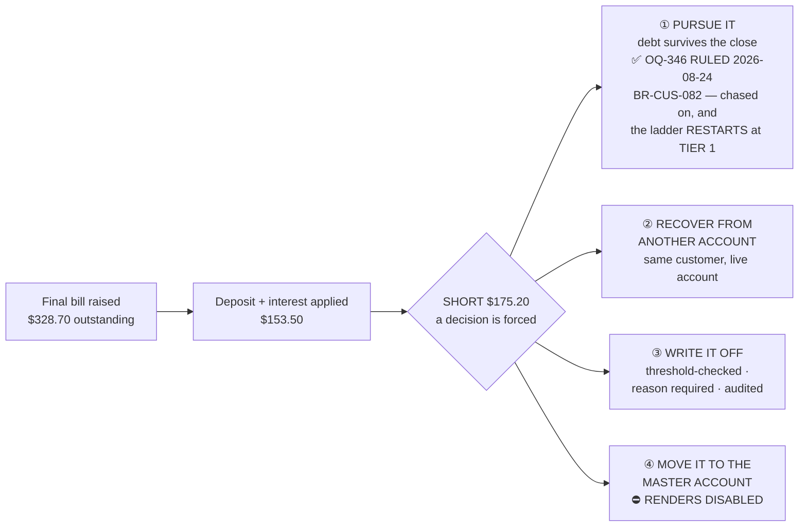

> ⚠ **OPTION ④ IS DISABLED, AND FOR A PRECISE REASON THAT A LANE MUST QUOTE.**
> **Master accounts EXIST** — BR-CUS-068 (PO 2026-08-22) makes a master an
> ordinary `accounts` row with `kind='master'`, payer = the premises'
> owner/manager, anchored on the first common-area unit and covering the rest via
> `service_agreements`. **No new table.** So the option is *not* disabled for a
> missing model. It is disabled because **the landlord-agreement flag has no
> column** — BR-CUS-068's own note. Per BR-SHL-025 a forbidden control is
> **disabled WITH its reason**, and this is the reason. **An earlier draft of
> this design said master accounts do not exist. That was wrong and is corrected
> here.**

> ~~⛔ **OQ-347 — the mirror case.** Deposit **$153.50** against **$142.30** owed.
> Do we settle and refund the **$11.20**, or refund it all and leave the bill
> standing? `[shot]` draws `refund $11.20` on `A-11208`, which **presumes an
> answer the rules have not given.** The seed keeps the row; the code stubs the
> path.~~ ✅ **RULED 2026-08-24 — OQ-347 IS CLOSED → BR-CUS-081.** PO, verbatim:
> *"a) settle and refund the $11.20"*. **The $153.50 settles the $142.30 and the
> customer is refunded $11.20; the account closes at zero and the bill does NOT
> stand.** Refunding the whole deposit and leaving $142.30 outstanding is rejected
> — it sends a final bill to a customer whose own money the utility is
> simultaneously returning. **`[shot]`'s `refund $11.20` on `A-11208` now draws
> the ruled behaviour, not a presumed one**, and **the code no longer stubs the
> path** — it builds it. Both movements write `audit_log` (hard rule 7) and the
> settlement is a **new row, never an edit of the issued bill** (hard rule 4).

#### 5.6.5 The impact screen — step 3 widened

The PO asked for *"screen to show all the impact on premises and unit, assets,
plans & rates, Deposites, payments - or anything that is important"*. One panel
per consequence, read-only, before anything commits:

| Panel | What it states |
|---|---|
| **Unit** | goes vacant on the move-out date · ✅ **OQ-350 RULED 2026-08-24 → BR-MET-105: the OWNER / LANDLORD pays the $30.50/mo base while it is empty** (PO, verbatim: *"(a) the owner/landlord"*), reached through `premises.owner_customer_id` (W0). **The panel can now print the sentence instead of a gap.** ⚠ Still unruled and **not** to be assumed on this screen: whether the owner is billed **per empty unit or once per premises**, and what happens **before an owner customer is linked** — W7 task 7.15 |
| **Assets** | meters stay; final reads taken; any customer-owned device flagged for collection |
| **Plan & rates** | the agreement ends; the unit keeps its plan for the next occupant |
| **Deposit** | on file + interest accrued, and where it is going |
| **Payments** | scheduled autopay **cancelled**, not left to fire at a closed account |
| **Open items** | unbilled usage · undelivered bills · an open payment plan · an open dispute |
| **Sub-accounts** | any child account under this one, and what happens to each |

#### 5.6.6 Test cases

| TC | Given | When | Then |
|---|---|---|---|
| TC-MVO-1 | outstanding $328.70, deposit $153.50 | step 3 | `SHORT $175.20` in the accent, and **the wizard cannot advance until a decision is made** |
| TC-MVO-2 | the shortfall screen | option ④ | rendered **disabled with the landlord-agreement reason**, never hidden |
| TC-MVO-3 | `pursue it` chosen | close | ~~⛔ `NotImplementedError("OQ-346")` — the ladder's behaviour past close is unruled~~ ⚠ **CORRECTED 2026-08-24 — OQ-346 IS CLOSED (BR-CUS-082):** the **$175.20** stays chased after the close and the ladder **restarts at TIER 1** (not the tier reached). The stub goes; the case asserts the restart, and that **no disconnection escalation is offered on a closed account** |
| TC-MVO-4 | deposit $153.50 > owed $142.30 | step 3 | ~~⛔ `NotImplementedError("OQ-347")`~~ ⚠ **CORRECTED 2026-08-24 — OQ-347 IS CLOSED (BR-CUS-081):** the **$142.30** is settled from the deposit and **$11.20** is refunded; the account closes at zero and **no final bill stands**. Both movements write `audit_log` |
| TC-MVO-5 | `write it off` above threshold | commit | refused for a clerk; a supervisor may; a reason is required; `audit_log` written (hard rule 7) |
| TC-MVO-6 | no final read | commit | refused — *nothing settles without one* |
| TC-MVO-7 | an estimated final read | the row | `estimated` in amber, and the settlement is provisional on screen |
| TC-MVO-8 | close committed | after | the unit's occupancy is decided **explicitly**, never left implicit |
| TC-MVO-9 | an issued final invoice | any path | **no UPDATE, no DELETE** — corrections are new rows (hard rule 4) |
| TC-MVO-10 | autopay enrolled | close | the schedule is cancelled, and the screen said it would be |

#### 5.6.7 Seed data — the six `[shot]` rows

| Account | Customer | Unit | Date | Step | Final read | Settlement | State |
|---|---|---|---|---|---|---|---|
| A-10992 | Fitzgerald, Sean | 17 Brambling Ct | Aug 20 | 4 of 4 | taken | refunded $88.40 | Done |
| A-11208 | Nakamura, Yuki | 44 Larkspur Way | Aug 24 | 3 of 4 | taken | **refund $11.20** ✅ **OQ-347 RULED 2026-08-24 → BR-CUS-081** — settle $142.30, refund $11.20 | Waiting |
| A-11603 | Thompson, R. | 88 Pine Vista | Aug 31 | 2 of 4 | due | settles exactly | Scheduled |
| **A-11024** | **Ridge Coffee Co.** | 500 Main · 200 | Sep 05 | 3 of 4 | taken | **SHORT $175.20** ✅ **OQ-346 RULED 2026-08-24 → BR-CUS-082** — still chased after close, ladder restarts at TIER 1 | In progress |
| A-11780 | Delgado, Pilar | 220 Sable Court | Sep 09 | 2 of 4 | **estimated** | — | In progress |
| A-11340 | Northwind Mfg. | 77 Industrial Way | Sep 12 | 1 of 4 | — | — | Scheduled |

`A-11024` is the shortfall proof and links to `SR-26-0048`; `A-11603` links to
`SR-26-0046`. **`A-11340 · Northwind Mfg.` also appears on the Accounts tab as
`Marked disconnect` and on the Disconnects tab at `TIER 3` owing $8,240.00 — one
account, three tabs, consistent.** A lane that breaks that consistency has broken
the fixture.

---

### 5.7 · TRANSFERS `[shot: TRF-01 ×2]`

**What it is.** The same customer, a new address — **one job, not a move-out
followed by a move-in.**

#### 5.7.1 KPI strip

| Label | Figure | Caption |
|---|---|---|
| `OPEN` | **2** | *same customer, new address* |
| `MOVING THIS WEEK` | **1** | *within 7 days of today* |
| `DEPOSITS CARRYING` | **1** | *not refunded and re-collected* |
| `ARREARS FOLLOWING` | **1** | *a debt moving to a new account* |
| `COMPLETED THIS MONTH` | **3** | *one job, not two* |

#### 5.7.2 The list `[shot]`

* **Search:** ⛔ **STALE — `BR-CUS-099` (PO 2026-08-25) removed the `request #` leg;** the box now reads *"Customer, account #, or either address…"*. Drawn as *"Customer, account #, either address, or request #…"* — **"either
  address"** is the whole point of the tab
* **Columns:** `FROM ACCOUNT` · `CUSTOMER` · `FROM → TO` · `OUT DATE` · `IN DATE` · `STEP` (of 5) · `MONEY` · `STATE`
* **`FROM ACCOUNT`** is **two lines**: `A-10650` above, `→ A-11940` beneath in ink-45 `[shot]`. The new account number appears **as soon as it exists** and reads `→ —` before that
* **`MONEY`** stacks up to two sentences: `deposit carried $153.50` and, beneath, `arrear follows $542.10` in **amber** `[shot]`

#### 5.7.3 The callout — and why it is a rule, not decoration

> `[shot]` **ONE JOB** — *"A transfer appears only here. Its two halves are
> deliberately kept out of Move-ins and Move-outs — the same job listed three
> times would be counted three times."*

**This is a counting contract between tabs.** The Move-ins tab shows **3** and the
Move-outs tab **5**; if a transfer's halves leaked in they would read 4 and 6 and
the KPI strips would lie. **A test must assert the exclusion**, because nothing
else will catch it.

#### 5.7.4 The five steps

| # | Step |
|---|---|
| 1 | Find the account and confirm the customer |
| 2 | Find the new unit (vacant and reserved only) |
| 3 | Dates — out, in, and whether they are the same day |
| 4 | Money — deposit carry, arrears follow, final and opening reads |
| 5 | Review — both consequences, one commit |

**Same-day rule applies here too:** outgoing pays the move day, incoming starts
the next day from the same reading `[shot: three of the five rows have OUT DATE =
IN DATE]`.

#### 5.7.5 Test cases

| TC | Given | When | Then |
|---|---|---|---|
| TC-TRF-1 | an open transfer | the Move-ins and Move-outs tabs | it appears in **neither**; their counts are 3 and 5 |
| TC-TRF-2 | a transfer at step 1 | the row | `→ —` in the FROM ACCOUNT cell, not a blank |
| TC-TRF-3 | deposit $153.50, arrears $542.10 | step 4 | both carried; **the deposit is not refunded and re-collected** |
| TC-TRF-4 | out and in on the same date | commit | one reading serves both; no gap, no double bill |
| TC-TRF-5 | the target unit has a live account | step 2 | refused with its reason |
| TC-TRF-6 | a transfer completes | both accounts | old `closed_at` set, new `opened_at` set, **and each links to the other** |

#### 5.7.6 Seed data — the five `[shot]` rows

| From → to | Customer | Addresses | Out | In | Step | Money | State |
|---|---|---|---|---|---|---|---|
| A-10650 → A-11940 | Iversen, Britt | 18 Marten Row → 204 Quarry Lane | Aug 02 | Aug 02 | 5 of 5 | deposit carried $153.50 | Done |
| A-10714 → A-11996 | Haddad, Nour | 3 Kestrel Close → 71 Alder Street | Aug 05 | Aug 06 | 5 of 5 | deposit carried $150.00 | Done |
| A-10877 → A-12031 | Bianchi, Marco | 44 Larkspur Way → 88 Foundry Row | Aug 09 | Aug 12 | 5 of 5 | deposit carried $150.00 | Done |
| **A-11455 → A-12055** | **Park, Jenna** | 901 Hillside Ave → 26 Meadowbank Rise | Aug 28 | Sep 03 | **3 of 5** | deposit carried $154.20 · **arrear follows $542.10** | In progress |
| A-11109 → — | Osei, Grace | 12 Harbour View → 500 Main · 210 | Sep 14 | Sep 14 | 1 of 5 | — | Scheduled |

`Park, Jenna` links to `SR-26-0047` and **is the same $542.10 balance the Accounts
tab shows at `60+ past`** — one customer, two tabs, one figure.

---

#### 5.7.7 THE TRANSFER WIZARD AS DRAWN — `TRF-02.1` … `TRF-02.5`, captured 2026-08-25

The PO sent all five steps. **Everything below is what is on the screen**, and
every figure has been re-derived rather than copied.

**The frame, on every step.** `← Transfers` · kicker `TRANSFER` · H1 **"Same
customer, moving to another of your addresses."** · sub *"Five steps · one job,
not two. The deposit moves with them."* Actions: `Save & exit` ·
**`Park — waiting on ▾`** (BR-SHL-047's park-with-a-reason again) · **`Split into
two`**. Footer on all five: **`Step N of 5 · both halves commit together at the
end.`**

The band beneath the title is the whole shape in one line:

    LEAVING   18 Marten Row    A-10650 · closes Aug 2   [E][W]
                        →
    ARRIVING  204 Quarry Lane  A-11940 · starts Aug 2   [E][W][S]

⚠ **The arriving side gains a service.** Leaving is electric + water; arriving is
electric + water + **sewer**. A transfer is NOT a like-for-like move of a service
set, and nothing in `transfers.py` currently reasons about a service the old
address did not have.

##### Step 1 · LEAVING (`TRF-02.1`)

> **STAYS WITH YOU** — *"This customer is not leaving. Their deposit, their
> discounts and their history move with them — nothing is refunded and
> re-collected."*

That is `BR-CUS-085`'s reason stated to a clerk, and it is the sentence the whole
wizard exists to make true.

✅ **AND `BR-CUS-085` NOW EXISTS — WRITTEN INTO THE REGISTER 2026-08-25 (DEF-711),
CARRYING THIS MEANING.** When this section was written the id resolved to nothing:
`04-docs/05-modules/03-customers/02-business-rules.md` ran **083 straight to 086**,
and §6.4's NEW-rules table proposed the SAME number for a different statement
(*"a parked wizard never holds money"*). **PO ruling 2026-08-25: `BR-CUS-085` is the
DEPOSIT rule — this sentence — and the parked-wizard rule takes `BR-CUS-108`**, because
085 was already cited in shipped code paths for the deposit meaning. The citation above
is therefore correct as written and resolves. ⛔ **What the registered rule binds is the
PROHIBITION** — no refund raised, no re-collection possible — **not the deposit POSITION
moving**, which is `BR-CUS-024` (PROPOSED) and `OQ-365` (OPEN), and **not the badge's
*discounts* and *history*, which are drawn copy with no mechanism anywhere.**

Search *"Search the account they are leaving"*; the drawn result is
`A-10650 · Iversen, Britt · 18 Marten Row · since Jun 2022 · balance **nothing** ·
Deposit held **$153.50**`. Four panels follow:

| Panel | Drawn |
|---|---|
| **a · The account** | `A-10650` · Iversen, Britt · 18 Marten Row · Plan `Residential Standard v3 · $30.50/mo` · Current balance **$0.00 · nothing outstanding** · **Deposit held $150.00 + $4.20 interest** · chip **`60+ past due`** |
| **b · Its relationships** | **`Standalone`** — *"Nothing else is attached. No sub-meter measures through it and no sub-accounts sit beneath it, so closing this side affects only this customer."* |
| **c · Same customer** | **`Holds 1 other account`** — `A-11512 · 3450 Oak Ridge Dr · Pending · awaiting` |
| **d · The premise** | Owner or manager **`Hillside Holdings · free text, not an account`** · Units 1 · **Occupied 1 of 1** |

> **CHECKED** — *"No active payment plan, no unresolved dispute, and the August
> cycle is already billed. Nothing blocks this transfer."*
>
> **FOLLOWS** — *"The $0.00 arrear is 60+ days past due. Step 4 decides whether it
> follows them to the new account or stays here to be pursued."*

✅ **Panel (d) is `DEF-650` DRAWN ON THE SCREEN** — *"free text, not an account"* is
the design telling us the owner has no posting target, which is exactly what
`BR-MET-113`/`BR-MET-116` ruled this morning. The screen and the ruling agree.

⛔ **THREE ERRORS, AND ALL THREE ARE IN STEP 1's PANELS — see `DEF-690`.**
They are listed under step 4, where the arithmetic that exposes them is drawn.

##### Step 2 · FINAL READS (`TRF-02.2`)

`Move-out date at 18 Marten Row *` = **08/02/2026** · `Bill to` = **Move-out date
(prorate)**. Final reads, *"3 registers including 1 sub-meter"*:

```
M-7120    E  kWh              previous  38,420   final  39,180   AMI
M-7121    W  gal              previous 104,900   final 107,240   AMI
S-7121-1  W  gal · irrigation previous  12,040   final  12,610   AMI
```

✅ Consumption re-derived: **760 kWh** · **2,340 gal** · **570 gal** on the
sub-meter. All three positive, all three plausible for a month.

> **ESTIMATE** — *"An estimated final read can produce a correction later, after a
> real read lands. Prefer a manual read on the day."*

##### Step 3 · ARRIVING (`TRF-02.3`)

Search *"Search the unit they are moving to"*, and **the rule is printed under the
box**: *"**Only vacant and reserved units appear — a unit with a live account
cannot be moved into.**"* The drawn results prove it by showing the exception:

| Address | Type | Plan on the unit | Meters | Status |
|---|---|---|---|---|
| 26 Meadowbank Rise | House | Residential Standard v3 | M-8801 · M-8802 · M-8803 | **`Vacant`** |
| 500 Main St · 210 | Suite | Small Commercial | M-6031 | **`Reserved`** |
| 88 Pine Vista | House | Residential Standard v3 | M-7301 | **`Live account`** |

> **REFUSED** — *"88 Pine Vista has an active account (A-11603, Thompson R.) with a
> move-out booked for Aug 31. It cannot be moved into until that closes."*

✅ **The refusal names the blocker, the party and the date.** It is not *"unit
unavailable"* — a clerk can tell the customer when it frees up. That is the
refusal standard the whole product is meant to meet.

**`Everything at 204 Quarry Lane`** — *3 billable meters · 1 device*:

```
M-8801  Meter              E Electric  200 A   12,840 kWh
M-8802  Meter              W Water     5/8"    44,120 gal
M-8803  Net meter          E Electric  200 A   import 880 / export 610   solar on site
BF-2210 Backflow preventer W Water     —       —                          test due in 22 days
```

> **SOLAR** — *"There is solar here, paired with net meter M-8803. **The plan on
> this unit must support net metering or the export will not be credited.**"*
>
> **TRANSFERS** — *"**The backflow test obligation belongs to the premise, not the
> occupant** — it comes with the unit and its next test is due in 22 days."*

⚠ **BOTH BANNERS ARE RULES, NOT DECORATION, AND NEITHER IS BUILT.** The first
says a plan/asset compatibility check must run before a move-in is allowed — a
customer moved onto a non-net-metering plan generates export nobody credits. The
second says an obligation is a property of the UNIT and survives every change of
occupant. Neither has a rule id.

`Service start date *` = **08/02/2026** · `Bill from` = **Service start date
(prorate)**. Opening reads — **4 rows**, and the fourth is why:

```
M-8801  E  kWh          prior final 12,840   opening 12,840   AMI
M-8802  W  gal          prior final 44,120   opening 44,120   AMI
M-8803  E  import kWh   prior final    880   opening    880   AMI
M-8803  E  export kWh   prior final    610   opening    610   AMI
```

✅ **A net meter is TWO registers on ONE meter.** *"3 billable meters"* and *"4
registers"* are both correct and they count different things.
✅ Every opening read equals its prior final — **no consumption is invented at the
boundary**, which is what makes the next line true.

> **Between the two addresses** · **`Same day`** — *"Same day. 18 Marten Row is
> billed through that day's reading, and 204 Quarry Lane starts from its own on the
> same date. **No gap and no double bill.**"*

##### Step 4 · MONEY (`TRF-02.4`) — and it is the arbiter

> **The deposit moves** · **`No refund, no re-collection`** — *"The customer is not
> leaving, so the $153.50 held on A-10650 moves to the new account with its
> interest intact. Refunding it and taking a new one would cost them the interest
> and delay the move."*

```
Held on A-10650      $150.00 principal
Interest earned      $  3.50
Moving to A-11940    $153.50
Refunded             Nothing
```

✅ **IT FOOTS: `150.00 + 3.50 = 153.50`**, and `$153.50` is the figure on step 1's
search row, twice here, and on step 5. **Four agreements and one disagreement.**

> **The arrear — does it follow them?** · **`Nothing owed`** — *"Nothing is
> outstanding on A-10650, so there is no decision to make here."*

**`What carries across`** — *"Because the customer is the same person"*:

| | Item | Drawn |
|---|---|---|
| ✓ | Deposit and interest | `$153.50 moves across intact` |
| ✓ | Payment history | *"4 years of it — **the new account is not treated as a new customer**"* |
| ✓ | Autopay and paperless | *"Both stay on, against the same bank details"* |
| ⚠ | Discounts | *"**Senior rate must be re-checked — eligibility depends on the premises, not the person**"* |
| ⚠ | The plan | *"The new unit carries its own plan. Residential Standard v3 there too, **but by coincidence, not by carry-over**"* |

✅ **THE LAST ROW IS A RULE AND IT MATCHES WHAT THE REPO ALREADY BELIEVES** —
*the account derives its plan from the unit*. The screen says so in the only place
a user would ever wonder, and it says it as a warning rather than a reassurance,
because the two plans being equal here is a coincidence.

⚠ **The discounts row is the one that costs money.** Eligibility depends on the
PREMISES, so a senior rate does not travel; a transfer that carried it silently
would under-bill every month until somebody noticed. `discounts.py` has no
re-check on transfer.

##### Step 5 · REVIEW & CONFIRM (`TRF-02.5`)

| Closing · 18 Marten Row `A-10650` | Opening · 204 Quarry Lane `A-11940` |
|---|---|
| Final reads — **3 registers, Aug 2** | Opening reads — **4 registers, Aug 2** |
| Final bill — Prorated to Aug 2 | Plan — Residential Standard v3 · from Aug 2 |
| Deposit — **Moves — nothing refunded** | Deposit — **$153.50 carried across** |
| Arrear — **None** | Opening balance — **$0.00** |
| **Account state — Closed, once the final bill settles** | **First bill — Next cycle, prorated from Aug 2** |

✅ **BOTH REGISTER COUNTS TIE TO THE ROWS DRAWN EARLIER** — step 2 lists exactly 3,
step 3 lists exactly 4.
✅ **`Closed, ONCE THE FINAL BILL SETTLES`** — the closure is conditional on money,
not on the date. That is `BR-CUS-030`'s shape and the screen states it.

> **BOTH OR NEITHER** — *"Both halves commit together. If the opening reads at 204
> Quarry Lane cannot be taken, the closure at 18 Marten Row does not happen either
> — **otherwise the customer ends up with no account anywhere**."*

✅ **ALREADY BUILT.** `commit_transfer` wraps both halves in one
`transaction.atomic()`, and this banner is the reason, written for a clerk.

**`What we'll send`** — *2 of 3 selected*:

| | Piece | Drawn |
|---|---|---|
| ☑ | Transfer confirmation | *"Both addresses, both dates, and what happens to the deposit"* |
| ☑ | Final bill for 18 Marten Row | *"Prorated to Aug 2"* |
| ☐ | Arrear notice | *"**Nothing owed, so nothing to notify**"* |

✅ **The unticked box explains ITSELF.** It is not disabled and silent; it says why
there is nothing to send. Commit button: **`Complete transfer ✓`**.

⚠ **BUT `BR-MET-115` (PO, this morning) REMOVED THE `On creation` TRIGGER** for
New Connect's communication, on the grounds that an internal event is not worth
telling a customer about. **A transfer confirmation at commit is a different
case** — the customer asked for this and it happens the same day — so the two are
not in conflict. Recorded because the next reader will ask.

##### What this capture settles, and what it opens

| | Finding |
|---|---|
| ✅ | The atomic commit, the deposit carry, the same-day boundary and the account-derives-plan rule are all drawn exactly as built or as already ruled |
| ⛔ | Three errors, all in step 1's panels — **`DEF-690`** |
| ⚠ | The arriving address gains **sewer**; nothing reasons about a service the old address lacked |
| ⚠ | **Plan/asset compatibility** (solar needs net metering) is drawn as a rule and has no id and no code |
| ⚠ | **A backflow test obligation belongs to the unit** and survives the occupant — drawn as a rule, no id, no code |
| ⚠ | **A senior discount must be re-checked on transfer** because eligibility is the premises' — drawn, and `discounts.py` does not do it |

### 5.8 · DISCONNECTS `[shot: DSC-01 ×2]`

**What it is.** The collections ladder, its protections, the cut and the
reconnect. **Today this is a notice modal and nothing else** — no list, no
ladder, no protections gate.

#### 5.8.1 KPI strip

| Label | Figure | Caption |
|---|---|---|
| `AT NOTICE` | **4** | *somewhere on the ladder* |
| `DUE TO CUT THIS WEEK` | **2** | *within 7 days of today* |
| `ON HOLD — PROTECTED` | **3** | *medical, plans, moratorium* |
| `CUT, AWAITING PAYMENT` | **1** | *still accruing base charges* |
| `RECONNECTIONS DUE` | **1** | *paid, awaiting a visit* |

**`CUT, AWAITING PAYMENT` · *still accruing base charges*** is a money statement:
the meter is off and the base charge is not.

#### 5.8.2 The list `[shot]`

* **Search:** *"Customer, account #, address, or meter #…"*
* **Segments:** `All` · `At notice` · `Due to cut` · `On hold` · `Cut` · `Reconnecting`
* **Columns:** `ACCOUNT` · `CUSTOMER` · `ADDRESS` · `OWED` · `TIER` · `CUT DATE` · `LAST NOTICE` · `STATE`
* **`TIER`** is a bordered chip: `TIER 1 · REMINDER` · `TIER 2 · 10-DAY` · `TIER 3 · 48-HOUR` (accent) · `HELD · MEDICAL` · `HELD · PAYMENT PLAN` · `HELD · WEATHER MORATORIUM` (grey) · `—`
* **`LAST NOTICE`** records **how it was delivered**: `emailed` · `posted` · `certified sent` · `certified signed` · `—`
* **`CUT DATE`** renders in the **accent** when it is this week `[shot: Aug 24, Aug 26]`

> **`LAST NOTICE` is a delivery claim the product cannot currently make.** There
> is **no email, SMS or print adapter in this release** — the in-app bell is the
> only channel that delivers anything. `certified signed` asserts a signature came
> back. **This column is drawn against a capability that does not exist**, and a
> lane must render the absence rather than fabricate a delivery state.
>
> ✅ **HALF-SETTLED 2026-08-25 — `BR-CUS-100`, PO ruling closing `DEF-692`:**
> *"you amke the provision and send in app messages - we discussed this before"*.
> **Every sentence above is still true**; what it did not say is that **in-app is
> the channel disconnect notices USE**. The notice is raised as an ordinary
> notification event and the in-app adapter delivers it — the same queue, the same
> dispatcher, the same provider seam every other channel will travel
> (`EP-NOT-05`), so nothing about the notice changes when email, SMS and print
> arrive.
>
> ⛔ **AND THE OTHER HALF IS NOT SETTLED BY IT.** `DSC-02.3` marks certified mail
> **`Required at tier 3 — proof of service`**, and proof of service is a **legal
> artefact produced outside this product** — a posted item, a tracking number, a
> signature that came back. No adapter manufactures one. So the SEND and the PROOF
> are separated: the send is in-app, and the proof is **a record a person enters**
> (channel, reference, signed-for date). `disconnect_notices` cannot hold that
> today, and until it can, `delivery_state` stays NULL with its reason and **a
> tier-3 cut must not be schedulable on an unrecorded service**.

#### 5.8.3 The ladder, and the thing that stops it

> `[shot]` **STOPS ITSELF** — *"If a customer pays or agrees a payment plan, the
> ladder stops automatically and the row leaves this list. Nothing here has to be
> cancelled by hand — the modal exists for clerk error, a dispute, or a regulator
> instruction."*

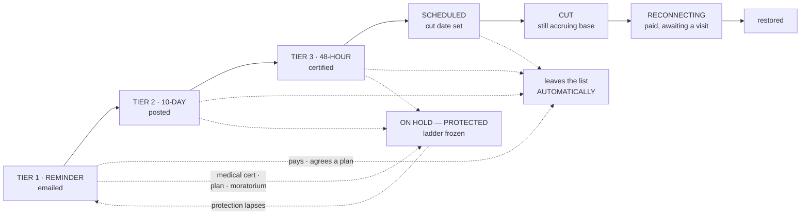

**Three protections, and each has a different lifetime:** a medical certificate
expires · a payment plan holds while it is kept and voids when it is not · a
weather moratorium is a **date window set by the regulator, not by the tenant**.

#### 5.8.4 The five steps

| # | Step |
|---|---|
| 1 | Find the account · what is owed · how long |
| 2 | **Protections check** — medical · plan · moratorium · dispute, each pass or fail with its reason |
| 3 | Tier and notice — which notice, by which channel, with what wording |
| 4 | Schedule the cut — date, and the field work |
| 5 | Review — **danger tier commit** |

**Reconnect is its own short flow:** payment confirmed → visit scheduled →
restored → the row leaves the tab.

#### 5.8.5 Test cases

| TC | Given | When | Then |
|---|---|---|---|
| TC-DSC-1 | a customer pays in full at TIER 2 | the payment posts | the ladder stops **automatically** and the row leaves the list — **no manual cancel** |
| TC-DSC-2 | a payment plan is agreed | the plan activates | `HELD · PAYMENT PLAN`, ladder frozen |
| TC-DSC-3 | the plan is broken | the miss | ⛔ **THIS CASE IS WRONG AS WRITTEN — SUPERSEDED 2026-08-25 BY `BR-CUS-098`.** It said *"the hold lifts and the ladder resumes **where it was**, not from tier 1"*. The PO was shown that this contradicts §5.8.3's own diagram (`HOLD -.->\|"protection lapses"\| T1`) and ruled **"Back to tier 1"**. **The correct expectation is: the hold lifts and the ladder RESTARTS AT TIER 1** — the customer receives a fresh reminder, 10-day and 48-hour notice before a cut can be scheduled again. It is left visible rather than deleted because a test case stating the opposite of a signed rule is how the wrong thing gets built, and the next reader needs to see that this one was caught. Consistent with `BR-CUS-082`, which already restarts the ladder at tier 1 for a debt surviving closure |
| TC-DSC-4 | a medical certificate on file | step 2 | **refused to advance**, with the protection named |
| TC-DSC-5 | a weather moratorium in force | step 2 | refused; the window's dates are shown |
| TC-DSC-6 | no delivery adapter | step 3 | the channel renders **its absence**, and no notice is recorded as `emailed` |
| TC-DSC-7 | the cut commits | step 5 | danger tier; `audit_log` written; base charges **keep accruing** and the screen said so |
| TC-DSC-8 | `A-11507` owes $0.00 | the row | `Reconnecting`, tier `—` — a paid account still on the tab because a visit is due |
| TC-DSC-9 | tenant B | `GET /disconnects` | none of tenant A's |

#### 5.8.6 Seed data — the nine `[shot]` rows

| Account | Customer | Owed | Tier | Cut date | Last notice | State |
|---|---|---|---|---|---|---|
| A-11507 | Greaves, Tom | $0.00 | — | Aug 12 | certified signed | Reconnecting |
| A-11488 | Doyle, Patrick | $612.75 | — | Aug 18 | certified signed | **Cut** |
| **A-11340** | **Northwind Mfg.** | **$8,240.00** | TIER 3 · 48-HOUR | **Aug 24** | certified signed | **Scheduled** |
| A-11720 | Calloway, Brett | $1,204.50 | TIER 3 · 48-HOUR | **Aug 26** | certified sent | Scheduled |
| A-11812 | Bramble Bakery | $2,410.00 | TIER 2 · 10-DAY | — | posted | Notice sent |
| A-11780 | Whitfield, Dana | $318.60 | TIER 1 · REMINDER | — | emailed | Notice sent |
| A-11902 | Okafor, Emmanuel | $948.20 | HELD · MEDICAL | — | — | On hold |
| A-11655 | Sandoval, Rita | $205.40 | HELD · PAYMENT PLAN | — | — | On hold |
| A-11933 | Iqbal, Nadia | $402.15 | HELD · WEATHER MORATORIUM | — | — | On hold |

**Three accounts appear on more than one tab and must agree:** `A-11340` (here,
Accounts as `Marked disconnect`, Move-outs at step 1 of 4) · `A-11780` (here at
TIER 1, Move-outs with an estimated read — **and those two are different
customers sharing a number in the screenshots; see §11**).

---

#### 5.8.7 THE DISCONNECT WIZARD AS DRAWN — `DSC-02.1` … `DSC-02.5`, captured 2026-08-25

**The frame.** `← Disconnects` · kicker `DISCONNECT` · H1 **"Cut service at an
address."** · sub *"Five steps · notices, protections and the date."* Actions
`Save & exit` · `Park — waiting on ▾`. Steps: **1 Account & reason · 2 Protections
· 3 Notice & date · 4 Fees & consequences · 5 Review**. And the footer, on every
one of the five: **`Step N of 5 · nothing is cut until the scheduled date`**.

✅ **That footer is the whole design in eight words.** The wizard SCHEDULES; it
never cuts. Step 5's button says `Schedule the disconnection ✓`, not *Cut*.

##### Step 1 · ACCOUNT & REASON (`DSC-02.1`)

`The account` · chip **`Ready to schedule`**. Search takes *"Customer, account #,
address, or meter #…"*.

```
Account          A-11340
Customer         Northwind Mfg.
Service address  77 Industrial Way
Owed             $8,240.00 · oldest 92 days
Deposit held     $500.00
Services         E W S
Last payment     $400.00 on 12 June
```

**`WHY IS SERVICE BEING CUT?`** — five cards, and every one carries its own plain
sentence: **Non-payment** (*the ladder has run and they have not paid*) ·
**Unsafe installation** (*a hazard found on site*) · **Tampering or theft** (*the
meter has been interfered with*) · **Premises abandoned** (*nobody is there and
nobody is paying*) · **The customer asked** (*they want service ended*).

⚠ **THE REASON IS NOT DECORATION.** Only the first is a collections outcome; the
other four are operational and **must not require a dunning ladder at all**. A
tampering cut has no tier 3 notice to serve, and *"the customer asked"* is closer
to a move-out. Nothing in `disconnects.py` keys off a reason.

**`Which services`** — *"One decision per service, not all or nothing"*:

> *"Many jurisdictions treat water differently from electricity, and some allow a
> **restrictor or load limiter** instead of a full cut. Choose per service."*

Columns: `SERVICE · METER · FULL DISCONNECTION · RESTRICTOR / LIMITER · LEAVE
CONNECTED`, with the drawn caption *"Cutting electric and sewer · restricting
water rather than cutting it. A restrictor limits flow to a minimum rather than
stopping it, **which many jurisdictions require for water**."*

⚠ **A RESTRICTOR IS A THIRD STATE AND THE SCHEMA HAS TWO.** `disconnect_cases`
knows cut and not-cut. *Restricted* is neither: service continues, billing
continues, and the account is under enforcement. **Not built, and it is drawn as
the DEFAULT treatment for water.**

##### Step 2 · PROTECTIONS (`DSC-02.2`) · chip **`All clear`**

**TEN checks**, each ticked with its own finding:

| # | Check | Drawn finding |
|---|---|---|
| 1 | Medical equipment on site | Nobody at this address is registered as depending on medical equipment |
| 2 | Weather moratorium | No heat or cold emergency declared for this date |
| 3 | Life support registration | Not registered |
| 4 | Age or disability protection | Nobody in the household is registered |
| 5 | Active payment plan | None — the last one lapsed in May |
| 6 | Open dispute | No dispute on the balance |
| 7 | Assistance application pending | No application in progress |
| 8 | Recent partial payment | Nothing since 12 June, so no good-faith payment to honour |
| 9 | Notice period served | Tier 3 was served on the date shown at step 3 |
| 10 | Landlord-billed premises | The occupant is the account holder, so no third party is affected |

> *"This step exists because **cutting service to a protected household is the
> single most serious thing this product can do**."*

⛔ **TEN ARE DRAWN. THREE ARE BUILT.** `disconnects.py` implements the medical
certificate, the payment plan and the weather moratorium — *"the three
protections, each with its own lifetime"* (task 7.7). **Seven are not:** life
support, age/disability, open dispute, assistance pending, recent partial
payment, notice-period-served and landlord-billed. → **`DEF-691`**. Each is a
reason a cut must not proceed, so each missing one is a household that can be cut
when it should not be.

✅ **Note the SHAPE of each finding: it states what was checked and what was
found**, never a bare tick. *"Nothing since 12 June, so no good-faith payment to
honour"* tells a clerk why the answer is no.

##### Step 3 · NOTICE & DATE (`DSC-02.3`)

`The ladder` — *At tier 3 of 3 · 3 days at this tier*:

```
Tier 1 · reminder        Served Aug 04 · email           [Served]
Tier 2 · 10-day notice   Served Aug 18 · posted          [Served]
Tier 3 · 48-hour notice  Served Aug 22 · certified mail  [Current]
```

✅ Aug 04 → Aug 18 is **14 days**; Aug 18 → Aug 22 is **4 days**. The tier-2
notice is a *10-day* notice and 14 days passed before tier 3 — **the ladder waited
longer than its own minimum**, which is the correct direction to err.

**`Tier 3 · 48-hour notice`**, shown **`AS THE CUSTOMER RECEIVES IT`** — the
verbatim letter:

> **Final notice before disconnection · A-11340**
> *"Our records show **$8,240.00** outstanding on your account. Unless payment is
> received, or you agree a payment plan with us, service at 77 Industrial Way may
> be disconnected **on or after Aug 24**. A reconnection fee of **$75.00** applies
> to restore service."*
> *"You have the right to dispute this balance, to request a payment plan, and to
> be protected from disconnection if somebody at this address depends on medical
> equipment. Call us before the date above."*

✅ **THE SECOND PARAGRAPH IS A STATUTORY RIGHTS NOTICE AND IT NAMES THREE OF THE
TEN PROTECTIONS.** The letter tells the customer they may invoke exactly the
things step 2 checks. That is the loop closing, and it is why the seven unbuilt
checks matter: the letter promises them.

**`HOW IT GOES OUT`** — `Certified mail` **`Required`** and locked (*"Required at
tier 3 — proof of service"*) · ☑ `Email` (*"Sent alongside, not instead of"*) ·
☑ `Text message` (*"A short version with the date and the amount"*) · ☑ `Door
hanger` (*"Left on the day if the crew attends"*). **Delivery address:** *77
Industrial Way · and the postal address on file*.

⛔ **B18 CONTRADICTS ITSELF HERE — `DEF-692`.** §5.8.2's own warning is that
*"`LAST NOTICE` is a delivery claim the product cannot currently make. There is
**no email, SMS or print adapter in this release**"*. This screen draws four
delivery channels, marks one **required for legal proof**, and the ladder above it
records *"Served Aug 04 · email"* as fact. **A tier-3 cut whose lawfulness rests
on certified mail cannot be built on an adapter that does not exist.**

`The date` · chip **`Computed, then chosen`**:

```
NOTICE SERVED      Aug 22    certified mail, signed for
STATUTORY PERIOD   48 hours  For Tier 3 · 48-hour notice
EARLIEST LAWFUL CUT Aug 24   Locked — computed, not chosen
```

> *"Computed as Aug 22 plus 48 hours, **rolled forward past weekends and public
> holidays**. **It cannot be typed.**"*

✅ **Aug 22 2026 is a Saturday and Aug 24 is a Monday** — the drawn case needs no
roll, so the rule is stated rather than demonstrated. **A lane must not read
"48 hours" as "+2 days"**: the roll is the rule and this fixture cannot prove it.

`Scheduled cut date *` = **08/24/2026** with *"Cannot be earlier than Aug 24."* ·
`Field work` = **Remote — electric can be cut at the meter**.

> **CREW** — *"A remote cut happens on the date. A visit has to be scheduled, and
> **the crew will not attend if somebody is home and disputes it on the
> doorstep**."*

⚠ That last clause is an operational rule with a data consequence — a cut can
fail on the doorstep and the case must be able to record *attended, not cut,
disputed*. No outcome vocabulary covers it.

##### Step 4 · FEES & CONSEQUENCES (`DSC-02.4`)

`Fees` — *"From your charge codes, never typed"*:

| Charge | Code | When it applies | Amount |
|---|---|---|---|
| Disconnection fee | `CC-DISC` | On the cut | **$45.00** |
| Reconnection fee | `CC-RECON` | When service is restored | **$75.00** |
| Field visit | `CC-FIELD` | Only if a crew attends | **$35.00** |

*"The reconnection fee is quoted now so the customer is told what it will cost to
get service back **before it is taken away**."* ✅ And `$75.00` is exactly the
figure in the tier-3 letter — **the quote and the notice agree**.

**`What this will do`** · **`What this will not do`** — the second is chipped
*"Worth being clear about"*:

| Will | Will NOT |
|---|---|
| Cut the services chosen at step 1 on the scheduled date, **leaving the account open** | **Close the account or settle the deposit — that is a move-out, not a disconnect** |
| **Keep charging base and standing charges — a disconnected account still accrues** | Stop the balance growing, or write any of it off |
| Add **$75.00** to the balance as the price of getting service back | Remove the meter, unless you chose meter removal as the field work |
| Move the account into the **disconnected state, which blocks new service elsewhere until it is settled** | |

✅ ~~**THIS ANSWERS THE QUESTION THE W7 LANE SERVED AS AN ABSENCE.**~~
⛔ **SUPERSEDED 2026-08-25 — AND REVERSED. BR-CUS-103 (PO, closing OQ-380)
ruled that base charges STOP at the cut; the answer was "no".** So the row
above — *"Keep charging base and standing charges — a disconnected account still
accrues"* — is **no longer the rule**, and neither is §5.8.3's diagram caption
*"CUT · still accruing base"*. Both are kept here rather than edited away
because this file is the drawing the ruling was taken against.

The paragraph this replaces read: *"It served `cut_base_accrual_unverified`
because nothing ruled whether a cut account keeps accruing base. The wizard
states it twice … it is drawn, consistently, and is still not a signed BR;
reported so it can be signed rather than inferred."* It was signed — the
opposite way. The absence is now `cut_accrual_caption_superseded` (**DEF-716**,
2026-08-25): a caption withheld as *unverified* reads as a question still open,
and this one is settled. Billing implements the rule by subtracting the dark
days from `service_days` (`disconnects.service_off_windows`); **no `accounts`
column is written and `commit_cut` still writes none.**

⚠ **The fourth row above — *"Move the account into the disconnected state"* — is
also now buildable and is still NOT built.** BR-CUS-107 (PO 2026-08-25, closing
DEF-701) seeds the `Disconnected` account status in class `non_billable`, which
is the state this row names; nothing assigns it, because a `non_billable`
account stops occupying its unit and is dropped from the bill run entirely. See
`apps/customers/disconnects.DISCONNECTED_STATUS_NOT_ASSIGNED`.

⚠ **"Blocks new service elsewhere until it is settled" is a CROSS-PREMISES rule**
with no id: a debt at one address stops a move-in at another. That reaches into
move-in, which does not check it.

⚠ **The $45.00 disconnection fee is in the fee table and in neither the summary
nor "What this will do"**, which mentions only the $75.00. Each fee row carries a
⊘ control, so the reading may be *waived*; the drawing does not say.

`The deposit` · chip **`A liability, not revenue`**:

> *"A deposit is money you hold **on the customer's behalf**. Applying it against
> the arrear reduces what they owe but **does not make it income**, and it leaves
> nothing held if they later restore service."*

| | Option | Drawn |
|---|---|---|
| ● | **Hold it** | *"The $500.00 stays held. The arrear stands at **$8,240.00** and the deposit is available if they reconnect."* |
| ○ | Apply it against the arrear | *"Reduces the arrear to **$7,740.00**. Nothing is held, so a new deposit is required to reconnect."* |

✅ **IT FOOTS: `8,240.00 − 500.00 = 7,740.00`.** And the chip is the accounting
rule stated to a clerk — applying a deposit is a **balance-sheet** move, not
revenue, which is exactly what the ledger must post.

##### Step 5 · REVIEW (`DSC-02.5`) · chip **`Ready to schedule`**

```
Account          A-11340 · Northwind Mfg.
Owed             $8,240.00
Reason           Non-payment
Services cut     Electric, Sewer
Services restricted  water — a restrictor, not a cut
Notice served    Aug 22 · certified, signed for
Earliest lawful  Aug 24
Protections      all clear
Deposit          held
```

**`What we'll send`** — *3 of 4 selected*:

| | Piece | Drawn |
|---|---|---|
| ☑ locked | Disconnection notice | *"Already served — this is the record of it"* |
| ☑ | Reminder 24 hours before | *"A last chance to pay before the crew attends"* |
| ☑ | Confirmation after the cut | *"States what was cut, and the price of getting it back"* |
| ☐ | Copy to the landlord | *"Only where the premises is landlord-billed — **it is not here**"* |

> **WHAT THIS WILL DO** — *"On Aug 24, electric and sewer will be cut at 77
> Industrial Way. The account stays open and keeps accruing, and $75.00 will be
> owed to restore it."*
>
> *"This schedules it. Nothing is cut until the date, and **it stops automatically
> if they pay or agree a plan**."*

✅ **"Stops automatically" is `BR-CUS`'s self-stopping ladder, already built**
(task 7.6, *"and it stops itself"*). The screen promises the customer's payment
cancels the cut with no human step, and the code does that.

⚠ **Step 5 reads `Reason: Non-payment` while step 1's highlighted card is
`Tampering or theft`.** Either the step-1 highlight is focus rather than
selection, or the fixture disagrees with itself. Recorded as an observation, not
asserted as a defect — the same class as `DEF-676`.
⚠ **Step 1's `Which services` table renders headers and caption with no rows**,
yet step 5 reports the per-service decision. Same reading problem, same class.

##### What this capture settles, and what it opens

| | Finding |
|---|---|
| ✅ | The self-stopping ladder, the computed-not-typed date, the deposit-as-liability rule and the *nothing is cut until the date* guarantee are all drawn as built or as already ruled |
| ✅ | Every figure foots: `8,240 − 500 = 7,740`; the `$75.00` quote matches the letter; the ladder's own intervals exceed its minimums |
| ⛔ | **Ten protections drawn, three built** — `DEF-691` |
| ⛔ | **Four delivery channels drawn, one marked legally required, no adapter exists** — `DEF-692`, and B18 §5.8.2 says so itself |
| ⚠ | **A restrictor is a third state** the schema cannot hold, drawn as the default for water |
| ⚠ | **The reason drives nothing** — four of five reasons need no ladder at all |
| ⚠ | **"Blocks new service elsewhere"** is a cross-premises rule with no id, and move-in does not check it |
| ⚠ | **A crew can attend and not cut** (disputed on the doorstep) with no outcome to record it |
| ⚠ | **Base accrual after a cut is DRAWN TWICE and signed nowhere** — put it to the PO rather than inferring it |

### 5.9 · IMPORTS `[shot: ACC-02]` — **BUILT FIRST**

> **PO, 2026-08-23, verbatim:** *"I will first build the entire account import
> wizard - we did it for premises, Units, Assets already, now we have to do exact
> same thing for accounts. the only thing is acocunts will be mapped to Units at
> the time of import plus you can select all required and optional field
> mapping"*

**What it is.** Bulk account loads — the migration from the old system, and any
correction batch since. **And it is the cheapest large win in the CR**, because
the runner already exists.

#### 5.9.1 The finding that makes this small

**`apps.metering` already holds ONE ETL runner with `target` parameterised**
(BR-MET-096, CR-023 design B15 §11). Its own docstring states the contract:

> *"⚠ A KIND IS COPY AND A ROUTE, NEVER BEHAVIOUR. Everything that differs
> between a premises run and a units run is a catalogue key or a path; the
> stages, the mapping table, the rules table, the dry run and the receipt are
> identical."*
> — `07-frontend/src/components/workflow/kinds.ts`

**Five targets are registered today** — `premises`, `units`, `assets_meters`,
`assets_submeters`, `assets_devices` (`import_runs.py:173–196`). **Accounts is the
sixth, and it is a tuple entry plus a column map, not a new runner.**

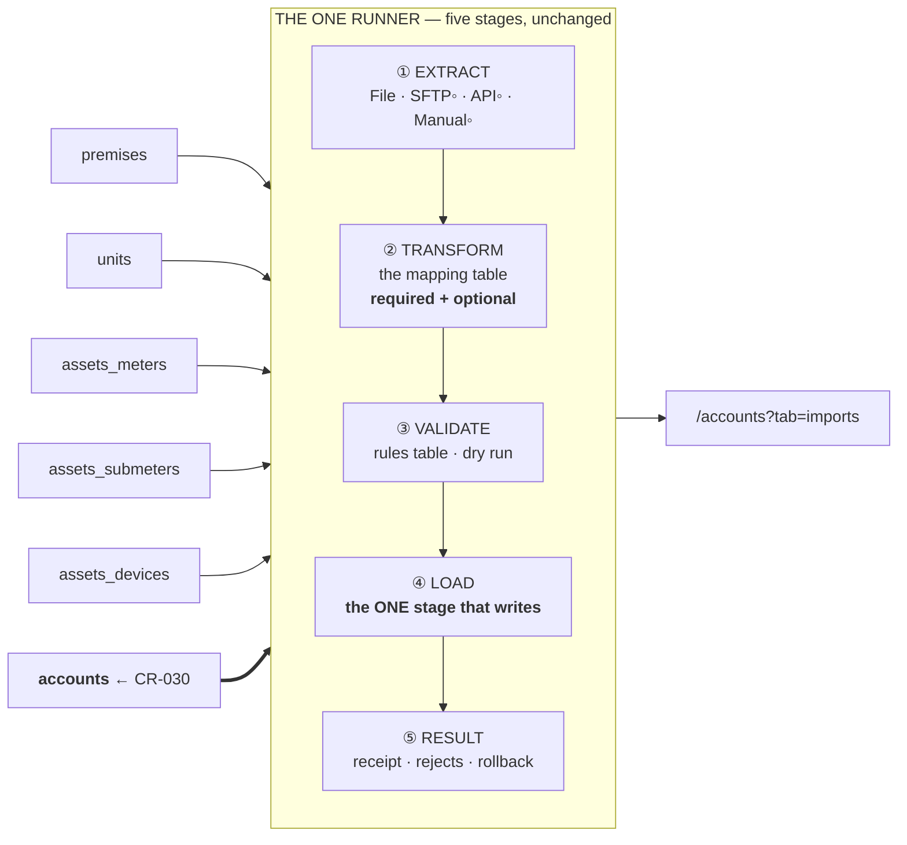

#### 5.9.2 What must be added — the complete list

| # | Where | Change |
|---|---|---|
| 1 | `import_runs.py` | `TARGET_ACCOUNTS = "accounts"`, appended to `TARGETS` |
| 2 | `import_runs.py` | `ACCOUNTS_COLUMNS` — the field map (§5.9.3) |
| 3 | `import_runs.py` | `ACCOUNTS_ALIASES` — stage-1 header auto-detect |
| 4 | `kinds.ts` | one `accounts` `WorkflowKind` object, `returnTo: "/accounts?tab=imports"` |
| 5 | i18n | the kind's seven keys × **11 locales** |
| 6 | `AccountsListPage` | the **Imports tab** (S81) — run history, rollback, reject fixing |
| 7 | Header | `↑ Import CSV` **leaves the Accounts header** for its own tab |
| 8 | Deprecate | the 3-step modal (`ImportAccountsWizard.tsx`, `account_import.py`, `POST /accounts/imports`) |
| 9 | `account_opening_buckets` | **the table + its RLS migration** — US-CUS-021 ⚠ §5.9.3a |
| 10 | LOAD stage | call `opening_balances.post_opening_batch(...)` — US-CUS-022 ⚠ §5.9.3a |
| 11 | Value mapping | **US-CUS-020 / BR-CUS-052** — the step S68 has specified since 2026-08-08 (DEF-611) |
| 12 | Deposits | original receipt dates feeding interest accrual — US-CUS-023 |

**The runner mechanics need nothing else** — stages, mapping table, rules table,
dry run, receipt, rollback and reject list are built and tested. **Rows 9–12 are
the CONTENT**, and they are EP-CUS-07's four unbuilt stories, not new scope.

#### 5.9.3 The field map — and the unit mapping the PO named

**`KIND_UNIT_REF` already exists** (`import_runs.py:247`) and is already used by
the assets targets. **The accounts→unit mapping the PO asked for is that kind,
reused** — not a new mechanism.

| Column | Label | Kind | Required | Note |
|---|---|---|---|---|
| `unit` | Unit | `KIND_UNIT_REF` | **✔ required** | **The PO's own line.** Resolved at LOAD time against the tenant's units — checked, never created |
| `account_no` | Account # | `KIND_TEXT` | optional | Blank → allocated from the `account` series |
| `customer_name` | Customer name | `KIND_TEXT` | **✔ required** | |
| `customer_no` | Customer # | `KIND_TEXT` | optional | ⛔ **W0** — the column does not exist yet |
| `account_type` | Account type | `KIND_LOOKUP` | **✔ required** | The signed four-code catalog |
| `account_subtype` | Account sub-type | `KIND_LOOKUP` | optional | |
| `status` | Status | `KIND_ENUM` | optional | Default `active`; `pending` must be loadable (the premises precedent) |
| `opened_at` | Opened on | `KIND_DATE` | optional | |
| `closed_at` | Closed on | `KIND_DATE` | optional | |
| `ob_current` | Opening balance · current | `KIND_DECIMAL` | optional | **⚠ THE FOUR AGED BUCKETS — BR-CUS-048, finance-signed 2026-08-08.** Blank = 0 |
| `ob_31_60` | Opening balance · 31–60 days | `KIND_DECIMAL` | optional | |
| `ob_61_90` | Opening balance · 61–90 days | `KIND_DECIMAL` | optional | |
| `ob_90_plus` | Opening balance · 90+ days | `KIND_DECIMAL` | optional | A 90+ bucket makes the account **notice-eligible on day one** (J4) |
| *(batch level)* | Cutover as-of date | `KIND_DATE` | **✔ required when any bucket is set** | **One date per batch**, not per row — it is the JE's entry date |
| `deposit_on_file` | Deposit on file | `KIND_DECIMAL` | optional | **4 dp stored, 2 displayed** |
| `deposit_received_on` | Deposit received | `KIND_DATE` | optional | **The ORIGINAL receipt date** — interest accrues from it (BR-CUS-050/057, US-CUS-023) |
| `currency` | Currency | `KIND_TEXT` | optional | `CHAR(3)`; default tenant currency |
| `autopay` | Autopay | `KIND_BOOLEAN` | optional | **Capture-only** (BR-CUS-059) |
| `tax_exempt` | Tax exempt | `KIND_BOOLEAN` | optional | |
| `tax_exempt_ref` | Tax exemption ref | `KIND_TEXT` | optional | |
| `tax_exempt_expires` | Exemption expires | `KIND_DATE` | optional | |
| `bad_address` | Bad address | `KIND_BOOLEAN` | optional | |
| `preferred_language` | Preferred language | `KIND_LOOKUP` | optional | |
| `email` · `phone` · `mailing_*` | contact block | `KIND_TEXT` | optional | ⚠ **lands on `contacts`, which W2 re-homes to the customer** |
| `external_ref` | External reference | `KIND_TEXT` | optional | **Never discard the customer's own key** — the premises precedent (B15 §4.2A #12) |

**Columns deliberately NOT offered, each with its reason** — the stated-absence
discipline the units target already applies:

| Not offered | Why |
|---|---|
| `balance` | A **cache** — but see the correction below: it is not imported *directly*, it is the **exact sum of the four buckets**, and the truth is the opening journal entry the ledger posts |
| `credit_tier` | **COMPUTED** (BR-CUS-058) — no input path exists |
| `kind` | A **refused input on every account path** (`services.REFUSED_FIELDS`); the only door to `master` is `POST /accounts/master` |
| `nsf_count` · `cash_only_no_autopay` | Set by payment behaviour, never declared |
| `plan` | **BR-CUS-029: the account plan snapshot has no table.** The account derives its plan from the unit |
| `meter #` | The assets import's job — **PO ruling 2026-08-21**, applied here by the same logic |

#### 5.9.3a · OPENING BALANCES — **the correction to this document, PO 2026-08-23**

> **PO, verbatim:** *"also when you upload accounts you will need trial balance
> field - opening balance for that account"*

**Right, and it is bigger than a field.** §5.9.3 as first written listed `balance`
under *not offered* with the reason *"importing it writes a lie."* That reasoning
is correct about `accounts.balance` **and it caused this document to omit the
opening balance entirely** — which would have shipped an accounts import that
cannot migrate a utility's receivables. Corrected here.

**What the repo already holds, and none of it is new scope:**

| Thing | State | Where |
|---|---|---|
| **BR-CUS-048** — opening balances are **AGED BUCKETS**, not a lump sum | **CONFIRMED · PO AC-3, option B.** Lump-sum and invoice-level were *explicitly rejected* | customers §02 |
| **BR-CUS-049** — they post as **balanced opening JEs**, AR ↔ clearing, dated at cutover, immutable | **CONFIRMED · PO AC-4** | customers §02 |
| **GT-16** — the worked figures | ❄️ **FROZEN, finance-signed 2026-08-08** | B5 |
| `opening_balances.post_opening_batch(...)` — the writer | ✅ **BUILT 2026-08-16** | `apps/ledger/opening_balances.py` |
| `account_opening_buckets` — the table | ❌ **PROPOSED-SCHEMA, not built** | US-CUS-021 |
| The importer that calls the writer | ❌ **not built** | US-CUS-022 |

> **⚠ THE WRITER HAS NO CALLER.** `opening_balances.py`'s own docstring says it:
> *"There is still **no importer** … nothing in the running product calls this
> file today, and a utility migrating in from another system still cannot bring
> its receivables across."* **W1 is the wave that calls it.**

**Four buckets, because one figure has no age.** `Current` · `31–60` · `61–90` ·
`90+`, as of the cutover date. A lump sum would land every migrated account at
`Current` on day one, so collections could not act and late fees would be wrong
for a quarter. **The buckets age forward by calendar days from the as-of date and
the display is derived, never re-stored** — the same BR-CUS-016 rule that gives
the Accounts tab its `AGEING` column (§5.1.2).

**The worked case, ❄️ frozen — a lane must reproduce it exactly:**

```
A-12103 · cutover 2026-08-31
   Current   84.20
   31–60     62.10
   61–90      0.00
   90+      121.00
           ───────
   balance  267.30      ← accounts.balance caches Σ buckets, exactly, no rounding

   overdue day one = 62.10 + 0.00 + 121.00 = 183.10   ← the late-fee base (GT-8)
   S17 row shows $267.30 with a derived `60+ past` pill, because a 90+ bucket exists

   ONE opening journal entry, dated 2026-08-31:
      DR  accounts_receivable      267.30
      CR  opening_clearing         267.30
   idempotent per (batch, account) · key `opening_balance|<account>|cutover:<batch>`

   BATCH TIE-OUT: 1,213 accounts → Σ = $184,320.55
```

> **AND THAT BATCH TOTAL IS THE KPI ON THE SCREENSHOT.** The Accounts tab's
> `OUTSTANDING` tile reads **$184,320** `[shot]`; GT-16's frozen batch tie-out is
> **$184,320.55**. The prototype figure and the finance-signed golden are the
> same number. **§5.1.1 said that tile "cannot be computed today" — it becomes
> computable the moment this importer runs**, because `reporting.ar_positions`
> gains a per-account AR position on the first call (`opening_balances.py`
> Impacts header). That correction is made in §5.1.1.

**Rules a lane must not soften:**

* **Customers writes the buckets; it NEVER writes journal lines** (B1, hard
  rule 5). It calls `post_opening_batch` and the posting service writes.
* **Bucket rows are immutable** — corrections are J6 adjustments, never edits
  (hard rule 4).
* **`accounts.balance` = Σ buckets exactly.** No rounding; inputs are already 2 dp.
* **The batch refuses to report success unless Σ AR debits = Σ clearing credits.**
* **Both GL accounts resolve by designation** (`chart.AR`, `chart.OPENING_CLEARING`),
  never by the literals 1200 and 3000 — a tenant may renumber its chart.
* ⛔ ~~**OQ-065 is OPEN and this wave meets it:** an opening **credit** balance (a
  legacy overpayment, i.e. a negative bucket) has no ruled handling. A negative
  bucket is a **row error citing OQ-065** — never a guess. Non-numeric is an
  ordinary row error.~~ ⚠ **WRONG — CORRECTED 2026-08-24, see §5.9.3b below.
  OQ-065 IS CLOSED and has been since 2026-08-08.** The ruled behaviour is
  BR-CUS-061: buckets stay debit-only **and the credit is carried as an account
  credit**, so the row **LOADS**. Non-numeric remains an ordinary row error.
* **All four buckets blank → balance 0.00, no bucket rows, and NO opening JE**
  (US-CUS-021 TC-5).

**So W1 is not "one tuple entry".** The runner target is the *mechanism*; the
*content* is **EP-CUS-07**, an epic that has existed since 2026-08-08 and owns
five stories, four of which are unbuilt:

| Story | What | State |
|---|---|---|
| **US-CUS-019** | Bulk account upload against the published template | ◑ shipped as the 3-step modal |
| **US-CUS-020** | **Source→target value mapping** (BR-CUS-052) | ❌ — this is **DEF-611** |
| **US-CUS-021** | Opening balances as aged buckets | ❌ |
| **US-CUS-022** | The balanced AR↔clearing handoff | ❌ — writer exists, caller does not |
| **US-CUS-023** | Deposits-on-file with **original receipt dates** feeding interest accrual | ❌ |

**And the migration order is a rule, not a convention** — BR-CUS-047: Premises →
Units + Plans → Assets → **Accounts** → opening reads. A row referencing a missing
unit is an **error, never an auto-create**.

#### 5.9.3b · OQ-065 IS **CLOSED** — **the correction to §5.9.3a, 2026-08-24 (CR-030 W1 write-back)**

> **What this document said, verbatim** (§5.9.3a's last-but-one bullet, and task
> **1.16** in §7): *"⛔ **OQ-065 is OPEN and this wave meets it:** an opening
> **credit** balance (a legacy overpayment, i.e. a negative bucket) has no ruled
> handling. A negative bucket is a **row error citing OQ-065** — never a guess."*

**It is not open, and it was not open when this document was written.** The
registry has carried the closure for sixteen days:

| Where | What it says |
|---|---|
| `12-governance/01-open-questions.md` line 60 | **CLOSED(→BR-CUS-061)** — *"option (b): carried account credit, buckets debit-only (PO)"* |
| `04-docs/05-modules/03-customers/02-business-rules.md:74` | **BR-CUS-061 · CONFIRMED · PO OQ-065 option (b), 2026-08-08** — *"Opening CREDIT balances at cutover import as a carried **account credit** (BR-PAY-010 overpayment pattern) — aging buckets stay debit-only; the credit auto-applies to the account's first bills; refundable on request"* |

**Why the error mattered rather than being a stale footnote.** This document is
the packet the build reads, so the stale reading propagated intact:
`06-backend/apps/customers/import_writer.py` refuses a negative bucket with
`message_key=customers.import.opening_bucket_negative` and `params["oq"] =
"OQ-065"`, under a docstring banner that states *"It is OPEN."* A utility
migrating a base in which some accounts are **in credit** therefore has those
rows **rejected**, and must settle them by hand in the system it is leaving —
which is option **(c)**, the option the PO did **not** choose. Filed as
**DEF-620** (critical, open).

**THE RULE, so no lane has to re-derive it.** BR-CUS-061 has two halves and the
code implemented one:

1. ✅ **Aging buckets stay DEBIT-ONLY.** No negative row is ever written to
   `account_opening_buckets`. The existing refusal to *store* a negative bucket
   is correct and stays.
2. ❌ **The credit is CARRIED AS AN ACCOUNT CREDIT** — the **BR-PAY-010**
   overpayment pattern — and **the row LOADS**. It auto-applies to the account's
   first bills and is refundable on request. This half is unbuilt.

**So the corrected statement of task 1.16 is:** *a negative opening balance is
carried as an account credit per BR-CUS-061 (BR-PAY-010 pattern) and the row
loads; buckets remain debit-only; non-numeric remains an ordinary row error.*

⚠ **What this correction does NOT do.** It does not specify the mechanism — which
`payments` call carries the credit, whether it posts in the same opening batch as
the debit buckets, and how it tie-outs against GT-16's frozen batch total. That
is design work a lane owes before building it, and **GT-16's figures are ❄️ FROZEN
(finance, 2026-08-08)**, so any figure that moves is a HUMAN-GUIDE §6 re-sign and
never an inline edit. **Nothing in this correction touches a frozen number:**
GT-16's worked position is all-debit (84.20 / 62.10 / 0.00 / 121.00 = **267.30**)
and has no credit row in it.

**And the read side already had it right**, which is how the disagreement was
found: `apps/customers/selectors.py` cites BR-CUS-061 by name — *"BR-CUS-061 ruled
that credits import as a carried account credit and that 'aging buckets stay
debit-only'"* — and refuses only to AGE a negative row, i.e. one the rule says
cannot exist. One module, two readings, three hundred lines apart.

#### 5.9.4 The Imports tab (S81) `[shot: ACC-02]`

| Element | `[shot]` |
|---|---|
| Header primary | `↑ New import` |
| KPI | `RUNS` **3** *since migration* · `ROWS LOADED` **1,645** *across all runs* · `REJECTED` **6** *2 still open* · `LAST RUN` **Aug 1** *autopay_enrolments.csv* · `ROLLBACK WINDOW` **30 days** *unbilled accounts only* |
| Lede | *"Bulk account loads — migrations from your old system, and any correction batch since. Each run keeps its file hash and its rollback point."* |
| Toolbar | search *"Search runs, files, users…"* · `All` · `+ Filter` · ▥ · **a second `↑ New import`** |
| Columns | `RUN` · `SOURCE` · `STARTED` · `BY` · `IN` · `LOADED` · `REJECTED` · `STATUS` + a row-action icon |
| Row actions | `↺` rollback on a loaded run · `🔧` fix on a run with open rejects |

> ⚠ **`[shot]` DRAWS TWO `↑ New import` BUTTONS — one in the page header and one
> in the toolbar. That breaks B14 rule 4 / BR-SHL-044 (exactly one primary per
> page).** Recorded as a prototype bug in §11; **build one**, in the page header,
> matching every other tab.

**`ROLLBACK WINDOW · 30 days · unbilled accounts only`** is the load-bearing
constraint: **an account that has been billed cannot be rolled back**, because
hard rule 4 forbids deleting an issued invoice. The window is a courtesy; the
billed check is the law.

#### 5.9.5 Test cases

| TC | Given | When | Then |
|---|---|---|---|
| TC-IMP-1 | a CSV with `UNIT_REF` headers | stage 1 | `unit` auto-detects from the alias set |
| TC-IMP-2 | a row whose unit does not exist | stage 3 | rejected **with the row number and the unresolved value** — no unit is created |
| TC-IMP-3 | a row whose unit already has a live account | stage 3 | rejected — one account per unit, ever |
| TC-IMP-4 | `unit` left unmapped | stage 2 → 3 | **cannot advance** — it is required |
| TC-IMP-5 | a `balance` column in the file | stage 2 | **not offered as a target**, and the reason is shown |
| TC-IMP-6 | 1,251 rows, 4 bad | stage 4 | 1,247 loaded, 4 rejected, receipt states both |
| TC-IMP-7 | the same file re-uploaded | stage 1 | the file hash is recognised and the operator is warned |
| TC-IMP-8 | a loaded run, no bills raised | `↺ rollback` | all rows removed; the run stays in history |
| TC-IMP-9 | a loaded run, **one account billed** | `↺ rollback` | **refused**, naming the billed account (hard rule 4) |
| TC-IMP-10 | a run 31 days old | `↺ rollback` | refused — outside the window |
| TC-IMP-11 | a deposit of `123.456789` | load | stored at **4 dp**, displayed at **2** |
| TC-IMP-12 | tenant B | `GET /imports?target=accounts` | none of tenant A's runs |
| TC-IMP-13 | the load stage | interrupted mid-write | **atomic** — a partial run leaves nothing behind |
| TC-IMP-14 | any run | after | `audit_log` carries the actor, the file hash and the row counts |

#### 5.9.6 Seed data — the three `[shot]` runs

| Run | Source | Started | By | In | Loaded | Rejected | Status |
|---|---|---|---|---|---|---|---|
| RUN-2814 | customer_accounts_migration.csv | Jul 28 · 12:05 | Alex Reed | 1,251 | 1,247 | 4 | Loaded |
| RUN-2822 | autopay_enrolments.csv | Aug 1 · 14:18 | Priya Menon | 312 | 310 | 2 | **Rejects open** |
| RUN-2801 | contact_updates.csv | Jul 20 · 10:44 | Alex Reed | 88 | 88 | 0 | Loaded |

**`RUN-2814` loads 1,247 — the exact figure the Accounts KPI strip reports.** The
two must be the same number in the fixture or the demo contradicts itself.
`RUN-2822` is the reject-fixing path; `RUN-2801` is the clean case.

---

## 6 · THE GAP REGISTER — everything missing, by kind

> **PO ask, 2026-08-23:** *"identify all gaps in Screens, endpoints, Tables, TCs,
> seed data, BRs, End to end test cases"*

**Read this section as the acceptance list.** Every row is a thing that does not
exist today and must exist for CR-030 to be done. Counts are at the foot of each
table so a lane can size its wave.

### 6.1 Screens

| # | Screen | Gap | Wave |
|---|---|---|---|
| 1 | **S81** Accounts → Imports tab | ❌ whole tab | W1 |
| 2 | **S82** `WFL-01.accounts` on the runner | ❌ target not registered | W1 |
| 3 | **S68** Account import — *the five-step spec* | ◑ **shipped as 3 steps since 2026-08-08; the value-map step never existed** | W1 |
| 4 | **S17** Accounts list | ◑ 2 tabs → 8; no KPI strip; `Status` not split; no column selector | W2 |
| 5 | **S21** Account detail — header | ◑ no autopay pill · no service chips with meter no · no `Since` · no metric columns · rail count wrong | W3 |
| 6 | **S21** Overview tab | ◑ no recent-bills panel · no usage chart · no `→ Update method` | W3 |
| 7 | **S21** Payments · Adjustments · Documents tabs | ❌ three whole tabs | W3 |
| 8 | **S21** Usage tab | ❌ chart + 5-metric strip | W3 |
| 9 | **S21** Notes tab | ⚠ **built as a table; `[shot]` draws cards** | W3 |
| 10 | **S83** Requests tab — list | ❌ | W4 |
| 11 | **S84** Request detail — 7 tabs | ❌ | W4 |
| 12 | **S85** New request — the applicant's form | ❌ | W4 |
| 13 | *unnumbered* Identity match | ❌ ⛔ D1 | W4 |
| 14 | *unnumbered* Quote builder | ❌ ⛔ D1 | W4 |
| 15 | *unnumbered* Review & approve | ❌ ⛔ D1 | W4 |
| 16 | *unnumbered* Form definitions (Settings → Configure) | ❌ ⛔ D1 | W4 |
| 17 | **S19** Move-in steps 3, 4, 5 | ◑ widened | W5 |
| 18 | **S20** Move-out steps 3, 4 + impact screen | ◑ widened | W5 |
| 19 | **S86** New Connect tab — list | ❌ | W6 |
| 20 | **S87** New Connect — 8-step wizard | ❌ | W6 |
| 21 | **S88** Connection detail | ❌ | W6 |
| 22 | *unnumbered* Work order detail | ❌ ⛔ D1 | W6 |
| 23 | *unnumbered* Work order templates (Settings) | ❌ ⛔ D1 | W6 |
| 24 | **S89** Transfers tab + 5-step wizard | ❌ | W7 |
| 25 | **S90** Disconnects tab + ladder + 5-step wizard + reconnect | ❌ | W7 |

**25 screen gaps. Ten have ids; six have none (D1); nine amend an existing screen.**

### 6.2 Endpoints

| Family | Endpoint | Gap |
|---|---|---|
| **Imports** | `POST /imports` with `target=accounts` | ❌ target rejected today |
| | the other 11 `/imports/*` routes | ✅ **already serve every target** |
| | `POST /accounts/imports` (3-step modal) | ⚠ **deprecate** |
| **Accounts** | `GET /accounts?ageing=` | ❌ segment filter |
| | `GET /accounts` KPI block | ◑ 3 of 5 figures unavailable |
| **Detail** | `GET /accounts/{id}/payments` · `/adjustments` · `/documents` · `/usage` | ❌ four |
| | `GET /invoices?f.account_id=` | ⚠ **contracted and unserved** — the Bills tab embeds it |
| | `POST /accounts/{id}/documents` | ❌ |
| **Requests** | 18 routes (§5.3.8) | ❌ **all eighteen** |
| **Move-in** | `GET /units/{id}/assets` · `/pricing` · `GET /customers/{id}/deposit-position` · `GET /discount-programmes` | ❌ four |
| **Move-out** | `GET /accounts/{id}/close-impact` · `POST …/settle-shortfall` | ❌ two |
| **Connections** | 9 routes (§5.4.6) | ❌ **all nine** |
| **Transfers** | `POST /transfers` · `GET /transfers` · `GET\|PATCH /transfers/{id}` · `POST …/commit` | ❌ four |
| **Disconnects** | `GET /disconnects` · `POST …/notice` · `POST …/schedule` · `POST …/cut` · `POST …/reconnect` · `GET …/protections` | ❌ six |
| **Customers** | `GET /customers` · `GET /customers/{id}` · `PATCH` | ❌ — **there is no customers list endpoint at all** |

**≈ 47 new endpoints. One (`/imports`) is a parameter change, not a route.**

### 6.3 Tables

| Table | Kind | Wave |
|---|---|---|
| `customers.customer_no` + the `customer` number series | **amend + catalog row** | W0 |
| `premises.owner_customer_id` | **amend** — FK beside the free-text owner | W0 |
| `contacts` re-homed account → customer | **amend** — ⚠ **the one irreversible step** | W0 |
| `service_requests` | NEW | W4 |
| `service_request_items` | NEW | W4 |
| `service_request_documents` | NEW | W4 |
| `service_request_fees` | NEW | W4 |
| `service_request_events` | NEW (append-only) | W4 |
| `service_request_form_templates` | NEW | W4 |
| `account_discounts` | ⚠ **CORRECTED 2026-08-27 (DEF-675) — NOT NEW.** It duplicates `discount_enrolments`, built six days earlier under CR-013 part 3, which is the ONLY grant table the bill run reads. See §5.5.5. | W5 |
| `connections` | NEW | W6 |
| `connection_services` | NEW | W6 |
| `work_orders` | NEW | W6 |
| `work_order_templates` | NEW | W6 |
| `service_characteristics` | NEW · ✅ **OQ-348 RULED 2026-08-24 → BR-MET-104 (on the UNIT)**; ⚠ **the shape — this table vs a column per service on `units` — is W6 task 6.9a, settled before the migration** | W6 |
| `transfers` | NEW | W7 |
| `disconnect_cases` · `disconnect_notices` · `account_protections` | NEW ×3 | W7 |

**18 table changes: 15 new tables, 3 amendments.** Every one tenant-scoped with
RLS `FORCE` and a matching `_rls_` migration — **no exceptions** (hard rule 1).

### 6.4 Business rules

| BR | Statement | Kind |
|---|---|---|
| **BR-CUS-069** | A service request is numbered at **submission**, not at draft, and the number is idempotent | NEW |
| **BR-CUS-070** | `address_as_given` is **immutable after submission**; resolution writes beside it, never over it | NEW |
| **BR-CUS-071** | **The system classifies**, by address resolution: vacant unit → move-in · nothing → new connection · live account → refused | NEW |
| **BR-CUS-072** | A refused or withdrawn request is **kept, never deleted**; reopening requires a reason | NEW |
| **BR-CUS-073** | Documents captured on a request **carry over to the account** and are not re-uploaded | NEW |
| **BR-CUS-074** | Approval is **threshold-checked**; refusal is supervisor-only and requires a reason code | NEW |

> ⚠ **RENUMBERED 2026-08-24 — THESE SIX WERE PROPOSED AS `BR-CUS-075…080`,
> AND THAT BLOCK IS NOW TAKEN BY EIGHT CONFIRMED RULES.** While this document
> sat in draft, `BR-CUS-075`…`083` were allocated to entirely different signed
> rules — the rollback mirror, credit-and-arrears, the opening credit's entry,
> the SR acknowledgement, the SR→child link, settle-and-refund, the
> post-closure ladder and the developer's master account. A lane building W5–W7
> from the old numbers would have cited a rule about something else entirely,
> and every one of those is CONFIRMED while these are `NEW`, so the proposals
> are what move. **They are now `BR-CUS-084…089`.**
>
> This is the hazard §6.4's own *"numbers are proposals"* line was meant to
> cover and does not: a proposal that names a number holds nothing, and the
> collision is invisible until two documents are read side by side. Found by
> the lane closing OQ-346…353, not by any gate.

| **BR-CUS-084** | Every wizard may be **parked** at a step boundary with a reason from the fixed nine, and resumes at its furthest incomplete step | NEW |
| ~~**BR-CUS-085**~~ → **`BR-CUS-108`** | A parked wizard **never holds money** — a deposit taken is a payment row | ⚠ **SUPERSEDED (PO ruling 2026-08-25, DEF-711 → `BR-CUS-108`) — THE PROPOSED NUMBER IS WITHDRAWN, THE STATEMENT IS NOT.** The wording above is kept exactly as it was proposed, because a reader holding this table beside the register has to be able to find it and be told the id no longer binds. **`BR-CUS-085` was cited for TWO different statements in this same document:** here, and at §5.7.7 for `TRF-02.1`'s *"the deposit stays with you"* — and `04-docs/05-modules/03-customers/02-business-rules.md` held neither, running **083 straight to 086**. **The PO ruled `BR-CUS-085` is the DEPOSIT rule; this one takes a new number.** The reasoning recorded with the ruling: 085 was already cited in shipped code paths for the deposit meaning, so moving it would mean re-pointing live citations to settle a proposal that had none. **Both rules are now in the register:** `BR-CUS-085` (the deposit is not refunded and re-collected) and `BR-CUS-108` (this statement), each CONFIRMED 2026-08-25. ⚠ **AND THE RENUMBERING NOTE THREE ROWS ABOVE IS NOW HALF TRUE:** its ordinal list *"park · parked-holds-no-money · transfer-is-one-job · …"* → `BR-CUS-084…089` still holds for 084, 086, 087, 088 and 089; **the second item is no longer 085.** |
| **BR-CUS-086** | A **transfer is one job** and appears in neither Move-ins nor Move-outs | NEW |
| **BR-CUS-087** | A move-out with a shortfall **cannot close** until a decision is recorded | NEW |
| **BR-CUS-088** | An import may be rolled back only if **no account in the run has been billed**, within the tenant's window | NEW |
| **BR-CUS-089** | The identity-match tier (`strong` · `probable` · `weak`) and its confirmer are stored; **money moves only on `strong`** | NEW |
| **BR-CUS-030** | Dunning stops at close | ⚠ **AMENDED — AND THE AMENDMENT IS NOW WRITTEN, 2026-08-24.** ~~⛔ OQ-346 decides what replaces it~~ → OQ-346 is **CLOSED → BR-CUS-082**: a debt surviving closure is still chased and **the ladder restarts at TIER 1**. `dunning stops` is superseded **for the closed-with-balance case only** and BR-CUS-030 carries the dated supersedes line |
| **BR-CUS-015** | The S17 list contract (seven columns) | ⚠ **AMENDED** — eight columns, `Status` split from `Ageing` |
| **BR-CUS-016** | Ageing is derived, never stored | ✅ **unchanged and now load-bearing** — it is why `AGEING` is its own column |
| **BR-CUS-052** | The import needs a value-mapping step | ✅ **unchanged — finally honoured** |
| **BR-MET-096** | One ETL runner, `target` parameterised | ✅ **unchanged — exercised a sixth time** |
| **BR-CUS-068** | Master accounts are `accounts.kind='master'` | ✅ **unchanged — used, not invented** |

**12 new rules, 2 amended, 4 load-bearing existing.** Numbers are proposals;
`BR-CUS-068` is the highest allocated today.

### 6.5 Test cases

| Group | Count | Reference |
|---|---|---|
| `TC-ACC-*` Accounts list | 7 | §5.1.4 |
| `TC-ACD-*` Account detail | 7 | §5.2.3 |
| `TC-REQ-*` Requests | 14 | §5.3.9 |
| `TC-NCT-*` New Connect | 9 | §5.4.7 |
| `TC-MVI-*` Move-ins | 10 | §5.5.6 |
| `TC-MVO-*` Move-outs | 10 | §5.6.6 |
| `TC-TRF-*` Transfers | 6 | §5.7.5 |
| `TC-DSC-*` Disconnects | 9 | §5.8.5 |
| `TC-IMP-*` Imports | 14 | §5.9.5 |
| `TC-UI-*` conformance | 8 | §10.3 |
| **Total** | **94** | |

**Every group carries a tenant-isolation case** (hard rule 1) and **every money
path carries an `audit_log` case** (hard rule 7). §3 of each story declares its
cases **before** the code is written — r11 step 2c.

### 6.6 Seed data

| Fixture | Rows | Why exactly these |
|---|---|---|
| Accounts | **8** | one per status/ageing shape, incl. the `+3` overflow and the 4-account customer |
| Account detail (`A-10432`) | **6** bills · **6** payments · **2** meters × 4 reads · **3** adjustments · **5** documents · **3** notes · **7** audit | the single account that demos all nine tabs |
| Requests | **8** | all five types, six states, and the cross-wiring to five other tabs |
| Connections | **8** | incl. `CON-26-0117` — **25 units, 7 orders**, the batching proof |
| Move-ins | **5** | incl. **2 drafts** — the park-and-resume proof |
| Move-outs | **6** | incl. **`SHORT $175.20`** and **`refund $11.20`** — the two OQ fixtures |
| Transfers | **5** | incl. the **arrears-following** case |
| Disconnects | **9** | all three tiers **and all three protections** |
| Imports | **3** runs | incl. the reject-open path; `RUN-2814` loads **1,247** |
| Work orders | **~45** | across the eight connections, per §8's per-service sets |
| Customers | **~30** | incl. one with **4 accounts** and one **returning** with a closed-account deposit |

> ⚠ **THREE CROSS-TAB CONSISTENCY CONTRACTS the seed must hold**, because nothing
> else will catch a break:
> **(a)** `RUN-2814` loads **1,247** = the Accounts KPI `ACCOUNTS` figure.
> **(b)** `A-11340 · Northwind Mfg.` reads `$8,240.00` on Accounts, Move-outs and
> Disconnects — **one figure, three tabs.**
> **(c)** `Park, Jenna`'s `$542.10` is the Accounts `60+ past` balance **and** the
> transfer's *arrear follows* figure.
> Each gets a fixture test.

### 6.7 End-to-end journeys

**305 files in `08-qa/01-e2e/journeys/`, numbered to J25. None of them starts
before an account exists.** That is the gap in one sentence.

| Journey | Spans | What it proves |
|---|---|---|
| **J26 · Request to service** | requests → move-in → billing | A phone call becomes `SR-26-0044`, is matched, priced, approved, routed, and produces a live account that raises a correct first bill |
| **J27 · The 25-unit build** | requests → connections → work orders → assets → accounts | `SR-26-0043` → `CON-26-0117`: 25 units, **7 orders**, per-service energisation, `$14,390.00` of charges ✅ **OQ-349 RULED 2026-08-24 → BR-CUS-083 — invoiced ONCE to the DEVELOPER through a master account** (`accounts.kind='master'`, BR-CUS-068), and a finish with **zero resident accounts** — the master account is the one account that does exist |
| **J28 · Transfer, one job** | transfers → accounts → payments → ledger | Deposit carries, arrears follow, out and in on one commit, **and the job appears in neither Move-ins nor Move-outs** |
| **J29 · Disconnect to reconnect** | disconnects → payments → work | Ladder tier 1→3, a protection freezes it, the protection lapses, the cut, the payment, the reconnect — **and the ladder stopping itself** |
| **J30 · Account migration** | imports → accounts → billing | 1,251 rows in, 1,247 loaded, 4 rejected and fixed, then a **rollback refused** because one account has been billed |
| **J08** *(exists)* | final bill settlement, five paths | ⚠ **AMEND** — it has no shortfall path; §5.6.4's four options are a sixth, seventh, eighth and ninth |

**5 new journeys, 1 amended.** Each is a handoff contract: the story that writes
it declares what it leaves in the DB for the next (CLAUDE.md dependency rule).

### 6.8 The gap totals

| Kind | Gaps |
|---|---|
| Screens | **25** (10 numbered · 6 unnumbered ⛔ D1 · 9 amendments) |
| Endpoints | **≈ 47** |
| Tables | **18** (15 new · 3 amended) |
| Business rules | **12 new · 2 amended** |
| Test cases | **94** |
| Seed fixtures | **11 sets · ~130 rows** |
| E2E journeys | **5 new · 1 amended** |
| Open questions | ~~**6 minted (OQ-346…351) · 5 new decisions (D1–D5)**~~ ⚠ **2026-08-24: 5 of the 6 are RULED** — OQ-346→BR-CUS-082 · OQ-347→BR-CUS-081 · OQ-348→BR-MET-104 · OQ-349→BR-CUS-083 · OQ-350→BR-MET-105. **1 still open: OQ-351** (asked 2026-08-24, awaiting the PO's promised detail). **D1–D5 remain unruled** |

---

## 7 · THE DATA-MODEL DELTA

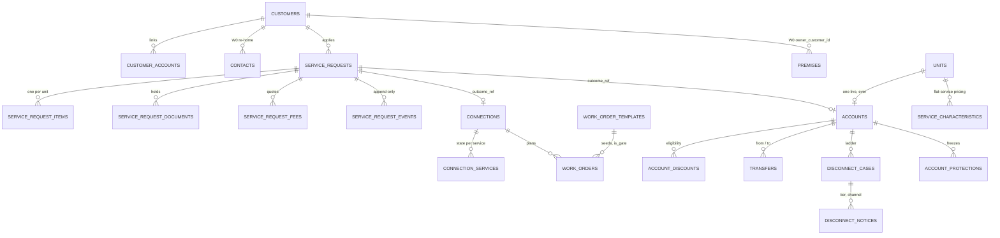

### 7.1 The three W0 amendments, and why they are first

| Change | Cost now | Cost later |
|---|---|---|
| `customers.customer_no` + `customer` series | one catalog row, one migration | a backfill across every account, and every carry-forward decided in the interim was decided by name |
| `premises.owner_customer_id` | one nullable FK | the connection invoice, the between-tenants question and the shortfall option all stay blocked |
| `contacts` → customer | **copy-then-cut, both readable during the overlap** | ⚠ **the one irreversible step in the CR** |

> ⚠ **The contacts re-home is planned as COPY-THEN-CUT, never a move.** Both
> readable during the overlap, with a switch-over commit and a separate cut
> commit. CR-030 step 8 states this as the rollback constraint.

### 7.2 Money columns

**Every money column in the new tables is `NUMERIC(18,4)` + `CHAR(3)`**, and
percentages `NUMERIC(18,6)` — the PO's re-sign of 2026-08-22, verbatim: *"We
already confirmed this - MOney 4 decimal, percentage 6 decimal , display both 2
decimal"*. **Existing `18,6` columns stay lawful containers**; the rule governs
what is written and what new columns declare. **Never float, never cents.**

---

## 8 · THE WORK-ORDER COUPLING — one request, many orders

> **PO, verbatim:** *"for water you ahve to inspect site and install, same is the
> case with gas, but for solar - you might do 3 or 4 service/work order"*
> and: *"utility may use our work order system or they mght do it outside of our
> system and record the details in system"*

### 8.1 The per-service order sets

| Service | Orders | The usual set | Gate |
|---|---|---|---|
| Electric | 1–2 | service drop → **meter set** | meter set |
| Water | **3** | site inspection & mark-out → tap and service line → **meter set** | meter set |
| Gas | **4** | inspection → service line and tap → meter set → pressure test and **light-up** | ⚠ **the light-up, not the meter set** |
| Sewer | 0–1 | tap and connection inspection | the water service it derives from |
| Thermal | 3 | inspection → service connection → **meter set** | meter set |
| Solar | **3–4** | interconnection application → inspection → net meter swap → commissioning and witness test | **permission to operate** |
| Battery | 1–2 | electrical inspection → commissioning | commissioning |
| Trash | 1 | container delivery | delivery recorded |
| Storm water | **0** | **assessed from records — no visit** | assessment recorded |
| Broadband | 1–2 | drop or equipment install → activate | activation |

⚠ **AMENDED 2026-10-03 (`DEF-WRK-9266`) — TWO ROWS ABOVE NAME HARDWARE NO LONGER FITTED.** Thermal is now
*inspection → **service connection*** (2 orders, gate: service connection) — `CR-080` took its meter off; solar is now
*interconnection application → inspection → commissioning and witness test* (3 orders) — `DEF-MET-9037` took its net
meter off. The rows are left as drawn; the seed (`W6_TEMPLATE_STARTERS`) is the live set. Decision log 2026-10-03.

**Gas is the one that catches people out.** Every other metered service is
billable once the meter is set; gas is not billable until the light-up, and a
lane that gates gas on the meter set will bill a customer with no gas.

### 8.2 Batching — the 25-unit arithmetic

**A template declares `scope`: per-premise · per-unit · per-asset.** Multi-unit
work **batches by default**.

```
500 Main Street · 25 units · E W S T +1
   per-premise orders : service drop · main tap · sewer connection      =  3
   per-unit batches   : meter set ×25 batched into 2 crew days          =  2
   per-premise        : pressure test · trash container delivery        =  2
                                                                   ───────
                                                                TOTAL = 7
```

**Seven orders, not seventy-six.** A *"split into individual orders"* control
exists for utilities that dispatch that way — **the batch is the default, not the
only option.**

### 8.3 The three modes — and why the list is identical in all three

| Mode | What the row asks for | Release |
|---|---|---|
| **We schedule it** | crew · skill · date · priority · dispatch · field completion | ⛔ **Later — the Work module is R5 (OQ-249)** |
| **Our crew did it** | a completion date and outcome per row | **v1** |
| **External system** | their reference, date, outcome, attachment | **v1** |

**The order list is identical in all three modes — only the right-hand columns
differ.** That is why the work plan can be built once, and why mode is settable
**per order**, not only per connection. A utility that does its own water work and
contracts out gas is the normal case, not the edge.

**Outcomes:** `passed` · `failed` (**raises a follow-up and puts the connection on
hold**) · `partially done` · `cancelled` · `waiting on someone else`.
**Dependencies:** blocked-by · parallel · cross-service.

---

## 9 · THE MONEY MAP — every dollar on these screens, classified

| Money | Where | Refundable | Posts to the ledger | State |
|---|---|---|---|---|
| **Application fee** | request, at submission | **No** — it pays for the assessment | via billing, never by the request | ❌ new |
| **Connection charges** | request quote → connection | No | via billing | ❌ new · ✅ **OQ-349 RULED 2026-08-24 → BR-CUS-083 — the DEVELOPER, via a master account** (`$14,390.00` on 25 units, invoiced once, not $575.60 per unit) |
| **Deposit** | move-in step 4, transfer step 4 | **Yes**, with interest | held, not revenue | ◑ `deposit_on_file` exists; **every write path is refused** (BR-CUS-023) |
| **Deposit interest** | account detail | Yes | — | ❌ **no column** (BR-CUS-057) |
| **Carry-forward** | move-in step 4 | n/a — it moves | a transfer between accounts | ❌ new · **`strong` match only** (BR-CUS-089) |
| **Final bill** | move-out step 3 | No | billing | ◑ |
| **Refund** | move-out step 4 | n/a | payments | ❌ new |
| **Shortfall** | move-out step 3 | n/a | **four paths, one disabled** | ❌ new · ✅ **OQ-346 RULED 2026-08-24 → BR-CUS-082** — path ① *pursue it* survives the close and **the ladder restarts at TIER 1**; ④ stays disabled for the landlord-agreement column |
| **Arrears following** | transfer step 4 | No | a transfer between accounts | ❌ new |
| **Base charge on a vacant unit** | — | No | billing | ❌ · ✅ **OQ-350 RULED 2026-08-24 → BR-MET-105 — the OWNER / LANDLORD pays the $30.50/mo**, via `premises.owner_customer_id`. ⚠ **Per empty unit or once per premises, and the gap before an owner is linked, are NOT ruled — W7 task 7.15** |
| **Base charge while cut** | disconnects | No | billing | ❌ new — *"still accruing base charges"* |
| **Reconnection fee** | reconnect | No | billing | ❌ new |
| **Write-off** | move-out step 3 | n/a | ledger, threshold-checked | ◑ threshold exists (S71 finance controls) |

**Four rules bind every row above.** Money is **4 dp stored / 2 displayed** ·
**only the ledger posting service writes journal lines** (hard rule 5) · **no
UPDATE or DELETE on an issued invoice or a payment** (hard rule 4) · **every money
action writes `audit_log`** (hard rule 7).

**`service_request_fees` never posts to the ledger itself.** It hands over to
billing, which owns invoices. A lane that posts from the request has broken the
module boundary.

---

## 10 · UI CONFORMANCE — how this CR stops the drift

> **PO, 2026-08-23, verbatim:** *"We are drifting lot when it comes to UI hence we
> need to be sure that we are building matching UI as provided prototype
> screensshots"*

**This section is not advice. It is a precondition on the whole CR**, and the
reason is mechanical rather than cultural.

### 10.1 Why the drift happens — the mechanism, precisely

The repo **has** an automated answer to *"does the app look like the design?"*:
**G14 `prototype_conformance`**, added 2026-08-10 from hard-won law 6, ratified
merge-blocking by the PO 2026-08-11. It reads the prototype HTML **at gate time**
and asserts that every tab label and guidance sentence the app ships is one the
prototype writes.

**And it has already failed silently once, in exactly this way.** `DEF-524`:
G14's source path was hardcoded to `UtilityBilling.html` (**r9**) and stayed
there for five days after the PO ruled r10 the reference. Its own docstring
records the cost:

> *"**It reported PASS through DEF-441, DEF-442, DEF-443, DEF-445, DEF-446 and
> DEF-520** — every UI divergence the PO found by opening the app. A permanently-
> GREEN gate is worse than the permanently-RED one DEF-490 was written about."*

**Six UI defects. One wrong path. The gate said PASS the whole time.**

### 10.2 The same failure is set up to happen again — and this is the finding

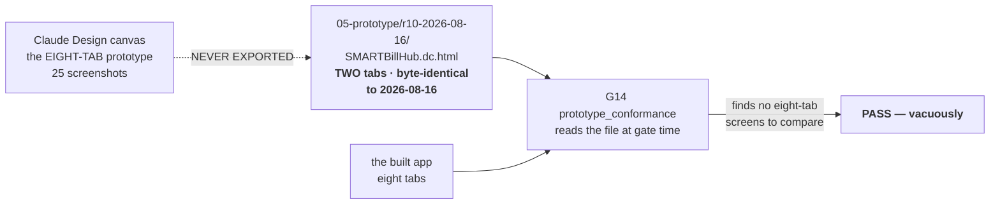

**`05-prototype/r10-2026-08-16/SMARTBillHub.dc.html` is byte-identical to its
2026-08-16 state and draws two Accounts tabs.** The eight-tab design exists only
in the Claude Design canvas and in twenty-five screenshots pasted into a chat
window. **A chat window is not a repo** (hard-won law 10). So:

* **G14 has nothing to compare these eight tabs against**, and will report PASS
  on every one of them however far they drift.
* **The next agent cannot see the screenshots at all.** Every `[shot]` stamp in
  this document is, for them, an unverifiable assertion by a previous session.

> ⛔ **D5 · EXPORT THE EIGHT-TAB PROTOTYPE INTO THE REPO AS `05-prototype/r11-2026-08-23/`
> BEFORE W2 STARTS, AND RE-POINT G14 AT IT.** This is the single highest-value
> item in the CR and it costs one file. Without it, *"build matching UI"* is a
> hope with no check behind it, and DEF-524 repeats with a different path.
> **Only the PO can produce the export** — the canvas is theirs.

### 10.3 What conformance means, made testable

Until D5 lands, this document's per-tab tables **are** the machine-readable
record: every label, column header, KPI caption, segment, placeholder, pill and
footnote in §5 is transcribed verbatim from a screenshot and stamped `[shot]`.
**A lane builds from those strings and a test asserts them.**

| TC | Assertion |
|---|---|
| TC-UI-1 | The tab strip is **exactly eight**, in order, and seven carry a count — Imports does not |
| TC-UI-2 | Every tab renders **exactly five** KPI tiles, each with label · figure · caption |
| TC-UI-3 | Every tab has search **and** segments **and** `+ Filter` **and** a column selector (the PO's uniform contract, §4) |
| TC-UI-4 | The header primary **relabels per tab** and there is **exactly one** primary on the page (B14 r4 / BR-SHL-044) |
| TC-UI-5 | Table body type is **13.5px** and headers **12px** on all eight tabs (the CR-016 gate already enforces this) |
| TC-UI-6 | Every list renders its **footnote sentence** under the pager |
| TC-UI-7 | Every detail view ends on an **Audit** tab |
| TC-UI-8 | No screen in this CR adds a class to a stylesheet — **Tailwind only** (B14 rule 21, G31 already enforces) |

### 10.4 The three checks that already exist and must not be silenced

| Check | What it catches here |
|---|---|
| **G14** | tab labels and guidance copy diverging from the prototype — **once D5 lands** |
| **G31 `declared_classes`** | a new screen reaching for `customers.css` instead of Tailwind (B14 rule 21) |
| **`12-smoke-walkthrough.mjs`** | a screen that renders nothing, a raw i18n key on screen, any 5xx — the class of defect a green suite cannot see |

**And the walkthrough must be extended to the eight tabs.** It currently walks
dashboard → premises → import → units → plans → settings. **CR-030's closure bar
(§8 of the change process) requires a person to perform each task in a browser**;
the walkthrough is how that becomes repeatable rather than a one-off afternoon.

> **Prove every new guard RED first** (hard-won law 7). Each conformance test
> above must be shown to fail against today's two-tab page before it is trusted
> green.

---

## 11 · THE BUILD — every task, in logical waves

**Wave order follows the PO's ruling of 2026-08-23**, not the tab-strip order:

> *"I will first build the entire account import wizard … then I will build
> Account tab, and account details view"*

W0 comes before it only because the import's `customer_no` column and the
account list's own search placeholder both depend on it, and it is one migration.

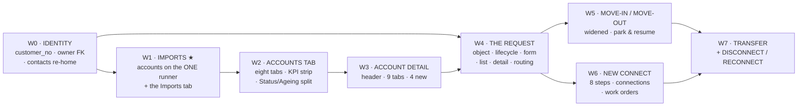

### W0 · Identity — *the cheapest thing that unblocks the most* · `2.41.0`

| # | Task | Kind |
|---|---|---|
| 0.1 | Add `customer` to `SERIES_CATALOG` (24th series), default `C-{00000}`, group `customers_premises` | backend |
| 0.2 | Migration: `customers.customer_no` + unique-within-tenant index | migration 🔒 |
| 0.3 | Backfill existing customers through the allocator; **gapless within the tenant** | migration 🔒 |
| 0.4 | Migration: `premises.owner_customer_id` FK, nullable, beside the free-text `owner_manager` | migration 🔒 |
| 0.5 | `contacts` re-home — **copy** to customer, both readable | migration 🔒 |
| 0.6 | Switch every reader to the customer-side contact | backend |
| 0.7 | `contacts` re-home — **cut**, separate commit | migration 🔒 |
| 0.8 | Settings → Numbering shows the new series and its preview | frontend |
| 0.9 | Tests: allocation · uniqueness · backfill count · isolation · both-readable overlap | tests |

**Closure:** a customer opened in a browser shows a number; the numbering setting
edits its format; a second tenant's series is independent.

### W1 · Imports ★ *built first* · `2.42.0`

| # | Task | Kind |
|---|---|---|
| 1.1 | `TARGET_ACCOUNTS = "accounts"` → `TARGETS` | backend |
| 1.2 | `ACCOUNTS_COLUMNS` — the 20-column field map (§5.9.3), each with label · kind · required · sample | backend |
| 1.3 | `ACCOUNTS_ALIASES` — header auto-detect | backend |
| 1.4 | The **not-offered** set with its reasons, as stated absences (G38) | backend |
| 1.5 | `unit` resolution at LOAD time via `KIND_UNIT_REF` — checked, never created | backend 🔒 |
| 1.6 | One-account-per-unit refusal in the validate stage | backend 🔒 |
| 1.7 | Rollback: refuse when any account in the run has been billed | backend 🔒 |
| 1.8 | `accounts` kind object in `kinds.ts`, `returnTo: "/accounts?tab=imports"` | frontend |
| 1.9 | The seven kind keys × **11 locales** (G15/G18 will fail otherwise) | i18n |
| 1.10 | **S81 Imports tab** — KPI strip, run table, rollback and fix row actions | frontend |
| 1.11 | `↑ Import CSV` **removed** from the Accounts header | frontend |
| 1.12 | Deprecate the 3-step modal; the route answers with a pointer, not a 501 | backend |
| 1.13 | **`account_opening_buckets`** + RLS migration — US-CUS-021 · `(tenant, account, import_batch, as_of, bucket, amount, currency)`, UNIQUE (account, bucket), append-only | migration 🔒 |
| 1.14 | The four bucket columns + the batch cutover date in the field map | backend |
| 1.15 | `accounts.balance` = **Σ buckets exactly**, no rounding | backend 🔒 |
| 1.16 | ~~A **negative** bucket is a row error **citing OQ-065**~~ ⚠ **CORRECTED 2026-08-24 — OQ-065 IS CLOSED (BR-CUS-061, PO 2026-08-08, option (b)). A negative opening balance is carried as an ACCOUNT CREDIT (BR-PAY-010 pattern) and the row LOADS; buckets stay debit-only. See §5.9.3b · DEF-620** — the shipped code refuses the row and is wrong; non-numeric remains an ordinary row error | backend 🔒 |
| 1.17 | LOAD calls **`opening_balances.post_opening_batch(...)`** — US-CUS-022. Customers writes no journal lines | backend 🔒 |
| 1.18 | The batch **refuses success unless Σ AR debits = Σ clearing credits** | backend 🔒 |
| 1.19 | All four buckets blank → balance 0.00, **no bucket rows, no JE** | backend |
| 1.20 | **US-CUS-020 value mapping** (BR-CUS-052) — the step S68 specified and the product never had (DEF-611) | full |
| 1.21 | **US-CUS-023** deposits with ORIGINAL receipt dates feeding interest accrual (BR-CUS-050/057) | full 🔒 |
| 1.22 | **BR-CUS-047 migration order enforced**: a row naming a missing unit is an error, never an auto-create | backend |
| 1.23 | Seed: the three `[shot]` runs, `RUN-2814` loading **1,247**; GT-16's `A-12103` buckets **84.20 / 62.10 / 0.00 / 121.00 = 267.30**; batch Σ **$184,320.55** | data |
| 1.24 | 14 `TC-IMP-*` (§5.9.5) + US-CUS-021's TC-1…TC-6 + **GT-16 drives the product, not a fixture** | tests |
| 1.25 | Extend `12-smoke-walkthrough.mjs`: accounts → Imports tab → stages 1→5 with a 3-row CSV carrying buckets | tests |

**Closure:** a person uploads a CSV of accounts against units, **maps their legacy
codes to our reference data**, sees the dry run, commits, reads the receipt showing
**Σ $184,320.55 migrated AR**, opens the trial balance and finds it **ties**, and is
refused a rollback on a billed account.

### W2 · The Accounts tab · `2.43.0`

| # | Task | Kind |
|---|---|---|
| 2.1 | The **eight-tab strip** with live counts; URL grammar per BR-SHL-011 | frontend |
| 2.2 | The **five-tile KPI strip**; the three billing-derived tiles **state their absence** | frontend |
| 2.3 | Split `Status` from **`AGEING`** — two columns, ageing derived (BR-CUS-016) | frontend |
| 2.4 | `GET /accounts?ageing=` segment filter | backend |
| 2.5 | ~~The `4 accounts` customer sub-link on the NAME cell~~ ⛔ **CUT BY PO RULING 2026-08-24 — *"okay dont link it"*.** Not built, and the two SERVER halves it needed are not built either (`account_row` serves no customer block; `ACCOUNT_FILTERS` has no `customer_id`, so the link could not have filtered). `TC-ACC-3`'s `it.todo` closes as **WON'T BUILD** — a todo left standing reads as work owed | ~~frontend~~ **CUT** |
| 2.6 | The `+3` service-chip overflow | frontend |
| 2.7 | Column selector on the Accounts tab | frontend |
| 2.8 | Header primary **relabels per tab**; `Export` secondary | frontend |
| 2.9 | **`CUSTOMER #` — THE COLUMN, THE SEARCH, THEN THE PLACEHOLDER (PO 2026-08-24: *"we were suppose to add customer # comlume what happened to that"*).** The stored column landed in W0 (`customers.customer_no`, migrations 0013 + 0014); what is owed is (a) `selectors.account_list` matching it, (b) the `CUSTOMER #` list column, (c) the placeholder — **in that order**, per B18's own *do not ship the placeholder before the column*. `TC-ACC-7` goes green on (a). → BR-CUS-053 amended | **full** |
| 2.10 | Seed: the eight `[shot]` account shapes — ✅ **AUTHORISED, PO 2026-08-24: *"so add them"***. Carries three upstream costs, all now in scope: metering must publish the seats, `core/sample_fixture.premises_plan()` grows to ~56 units, and tenancy/rating must enable ≥8 services | data |
| 2.11 | 7 `TC-ACC-*` + 8 `TC-UI-*` | tests |
| 2.12 | **BR-CUS-015 amended** — eight columns, dated, with its supersedes line | write-back |

### W3 · The account detail · `2.44.0`

| # | Task | Kind |
|---|---|---|
| 3.1 | Header: autopay pill · service chips with meter numbers · `Since Feb 2024` · three metric columns | frontend |
| 3.2 | The **seven-glyph icon rail** ✅ **D2 RULED 2026-08-24 → BR-SHL-045; BUILT.** ✉ Send statement · 🖨 Print bill · $ Issue credit · ⇄ Change plan · ⚡ Disconnect notice · 🗓 Payment plan · ✎ Add note — r10's own seven, in r10's order, in `AccountIconRail.tsx`. The label is each button's **accessible name** (`aria-label` + `title`, keyboard-reachable), not only a hover tooltip; the disconnect glyph takes B14's danger tier; the four with no endpoint are disabled WITH their module's reason (BR-SHL-025). ⚠ **AMENDED 2026-09-07 (`DEF-CUS-4631`): it is ONE disabled, not four.** Three of the four were refusing on questions the PO closed on 2026-08-12 and on tables that had since been built; they are now LIVE and their refusals DERIVED from facts about the account. Only ✉ Send statement still refuses, truthfully. **Nothing was lost** — the "ten" in the old docstring were these seven plus task 3.3's action stack | frontend |
| 3.3 | Action stack: `Record payment` primary · `Adjust` · `Move-out` | frontend |
| 3.4 | Overview: recent-bills panel + usage-trend chart + `→ Update method` | frontend |
| 3.5 | **Payments tab** — incl. the deposit row at `Held` | full |
| 3.6 | **Adjustments tab** | full |
| 3.7 | **Documents tab** — and the request carry-over lands here | full |
| 3.8 | **Usage tab** — chart + 5-metric strip. ✅ **THE FIGURE IS RULED (PO 2026-08-24: *"based on meter reading calculate monthly useage and save them and display them"*) → BR-MET-106: `Σ MeterRead.consumption` per calendar month per account per service, WITH its unit, STORED, restated (never edited) on a read correction, and an unread month renders ABSENT rather than `0`.** ⛔ **D3 (*Compare to neighbors*) is UNCHANGED and still unspecified** — the ruling covers the chart and the strip, not that link  ⚙ **BUILT 2026-08-24.** Backend: `meter_read_monthly_usage` in **metering** (the module that owns `meter_reads`; `customers` may not write it — B2 §2), migrations `metering.0024` + RLS `0025` in DEF-639's repaired `NULLIF(current_setting('app.tenant_id', true), '')::uuid` form, sole writer `monthly_usage_service.recompute_account` (idempotent on a SHA-256 of the lineage heads + quantity + unit; a restatement supersedes the head and inserts, never edits), read model `monthly_usage_reads.usage_payload`, endpoint `GET /accounts/{id}/usage?months=12|24`. Frontend: `features/customers/AccountUsageTab.tsx` — r10's segments, the 24-bar chart and the five tiles, verified in a browser at **628 kWh · 842 kWh (2026-07) · 412 kWh (2026-02) · +8.28% · 3.42 kgal**. ⚠ **ONE LINE IS OWED:** `AccountDetailPage.tsx` (another lane's file) still renders the STALE `ArrivesWith … tracks="DEF-475"` for this tab and must mount `<AccountUsageTab accountId={detail.id} client={props.client} t={translate} />` instead — until then G40 reports the component unmounted, correctly. ⛔ **D3 (*Compare to neighbors*) IS STILL UNSPECIFIED AND IS NOT DRAWN AT ALL** — omitted rather than disabled-with-a-reason, on the BR-SHL-010 precedent this same screen already uses for r10's read-log `Export`; nothing serves it and nothing stubs it. ⚠ **`All` is NOT one summed line** — hard rule 3 forbids adding kWh to kgal, so the payload carries one series per service and the segment picks. ⚠ **`OQ-358` minted**: a month whose reads for ONE service disagree about the unit refuses with `NotImplementedError("OQ-358")` rather than converting. | full |
| 3.9 | Meters tab re-specified against the **post-CR-028** model + the nested read log | frontend |
| 3.10 | **Notes tab: table → cards** | frontend |
| 3.11 | Audit tab: a **portal actor** in `USER` | full |
| 3.12 | Seed: `A-10432` with all nine tabs populated | data |
| 3.13 | 7 `TC-ACD-*` | tests |

### W4 · The request — *the front door* · `2.45.0`

> ⚠ **AMENDED 2026-08-24 by the CR-031 W4 FRONTEND lane.** Rows 4.10–4.16 carry
> a fourth column stating what was actually built, what was refused and why, and
> what each refusal is waiting on. Rows 4.1–4.9 and 4.17 are the BACKEND lane's
> and are not restated here — that lane's own report owns them.

| # | Task | Kind | Status (frontend lane, 2026-08-24) |
|---|---|---|---|
| 4.1 | Six tables + their RLS migrations (§5.3.7) | migration 🔒 |
| 4.2 | The ten-state lifecycle with its transition guards | backend |
| 4.3 | `submit` — number allocation, **idempotent** | backend 🔒 |
| 4.4 | `resolve-address` — **the classifier**, three outcomes | backend 🔒 |
| 4.5 | `match-customer` — tiers `strong`/`probable`/`weak`, confirmer stored | backend 🔒 |
| 4.6 | Fees: quote from charge codes, waiver with a reason; **never posts to the ledger** | backend 🔒 |
| 4.7 | Documents: required-per-tenant, carry-over to the account | backend | ✅ **BUILT — AND THIS ROW WAS STALE UNTIL 2026-08-25.** It read *"OQ-351 STILL OPEN … the SEED stays blocked"* while the registry had **CLOSED OQ-351 on 2026-08-24** to reading **(A)**, the tenant-set checklist → **BR-CUS-095**, and the code had landed: migrations `0019_cr031_br_cus_090_093_094_095` + `0020_rls_sr_document_requirements`, and the Settings screen `ServiceRequestDocumentSettingsPage.tsx` (the `5 × 8` checklist at `/settings/reference-data/service-request-documents`, **shipping entirely unticked** — that default is the ruling's sharpest clause and may not be softened with a helpful pre-tick). **THE SEED IS UNBLOCKED** — task 4.14 was held by this row alone and is not held by it any more. Two gates stand (B19 §5): attaching never blocks CREATION; an unverified required document blocks APPROVAL |
| 4.8 | `approve` / `refuse` — threshold-checked, reason codes | backend 🔒 |
| 4.9 | `route` — opens fulfilment, **links both ways** | backend |
| 4.10 | **S85 the applicant's form** — customer language, no utility terms | frontend | ✅ **BUILT 2026-08-24** (`07-frontend/src/features/customers/ServiceRequestCapturePage.tsx`) — the six steps on the shared `WizardFrame`, plus `REQ-03.sent`. ⚠ **BR-CUS-093's own worked example CANNOT be honoured and the screen says so instead of faking it:** the ruling is *"a clerk opens the form on Tuesday, the request is `SR-26-0048` from that moment"*, and `service_request_service._clean_capture(partial=False)` requires `address_as_given` (step **3**) and `applicant_name` before a row may exist. So `Save as draft` is disabled WITH that reason until both are typed, and the footer reads *"not saved yet"* rather than naming a number that does not exist. **NEEDS A DEFECT ROW AND A BACKEND CHANGE** (a nullable-at-draft create, or a ruling that the number arrives with the address) — this lane may not pick either. ⛔ **AND A SECOND DEFECT, FOUND ONLY BY THE BROWSER WALKTHROUGH (hard-won law 6): `POST /service-requests/{id}/category` ANSWERS 200 THE FIRST TIME AND 500 ON EVERY CALL AFTER IT.** `service_request_service.set_customer_category` builds its audit `before` blob from `request.account_type_id` / `.account_subtype_id`, which are `UUID` objects once set, and the audit row JSON-serialises `details` — `TypeError: Object of type UUID is not JSON serializable`. Measured against a running stack: call one **200**, call two **500**, call three with a DIFFERENT code **500**; `services` ×3, `resolve-address` ×2 and `PATCH` ×2 were each measured **200** and are idempotent. The same function's `after` block already writes `str(subtype.id)`, so the fix is `str(...)` on the two `before` values — one line in `06-backend/apps/customers/service_request_service.py`, which this lane may not edit. **A clerk who changes their mind about the customer category meets a 500 today.** The frontend now sends the category only when it CHANGES, which is the right shape anyway and is not a workaround for the defect — the defect is still reachable and is still owed a row ⛔ **No `Social Security Number` input is drawn** (BR-CUS-092(b)/(d)) and ⛔ **no file input** — `attach_document` stores a `storage_ref` and NO route in this product accepts a file for a service request, so the step records WHICH documents were brought and the control is disabled with that reason |
| 4.11 | **S83 list** — KPI strip, five type pills, age accent ⛔ **D4** | frontend | ✅ **BUILT 2026-08-24** (`ServiceRequestsListPage.tsx`) — the five KPI tiles, the eight columns, the five segments as a URL filter, and `DISCONNECT` as a lawful type (BR-CUS-091). ⛔ **THE AGE ACCENT IS NOT DRAWN AND D4 IS STILL OPEN.** B19 §12.1 could only bound the threshold *between 6 and 11 days*; `list_row` refuses to serve `age_is_accented` for that reason, and picking 7 here would resolve a decision by choosing a value. `TC-REQ-14` is asserted INVERTED — a 15-day row and a 2-day row are proved to be styled identically — and the case stays owed. ⚠ **The list is its OWN route (`/requests`), not the Accounts page's Requests tab** as B19 §12.1 draws it: `AccountsListPage.tsx` owns that eight-tab strip and was another lane's file in the shared tree. **The tab body is ONE line and it is OWED** — until it lands, that tab still renders an *arrives-with* note that is now FALSE |
| 4.12 | **S84 detail** — header, 3 actions, icon rail, 7 tabs | frontend | ✅ **BUILT 2026-08-24** (`ServiceRequestDetailPage.tsx`) — **SIX tabs**, not seven (B19 §12.2 draws `Applicant · Location & services · Documents · Fees · Decision · History`; the "7" in this row is B18's own earlier count and is stale), the three header actions, and `Save & exit` + `Park` as the TWO controls B19 §12.2 settles. ⛔ **THE SEVEN-GLYPH ICON RAIL IS NOT BUILT.** BR-SHL-045 names its seven for the ACCOUNT detail (send statement · print bill · issue credit · change plan · disconnect notice · payment plan · add note) and **not one has a service-request endpoint behind it**; a rail of seven disabled glyphs would be seven reasons nobody asked for. **NEEDS ITS OWN RULING**. ⚠ **AND ONE READ-MODEL GAP, REPORTED:** `service_request_reads.detail` serves **no category at all** — neither `account_type` nor `account_subtype` appears in any tab — so REQ-02 cannot show what a request was categorised as, and a half-finished draft reopened from the list cannot restore the chip the clerk picked. The column is written (`set_customer_category`) and never read back |
| 4.13 | The four unnumbered screens ⛔ **D1** | frontend | ⚠ **THREE OF FOUR BUILT, AND THE FOURTH CANNOT BE.** **Identity match** → the Decision tab's `Existing customer` panel (a panel, not a page — that is where B19 draws it), with the server's *"nothing matches automatically"* refusal on the control. **Review & approve** → the Decision tab's outcomes, conditions and commit. **Form definitions** → `ServiceRequestDocumentSettingsPage.tsx`, BR-CUS-095's `5 × 8` checklist at `/settings/reference-data/service-request-documents`, shipping ENTIRELY UNTICKED. ⛔ **The QUOTE BUILDER is NOT built**: the server answers `connection_quote: {raised: false, reason: "raised_after_review"}` with **no endpoint behind it**, so a builder drawn over it would be dead UI (hard-won law 2). What is built is the application-fee half; the quote half states its own absence on the panel it belongs to. **D1 IS STILL UNRULED** — A1 allocates no id for any of the four and r10 draws no `REQ-` badge, so all four routes carry `ids: NONE` with the reason on the row in `07-frontend/src/routing/screenIds.ts`, and **these screens draw no visible tag** |
| 4.14 | Seed: the eight `[shot]` requests, **cross-wired to five tabs** | data | ❌ **NOT DONE** — a DATA task, outside the W4 frontend lane. **J26 cannot run without it**: the journey has no fixture. Now UNBLOCKED (BR-CUS-095 closed OQ-351, which was the only thing holding it) |
| 4.15 | 14 `TC-REQ-*` | tests | ⚠ **PARTIAL, AND THE SPLIT IS DELIBERATE.** 56 frontend cases across four suites (`ServiceRequestsListPage.test.tsx` · `ServiceRequestDetailPage.test.tsx` · `ServiceRequestCapturePage.test.tsx` · `ServiceRequestDocumentSettingsPage.test.tsx`), covering the frontend half of TC-REQ-2 · 4 · 6 · 7 · 9 · 13 · 14 plus BR-CUS-089/090/091/092/095. **TC-REQ-8 · 11 · 12** (an approval threshold, the two-way child link, tenant isolation) are SERVER cases with no frontend surface and live in `06-backend/tests/test_cr031_service_request*.py`. **TC-REQ-14 is asserted INVERTED** — see 4.11 |
| 4.16 | **J26** journey | e2e | ⚠ **WRITTEN, NOT ACTIVATED** — `08-qa/01-e2e/journeys/J26-request-to-service.md`, eleven steps with the handoff contract per step. There is no `J26.spec.ts` (task 4.14's fixture does not exist), and its `stories:` list is **EMPTY, which is a finding**: hard-won law 8 — B18 proposes S83/S84/S85 and `05-user-stories.md` stops at US-CUS-023, so **no story owns any of the three screens this wave built**. Three stories are owed |
| 4.17 | BR-CUS-069…074 written to `04-docs/05-modules/*/02-business-rules.md` **before the code** | write-back |

### W5 · Move-in and move-out widened · `2.46.0`

| # | Task | Kind |
|---|---|---|
| 5.1 | Park & resume on **every** wizard — the nine reasons, the step bar, the `WAITING ON` column | frontend + backend |
| 5.2 | Move-in step 3: the asset panel, **post-CR-028** — `GET /units/{id}/assets` | full |
| 5.3 | Move-in step 4: rates, charge codes, taxes, a worked month — `GET /units/{id}/pricing` | full |
| 5.4 | Move-in step 4: eligibility panel + ~~`account_discounts`~~ **`discount_enrolments`** (⚠ CORRECTED 2026-08-27, DEF-675 — the table this row named does not need building; the six columns exist) | full |
| 5.5 | Move-in step 4: deposit carry-forward, **`strong` match only** | backend 🔒 |
| 5.6 | Move-in step 5: the *"what we'll send"* panel — **drawn against an adapter that does not exist**, and says so | frontend |
| 5.7 | Move-out step 3: **the impact screen**, seven panels | frontend |
| 5.8 | Move-out step 3: the shortfall decision, **four options, option ④ disabled with BR-CUS-068's reason** | full 🔒 |
| 5.9 | Move-out step 4: refund path | full 🔒 |
| 5.10 | ~~⛔ Stubs: `NotImplementedError("OQ-346")` · `("OQ-347")` · `("OQ-350")`~~ ⚠ **CORRECTED 2026-08-24 — ALL THREE ARE RULED; THERE ARE NO STUBS LEFT IN W5.** **OQ-346 → BR-CUS-082** (the $175.20 is chased on, ladder restarts at TIER 1) · **OQ-347 → BR-CUS-081** (settle $142.30 from the $153.50 deposit, refund $11.20) · **OQ-350 → BR-MET-105** (the $30.50/mo on an empty unit is the owner's). W5 builds the impact screen's sentence and the settle-and-refund path; **the ladder itself and the empty-unit biller are W7's** (tasks 7.15, 7.16) | backend |
| 5.11 | Seed: 5 move-ins (2 drafts) + 6 move-outs (the two OQ fixtures) | data |
| 5.12 | 10 `TC-MVI-*` + 10 `TC-MVO-*` | tests |
| 5.13 | **J08 amended** with the shortfall paths | e2e |
| 5.14 | **BR-CUS-030 amended**, dated, with its supersedes chain | write-back |

### W6 · New Connect — *the largest single build* · `2.47.0`

| # | Task | Kind |
|---|---|---|
| 6.1 | Five tables + RLS (§5.4.6) | migration 🔒 |
| 6.2 | The connection state machine, **plus a state per service** | backend |
| 6.3 | `work_order_templates` seeded with the **ten per-service sets and their gates** (§8.1) | data |
| 6.4 | Batching: scope per-premise/per-unit/per-asset; **25 units → 7 orders**; the split control | backend 🔒 |
| 6.5 | Dependencies: blocked-by · parallel · cross-service | backend |
| 6.6 | Outcomes, incl. `failed` → follow-up + connection `On hold` | backend |
| 6.7 | The **three modes**; identical list, different right-hand columns; **mode per order** | frontend |
| 6.8 | `energise` **per service, gate-checked** — gas on the light-up, solar on PTO, sewer on water | backend 🔒 |
| 6.9 | ~~⛔ `service_characteristics` — stub `NotImplementedError("OQ-348")` for trash/storm/broadband~~ ⚠ **CORRECTED 2026-08-24 — OQ-348 IS RULED → BR-MET-104: the pricing characteristic lives on the UNIT** (`metering.Unit.square_feet` is the precedent). Build it for trash, storm water and broadband; the stub goes | backend |
| **6.9a** | ⚠ **SETTLE THE SHAPE BEFORE THE MIGRATION IS WRITTEN — and this task precedes 6.1.** BR-MET-104 fixes **WHERE** the characteristic lives, **not HOW MANY**: one unit may take **trash AND storm water AND broadband at once**, which is **three** characteristics with **three** units of measure (container count · impervious area · speed tier). So unit-level means **either a column per service on `units`** — a schema that grows with the ten-service catalogue, which is exactly what B2 §2's reviewed-interface rule exists to make somebody think about — **or a value table keyed by unit-and-service** (the `service_characteristics` shape §5.4.6 draws). `square_feet` is one column because there is one of it; the flat services are not. **Decide, record the decision with its worked case, THEN migrate.** A migration written before this is written twice | **decision → migration 🔒** |
| 6.10 | ~~⛔ Connection charges payer — stub `NotImplementedError("OQ-349")`~~ ⚠ **CORRECTED 2026-08-24 — OQ-349 IS RULED → BR-CUS-083: the DEVELOPER, via a master account.** `CON-26-0117`'s **$14,390.00** raises **one** invoice against BR-CUS-068's `accounts.kind='master'` row, opened at approval — **not $575.60 against each of the 25 units**. Note before building: the master account exists **before any resident account does**, so the charge is raised against a party who may never take service at the premises | backend 🔒 |
| 6.11 | **S87** the 8-step wizard; step 3 collapses to one row for a house | frontend |
| 6.12 | **S86** list — `5 of 9` orders progress, five segments | frontend |
| 6.13 | **S88** connection detail | frontend |
| 6.14 | Work-order detail + templates screens ⛔ **D1** | frontend |
| 6.15 | Seed: 8 connections incl. `CON-26-0117` (**25 units, 7 orders**) + ~45 work orders | data |
| 6.16 | 9 `TC-NCT-*` | tests |
| 6.17 | **J27** journey | e2e |

### W7 · Transfer, then disconnect · `2.48.0`

| # | Task | Kind |
|---|---|---|
| 7.1 | `transfers` table + RLS; 5 steps; one commit for both halves | full 🔒 |
| 7.2 | **The exclusion contract** — a transfer appears in neither Move-ins nor Move-outs, with a test | tests |
| 7.3 | Deposit carries **without** a refund-and-recollect; arrears follow | backend 🔒 |
| 7.4 | **S89** transfers tab — two-line FROM cell, stacked MONEY sentences | frontend |
| 7.5 | `disconnect_cases` · `disconnect_notices` · `account_protections` + RLS | migration 🔒 |
| 7.6 | The ladder: tiers 1–3, **and it stops itself** on payment or plan | backend 🔒 |
| 7.7 | The three protections, each with its own lifetime | backend 🔒 |
| 7.8 | The cut — danger tier, `audit_log`, **base charges keep accruing** | full 🔒 |
| 7.9 | Reconnect flow | full |
| 7.10 | `LAST NOTICE` renders **the absence of a delivery adapter**, never a fabricated `emailed` | frontend |
| 7.11 | **S90** disconnects tab — six tier chips, six segments | frontend |
| 7.12 | Seed: 5 transfers + 9 disconnects (all tiers, all protections) | data |
| 7.13 | 6 `TC-TRF-*` + 9 `TC-DSC-*` | tests |
| 7.14 | **J28** and **J29** journeys | e2e |
| **7.15** | ⚠ **THE EMPTY-UNIT BASE CHARGE — BR-MET-105 (PO 2026-08-24, OQ-350 closed).** The **$30.50/month** on a unit sitting empty between tenants **accrues to the owner / landlord**, reached through `premises.owner_customer_id` (W0), and it is a real receivable against a real party: **balanced pair, ledger posting service only** (hard rule 5), **`audit_log` on the money action** (hard rule 7). The five seeded `occupancy_statuses`, consumed by nothing until now, become load-bearing. ⚠ **TWO THINGS THE RULING DOES NOT SETTLE, AND THE BILLER MUST NOT ASSUME EITHER: (1) is the owner billed PER EMPTY UNIT or ONCE PER PREMISES?** — a 25-unit building with 6 empty units is either six $30.50 lines or one, and **$183.00 vs $30.50 is the difference on one bill**; **(2) what happens BEFORE an owner customer is linked?** — `premises.owner_customer_id` is nullable and an empty unit under an unlinked premises has no payer at all. **Raise both with the PO BEFORE writing the biller, not after**; until they are ruled the accrual is measured and reported, never silently posted to a guessed party | **decision → backend 🔒** |
| **7.16** | ⚠ **THE POST-CLOSURE LADDER — BR-CUS-082 (PO 2026-08-24, OQ-346 closed).** A debt surviving account closure is **still chased** and the ladder **RESTARTS AT TIER 1** — it does not resume the tier reached before closure. Worked: `A-11024 · Ridge Coffee Co.`, **$175.20** short after a **$153.50** deposit against **$328.70**. **A closed account cannot be escalated to disconnection** — there is nothing left to disconnect — so this is a **collections** ladder, not a service one, and tasks 7.6–7.8's cut path must be unreachable from it. **BR-CUS-030's `dunning stops` is superseded for this case only**; an account closing at zero still stops | backend 🔒 |
| **7.17** | ⚠ **THE SETTLE-AND-REFUND CLOSE — BR-CUS-081 (PO 2026-08-24, OQ-347 closed).** Where the deposit is worth more than everything owed, **settle from the deposit and refund the difference** — **$153.50** deposit settles a **$142.30** final bill and **$11.20** is refunded; **the bill does not stand.** Both movements write `audit_log`; the settlement is a **new row**, never an edit of the issued bill (hard rule 4). Shares the W5 refund path (task 5.9) — stated here because the ruled behaviour is a collections/closure rule | full 🔒 |

### 11.1 Task totals

| Wave | Tasks | Version | Depends on |
|---|---|---|---|
| W0 Identity | 9 | `2.41.0` | — |
| **W1 Imports ★** | **25** | `2.42.0` | W0 (for `customer_no`) · EP-CUS-07 |
| W2 Accounts tab | 12 | `2.43.0` | W1 |
| W3 Account detail | 13 | `2.44.0` | W2 |
| W4 The request | 17 | `2.45.0` | W0, W3 |
| W5 Move-in/out | 14 | `2.46.0` | W4 |
| W6 New Connect | ~~17~~ **18** | `2.47.0` | W4 |
| W7 Transfer + disconnect | ~~14~~ **17** | `2.48.0` | W5, W6 |
| **Total** | ~~**121**~~ **125** | | |

⚠ **W6 AND W7 RECOUNTED 2026-08-24 (write-back lane), after the PO's twelve
rulings.** **W6 +1:** task **6.9a** — settle the flat-service characteristic's
SHAPE (a column per service on `units` vs a value table keyed by unit-and-service)
**before the migration is written**; BR-MET-104 ruled WHERE the number lives, not
HOW MANY there are. **W7 +3:** tasks **7.15** (the empty-unit base charge,
BR-MET-105 — **and the two things it leaves unruled**), **7.16** (the post-closure
ladder, BR-CUS-082) and **7.17** (settle-and-refund at close, BR-CUS-081). No task
was removed: 5.10, 6.9 and 6.10 change from *stub* to *build*, they do not
disappear.

🔒 marks a **sensitive path** (CLAUDE.md): RLS, money rounding, idempotency keys,
migration ordering. Each gets a `HUMAN-REVIEW-PENDING` flag and a row in
`12-governance/09-human-review-ledger.md` (G7 enforces).

**Every wave bumps both version literals in one commit** —
`07-frontend/package.json` and `06-backend/pyproject.toml`, which have agreed at
`2.40.3` since CR-018 Phase 2b. **G35 `version_lockstep` enforces the pair.**

### 11.2 Rollback, per wave — stated before shipping

* **W0** — additive migrations, reversible. ⚠ **except 0.7, the contacts cut**,
  which is why it is a separate commit after 0.6 proves the new reader works.
* **W1** — the runner target is a tuple entry; removing it removes the target.
  The 3-step modal stays reachable until W1 closes.
* **W2–W7** — new tables and new screens. **Rollback is a feature flag on the tab
  strip**: the eight tabs collapse to `Accounts │ Imports` and every existing
  wizard is reached exactly as it is today.

---

## 12 · THE PO AGENDA — six questions and five decisions

~~**Nothing here is decided by this document.**~~ ⚠ **STILL TRUE OF THIS
DOCUMENT, BUT NO LONGER TRUE OF THE AGENDA — CORRECTED 2026-08-24 (write-back
lane).** The PO ruled **five of the six questions** in one message on 2026-08-24;
the rulings are recorded verbatim in `12-governance/02-decision-log.md`
(*"TWELVE PO RULINGS IN ONE MESSAGE"*), the questions are **CLOSED** in
`12-governance/01-open-questions.md`, and each has a business rule. **§12.1 below
carries the ruling and its worked figure per row.** **D1–D5 in §12.2 are
untouched and remain unruled.** Each item is put in plain English with a concrete
figure, per the standing instruction (*"never as an ID to go and look up"*).

### 12.1 The six questions CR-030 minted — **five RULED 2026-08-24, one still open**

| OQ | In plain English | The figure | Blocks | **Ruling — PO 2026-08-24** |
|---|---|---|---|---|
| **OQ-346** | When a customer leaves owing more than their deposit covers, do we keep chasing the debt after the account is closed? And if we do, does the reminder ladder start again or carry on from where it had reached? | **$175.20** short | ~~W5 · the move-out close~~ **lifted; the ladder is W7** | ✅ **CLOSED → BR-CUS-082.** *"(b) continue, ladder restarts"* — **the $175.20 is still chased after the close, and the ladder starts again at TIER 1**, not from the tier reached. **Supersedes BR-CUS-030's `dunning stops` for the closed-with-balance case only.** A closed account cannot be escalated to disconnection |
| **OQ-347** | When the deposit is worth **more** than everything owed, do we settle the bill and refund the difference, or refund the whole deposit and leave the bill standing? | **$153.50** deposit vs **$142.30** owed → **$11.20** | ~~W5~~ **lifted; W7 owns the shape** | ✅ **CLOSED → BR-CUS-081.** *"a) settle and refund the $11.20"* — **settle the $142.30 from the $153.50 deposit and refund $11.20; the account closes at zero and the bill does NOT stand.** Both movements write `audit_log`; the settlement is a new row, never an edit |
| **OQ-348** | Trash, storm water and broadband are priced on a number — bins, square feet of hard surface, speed — and the product has nowhere to keep any of them. Do we add a "service characteristic" to the unit, or extend asset types? | 3 of 10 services unpriceable | ~~W6 · those three services only~~ **lifted** | ✅ **CLOSED → BR-MET-104.** *"(a) a characteristic on the service point - we ahve it on unit"* — **a typed characteristic, and it lives on the UNIT** (`metering.Unit.square_feet` is the precedent). ⚠ **WHERE, not HOW MANY:** a unit taking trash AND storm water AND broadband needs **three** characteristics with three units of measure, so **W6 task 6.9a settles column-per-service-on-`units` vs a value table keyed by unit-and-service BEFORE it writes a migration** |
| **OQ-349** | A developer builds 25 units and owes the connection charges. Does the bill go to a master account for the building, or to the first account opened on each unit? | **$14,390.00** | ~~W6~~ **lifted** | ✅ **CLOSED → BR-CUS-083.** *"a) the developer, via a master account"* — **one invoice for $14,390.00 to the developer through BR-CUS-068's `accounts.kind='master'` row**, not $575.60 against each of the 25 units. The master account exists before any resident account does |
| **OQ-350** | While a unit sits empty between tenants, somebody is still paying the standing charge. Who? | **$30.50/month** | ~~W5 · the move-out impact screen~~ **lifted for the screen; the biller is W7** | ✅ **CLOSED → BR-MET-105.** *"(a) the owner/landlord"* — **the $30.50/month accrues to the owner/landlord**, via `premises.owner_customer_id` (W0); the five seeded `occupancy_statuses` become load-bearing. ⚠ **NOT RULED, and W7 task 7.15 must raise both before the biller is written: per empty unit or once per premises, and what happens before an owner customer is linked** |
| **OQ-351** | Which documents must be on file before a request can be approved — a list each utility sets for itself, or one fixed list? | 8 document types | W4 · the seed only | ⛔ **STILL OPEN — ASKED, NOT UNASKED.** Put to the PO 2026-08-24; the answer was *"i will give you details"*, **a promise of input, not a ruling**. Neither the tenant-set checklist nor the fixed list is chosen and **no lane picks one**. The build stays unblocked; **the seed stays blocked** |

### 12.2 The five decisions this document opens

| D | The decision | Why it cannot be taken by a lane |
|---|---|---|
| **D1** | **Screen ids.** S61–S80 are all allocated; **ten slots remain (S81–S90) and this CR needs sixteen.** The next free ground is **S115**. | Allocation is the PO's and G17/G29 exist to stop a collision |
| **D2** | ✅ **RULED AND BUILT 2026-08-24 — see BR-SHL-045.** ~~The account-detail icon rail is seven glyphs in the screenshot and ten in the code's own docstring. Which three left, and what does each of the seven do?~~ **The PO chose *"Seven icons, label appears on hover"***, and the rail ships as ✉ Send statement · 🖨 Print bill · $ Issue credit · ⇄ Change plan · ⚡ Disconnect notice · 🗓 Payment plan · ✎ Add note — r10's own seven, transcribed from its markup. ⚠ **THE "SEVEN VS TEN" WAS A MISCOUNT, NOT A CUT: none of the ten ever left.** The ten are these seven PLUS Record payment, Adjust and Move-out, and those three are task 3.3's action stack below the rail. The docstring that said otherwise is what created this question, and it is corrected. **Built beyond the literal words, deliberately:** the label is the button's ACCESSIBLE NAME (`aria-label` + `title`, keyboard-reachable), which hover merely reveals — hover is a mouse, and one of the two glyphs a touch user would be guessing between SENDS A DISCONNECT NOTICE. That one takes B14's danger tier. | ~~A picture cannot say what a glyph does~~ **ANSWERED** |
| **D3** | **"Compare to neighbors →"** appears on the Usage tab. Nothing specifies it — what it compares, to whom, and whether it is legal to show. | New feature, and possibly a privacy question |
| **D4** | **The age accent threshold** on the Requests tab. `15d` and `11d` are accent; `5d` is not. Proposal: **7 days**. | A number the customer's service standard should set |
| **D5** | ⚠ **Export the eight-tab prototype into `05-prototype/r11-2026-08-23/` and re-point G14 at it — before W2.** | **Only the PO holds the canvas**, and without it the one automated UI check passes vacuously (§10.2) |

**D5 is the one to take first.** The other four change what gets built; D5 changes
whether we can tell.

---

## 13 · PROTOTYPE OBSERVATIONS — recorded so conformance does not copy them

Recording these follows CR-028 §11's precedent: a divergence noticed in the
design artefact is written down, so a lane building to conformance does not
faithfully reproduce a mistake.

| # | Where | Observation |
|---|---|---|
| 1 | **ACC-02 Imports** | **Two `↑ New import` primaries** — one in the page header, one in the toolbar. B14 rule 4 / BR-SHL-044 allow **exactly one**. Build one, in the header. |
| 2 | **Accounts tab** | The search placeholder offers **`customer #`**, which does not exist until W0. The placeholder must not ship before the column. |
| 3 | **DSC-01** | `LAST NOTICE` shows `emailed` · `posted` · `certified sent` · `certified signed`. **There is no email, SMS or print adapter in this release.** Render the absence; do not fabricate a delivery state. |
| 4 | **MVO-01 / DSC-01** | `A-11780` is **`Delgado, Pilar`** on Move-outs and **`Whitfield, Dana`** on Disconnects — the same account number, two customers. A fixture slip; the seed must pick one. |
| 5 | **ACC-01 detail** | The `Deposit & credit` panel shows `Interest accrued $3.20` and `Credit tier A`. **Neither has a column or a computer** (BR-CUS-057 / BR-CUS-058). Both must render as not-recorded with their rule — never as a figure. |
| 6 | **ACC-01 detail** | `Portal access · Last login 3 days ago` — **BR-CUS-028: portal data is not fabricated in v1.** |
| 7 | **REQ-01** | The `TYPE` column draws five types while the design carried two. **Taken as correct and adopted** (§5.3), but it widens the CR and is recorded as such. |

---

## 14 · WHAT THIS DOCUMENT DOES NOT DO

* **It decides nothing.** Six questions and five decisions go to the PO (§12).
* **It allocates no screen ids** — ten are proposed, six have nowhere to go (D1).
* **It touches no frozen figure.** Nothing in B4 or B5 moves; no finance re-sign
  is needed (CR-030 step 2).
* **It does not build the portal.** The request must be clerk-raiseable without
  one, from day one.
* **It does not build work scheduling, dispatch, crews or the map** — R5, OQ-249.
* **It does not build the delivery adapter**, which it names as a prerequisite in
  four places and which no wave here delivers.
* **It does not add a service to a live account** — designed, deliberately
  deferred to its own CR.

---

**Supersedes:** the four design analyses of 2026-08-22 (the Accounts brief, the
front-door analysis, the consumer-onboarding document and the eight Claude Design
instruction sets), held outside the repo at the PO's instruction. Where this
document and those differ, **this one is right** — and two of their claims are
corrected explicitly: master accounts **do exist** (§5.6.4) and the assets model
**has changed** (§5.5.3).


---

## §5.4.9 · NEW CONNECT AS DRAWN — the nine screens captured 2026-08-25

The PO sent the New Connect screens while W6's schema lane was still writing.
Captured here **verbatim from the drawing**, because §5.4.6's table list predates
them and three of the facts below contradict or extend it. Screen ids as the
prototype stamps them: `NCT-01`, `NCT-02.overview`, `NCT-02.units`,
`NCT-02.orders`, `NCT-02.assets`, `NCT-02.charges`, `NCT-02.history`.

### NCT-01 — the list

Tabs carry counts (`New Connect ⁷`). Header actions `Export` and **`+ New
connect`** (primary). Five KPI tiles, with their subtitles:

| Tile | Figure | Subtitle |
|---|---|---|
| OPEN | **7** | service being established |
| WAITING ON INSPECTION | **2** | nothing can pass until they attend |
| PARTLY ENERGISED | **3** | some services billing, some not |
| UNITS AWAITING ENERGISATION | **42** | across the 7 open builds |
| OLDEST | **19 days** | CON-26-0119 · waiting on permit |

Segments: `All · In progress · Waiting · Partly energised · Done`. Search takes
*"Connection #, premise, address, applicant, or request"*.

Columns — `CONNECTION · PREMISE · UNITS · SERVICES · ORDERS · TARGET · WAITING ON
· STATE`. The eight seeded rows §5.4.8 promises, five of them drawn:

```
CON-26-0110  3450 Oak Ridge Dr   1   E W          5 of 5  Aug 14  —           Energised
CON-26-0119  77 Foundry Row      1   E W G        5 of 9  Sep 08  permit      On hold
CON-26-0121  14 Willow Bend      1   E W          2 of 5  Sep 15  materials   In progress
CON-26-0126  8 Quarry Lane       1   E W G        3 of 9  Sep 22  inspection  Partly energised
CON-26-0117  500 Main Street    25   E W S T +1   5 of 7  Sep 30  inspection  Partly energised
```

`ORDERS` is *done of total* with a progress underline. `SERVICES` is the
two-character badge set with a **`+1`** overflow chip. `WAITING ON` is a short
free noun — `permit`, `materials`, `inspection`, or `—`.

⚠ **CON-26-0119 IS `5 of 9` AND `On hold` AT THE SAME TIME.** A hold outranks
progress and does not erase it, which is why the connection's own state is
derived from its services rather than replacing them.

### THREE STRUCTURAL FACTS THE DRAWING SETTLES THAT §5.4.6 DID NOT

**1 · `mode` IS ON THE WORK ORDER.** §6.3 lists `mode` on `connections`; the Work
orders tab draws a **MODE** column per order (every row `Our crew`). The screen
is the reference (PO 2026-08-16).

⚠ **THIS CLAUSE ORIGINALLY READ *"nullable, inheriting the connection's"* AND
THAT WAS AN INFERENCE, NOT A DRAWN FACT — CORRECTED 2026-08-25.** The picture
shows only that MODE is a per-order column. The building lane read this capture,
disagreed, and argued it out rather than following it; its case is better than
mine and the code STAMPS the mode NOT NULL on each order:

* **A mode describes WORK, and some of that work is finished.** Under
  inheritance, editing the connection's column relabels an order completed in
  March as `external` in April, **with nothing recording that it moved**. That is
  precisely the hazard `invoice_lines.tariff_version_id` is stamped to avoid, and
  the locked-at-issue snapshot CLAUDE.md already records.
* **§8.3's own economics point the same way** — *"a utility that does its own
  water work and contracts out gas is the normal case, not the edge"*. Mixed is
  ordinary, and a column that is usually NULL and occasionally not is a worse
  record of an ordinary thing than one that always says.

Both shapes are single-truth; they disagree about which way inheritance runs.
The stamped reading holds, and the decision is visible in
`test_w6_mode_is_stamped_on_the_order_and_the_connection_reading_is_derived` —
the test that would have to be rewritten to reverse it.

**2 · `is_gate` SHOWS AS A FLAG ON THE ORDER IT PRODUCED.** `WO-4902 Meter set ·
electric 🚩` and `WO-4905 Meter set · water 🚩` carry it; the other three do not.
⚠ **And for GAS the gate is the light-up, not the meter set** (§8.1).

**1a · `waiting_on` IS ITS OWN COLUMN AND IS *NOT* THE HOLD'S REASON.** Found by
the building lane, in the drawing, and it is not obvious: **two of the five drawn
rows wait while NOT held** — `CON-26-0121` is `In progress` waiting on
`materials`, `CON-26-0126` is `Partly energised` waiting on `inspection`. Only
`CON-26-0119` is `On hold` (waiting on `permit`). So a connection can be waiting
without being held, and folding the two together would lose that.

**1b · NCT-01's `Waiting` AND `Done` SEGMENTS ARE NOT STATE TOKENS, AND NO
SEGMENT RULE IS DERIVABLE FROM THE DRAWING.** No drawn row carries either word in
its STATE cell. Worse, **`CON-26-0126` is `Partly energised` AND waiting on
inspection at once**, so it satisfies two segments and nothing says which
exclusive one holds it. No rule shipped; recorded as owed.

**3 · `scope` TAKES THREE VALUES AND THEY ALL APPEAR IN ONE CONNECTION** —
`Premise` (service drop; site inspection), `Unit` (tap & service line), `Asset`
(both meter sets). `WAITS FOR` is `blocked_by` and draws a **chain**:
`WO-4905 → WO-4904 → WO-4903`. `OUTCOME` is `Passed`.

### NCT-02 — the detail

`CONNECTION CON-26-0110 [Energised]` · **3450 Oak Ridge Dr** · *"single unit ·
Rodriguez, M. · from request SR-26-0018"* · *"Started Aug 12 · target
energisation Aug 14"*. Three figures across the head: **PROGRESS 5 of 5 orders**
· **WAITING ON Nothing** (*not blocked*) · **CHARGES $2,340.00** (*paid Aug 15*).
Actions: `Continue setup →` (primary) · `Add work order` · **`Cancel
connection`** (danger tier). Six-icon rail. Tabs: Overview · Units · Work orders
· Assets · Charges · History.

✅ **TASK 6.2's "STATE PER SERVICE" IS DRAWN LITERALLY**, side by side:

```
ELECTRIC   Energised   1 of 1 units · Aug 18
WATER      Energised   1 of 1 units
```

A connection-service carries its own state, a *units energised of units total*
count, and an energisation date.

**Overview** also draws `Sub-meter links 1`, `Plan assignments 1`, a **What's
left** list (*1 outstanding: ⚠ Occupancy set per unit — "Not yet occupied —
vacant with service off"*), and a newest-first **Timeline**.

**Units** — bulk action `Set occupancy for selected units`; columns `UNIT · TYPE
· SERVICES · METERS · PLAN · OCCUPANCY · ACCOUNT`; the row reads `Whole property
· House · E W · 2 · Residential Standard · [Vacant · service off] · —`.
⚠ **A NEW CONNECT ENDS WITH UNITS VACANT, SERVICE OFF AND NO ACCOUNT.** That is
the terminal state, not an incomplete one — an account arrives with a move-in.

**Work orders** — `5 of 5 orders complete`, and the footer reads *"5 orders for a
single unit — nothing to batch."* beside a **`Split into individual orders`**
button. **Batching is suppressed at one unit** (task 6.4).

**Assets** — `Installed assets · 2 meters · 1 sub-meter links`; columns `ASSET ·
SERVICE · KIND · UNIT · SIZE · MULT. · READ METHOD · PARENT · STATUS`; rows
`M-5001 E Meter · Whole property · 5/8" · 1 · AMR · — · Installed` and `M-5002 W`
identically. A red-ruled note: **SUB-METERED — *"A single unit has no
sub-metering — each meter bills its own service directly."***

**Charges** — `One-time charges [paid Aug 15]`; columns `CHARGE · BASIS · RATE ·
× UNITS · TOTAL`:

```
Connection fee · electric  CC-CONN-E  per unit          $185.00  1  $185.00
Tap fee · water            CC-TAP-W   per unit, 5/8"    $310.00  1  $310.00
Meter set                  CC-MSET    per meter          $45.00  2   $90.00
Inspection                 CC-INSP    per premise       $120.00  1  $120.00
                                                        Total       $2,340.00
```

⚠ **`185 + 310 + 90 + 120 = 705`, NOT `2,340`.** The drawn total is
`CON-26-0117`'s — see DEF-676. The BASIS column is the load-bearing part: a
charge is priced **per unit · per meter · per premise**, and a tap fee carries
the meter size (`per unit, 5/8"`). Footnote: *"These lines came from request
SR-26-0018's quote and were **not re-priced**."*

**Deposits**, on the same tab, badged **`Policy, not a collection`**: *"A deposit
is a policy recorded against each unit now and collected when a tenant moves in.
Nothing is being taken here, and nothing appears on the building owner's
account."* — `Policy on this build $150.00 per residential unit` · **`Collected
so far — Nothing yet — due at move-in`**.
⚠ **THIS IS THE CLEANEST STATEMENT ANYWHERE OF WHY A NEW CONNECT TAKES NO
DEPOSIT**, and it is the same `$150.00` figure the move-in carry-forward uses.

**History** — `This connection only`; columns `WHEN · WHO · WHAT HAPPENED`;
actors are people (`D. Ortiz`, `A. Reed`), a crew (`Our crew`), or **`System`**.
The system line is the important one: *"Electric energised — **gate WO-4904
passed**"* — energisation is caused by a gate order passing, not by a person.

### ⚠ TWO DRAWING DEFECTS — DEF-676, recorded so conformance does not copy them

* **`CON-26-0110`'s Timeline and History say "25 units" and "25 electric meters
  set"** on a connection its own header calls *single unit*, whose Units tab has
  one row and whose service blocks read `1 of 1 units`. Twenty-five is
  `CON-26-0117`'s figure. The charges Total has the same origin.
* **The Overview account row renders `AccountNot an account — charges follow the
  connection`** — label and value concatenated with no separator.

Neither is to be fixed in r10: it is the reference, and editing it would destroy
the divergence record — the same reasoning that keeps `Rubbish collection`
struck through in B19 §3 (BR-RAT-118).


## §5.4.10 · THE NEW CONNECT WIZARD AS DRAWN — S87, captured 2026-08-25

`NCT-03.1` … `NCT-03.4`. **Nine steps**, not the eight §11 task 6.11 says:

    1 Owner & build · 2 Scope & mode · 3 Premise · 4 Units · 5 Map services
    6 Plans & work orders · 7 Charges · 8 Communication · 9 Review & confirm

Header: *"Establish service at a new address."* / *"Nine steps · who is asking,
the address, its units, its services and its pricing."* Actions `Save & exit` and
**`Park — waiting on ▾`** — the park-with-a-reason of BR-SHL-047, already built
for the move-out wizard.

⚠ **`Step 2 of 9 · nothing is written until step 9`.** The whole wizard is a
DRAFT; no premise, unit, connection or order exists until confirm. That is the
contract the backend must honour.

**PREFILLED banner:** *"Opened from approved request SR-26-0043. The applicant,
the address and the unit count arrived from it — **steps 1 to 4 are prefilled**."*
So an approved service request is the wizard's ordinary entry point, and it
carries four steps' worth of answers with it.

### ✅ STEP 1 SETTLES `DEF-650` AND UNBLOCKS `BR-MET-105` — THE OWNER *BECOMES A CUSTOMER*

The "Who is asking for this" panel carries a green badge reading **`Becomes a
customer`**, and states the mechanism in its own words:

> *"These details create a customer record, which is what makes the owner
> **billable at step 7**. Without them the connection charges have nowhere to
> go."*

Step 3 repeats it on the premise: **`Ridge Property LLC · Builder or developer ·
a customer, so it can be billed`**.

**This is the missing party DEF-650 is about.** That defect says *"the owner is
free text on the premise record… a charge cannot be posted to free text"*, and
that BR-MET-105's **$30.50/month** empty-unit charge therefore has no posting
target. **The wizard creates the target.** Owner type is a real classification
(`Builder or developer`) with a sub-category (`Construction temporary`) —
*"the same set the service request uses, so a request and a build classify
alike"*.

⚠ **BUT IT CLOSES THE GAP ONLY GOING FORWARD, AND THAT DISTINCTION IS THE WHOLE
REMAINING DEFECT.** A premise created THROUGH this wizard has an owner who is a
customer. A premise that arrived by import, or that predates the wizard, still
carries free text — and `premises.owner_customer_id` (BR-MET-105a's column) still
does not exist. So: mechanism ✅, column ❌, backfill ❌.

### STEP 2 · SCOPE AND MODE

*"WHAT ARE WE CONNECTING?"* — three exclusive cards, and the sub-lines are the
definitions: **A new premise** (*"nothing is served at this address yet"*) · **New
units at an existing premise** (*"the building is served; these units are not"*) ·
**A new service at an existing unit** (*"they have service and want one more"*).

Then `How many units? 25` and `Target energisation date 09/30/2026`.

*"HOW IS THE WORK BEING DONE?"* — three cards, and **the first is DISABLED**:

| card | state | sub-line |
|---|---|---|
| **We schedule it** | ⛔ **greyed — *"coming with the Work module"*** | crews, dispatch and scheduling |
| **Our crew did it** | selected | record what was installed, after the fact |
| **External system** | available | record their work order reference |

✅ **THE DISABLED CARD CONFIRMS THE BUILD.** `connections.py` raises
`NotImplementedError("OQ-249")` for `we_schedule` — the drawing greys out exactly
that mode, for exactly that reason. The stub and the screen agree without either
having seen the other.

✅ **AND THE FOOTNOTE SETTLES THE `mode` DIVERGENCE OF §5.4.9 IN THE BUILD'S
FAVOUR:** *"**Mode can be changed per order later** — a build often mixes your
crew and a contractor."* Per-order is drawn, and §8.3's economics are restated on
the screen. My original *"nullable, inheriting"* inference is wrong twice over.

### STEP 3 · PREMISE

`Address 500 Main Street` · `Premise type Multi-unit residential` · `Parcel or
GIS reference PL-2026-0884` · `Read route RT-001 · North AMI`. Note:
*"Becomes the service address of every unit below it"*, and the owner is
*"Taken from step 1, where it is entered once. Change it there and it changes
here."* — **one source, echoed, never re-entered.**

### STEP 4 · UNITS — A PATTERN, NOT A LIST

`Prefix Apt` · `From 101` · `To 125` · `Per floor Not by floor` → *"Produces
**Apt 101–125** — 25 units, editable below."* Beside it, **`↑ Upload a unit
schedule`**.

**The common-area checkbox carries its own justification:** *"Corridors, car
park, irrigation. **It always exists and nobody remembers to add it** — so it is
ticked by default."* The table then reads **`Showing 9 of 26 units · common area
included`** — 25 + 1, which foots.

⚠ **TWO SMALL DRAWING INCONSISTENCIES, recorded not copied (DEF-676's precedent):**
step 2 says *"More than one unit opens the pattern creator at **step 3**"* and the
pattern creator is drawn at **step 4**; and the common-area checkbox renders
**unticked** beside text saying it *"is ticked by default"*.


### §5.4.10 continued — steps 5 to 7, captured 2026-08-25

**Completed steps LOCK.** From step 5 onward, steps 1–4 render with a 🔒 on the
strip. Combined with *"nothing is written until step 9"* (BR-MET-112): the answers
are frozen but nothing is persisted, so the draft is immutable-in-parts.

### STEP 5 · MAP SERVICES — AVAILABILITY IS THE STREET'S, NOT THE UNIT'S

*"Services available at this premise"* — **`5 of 10 available at this address`**,
with all ten chips drawn and five outlined: Electric, Water, Sewer, Trash, Storm
water. The rule is stated beneath, and it is the load-bearing sentence of the
whole step:

> *"**Availability belongs to the street, not to a unit.** The grid below can only
> offer what is ticked here — **this is the check that stops somebody connecting
> gas where there is no gas main.**"*

Then *"Which services per unit"* — a grid of the FIVE available services against
the units, with an **`Apply to all units`** bulk row, headed *"Only services
available at the premise are offered · showing 6 of 26 units"*. Apt 101–106 carry
E, W and S ticked; T and D unticked.

**So service availability is a two-level fact:** the premise says what the street
can deliver, the unit says what this unit takes, and **the second can never
exceed the first.**

⚠ **CONFLICT 1 — THE FOUR BADGE LETTERS ARE r10's, AND `BR-RAT-118` RULED
AGAINST THEM.** The chips read `D Storm water · O Solar · H Thermal · Y Battery`.
BR-RAT-118 (PO 2026-08-24, *"We call trash"*) settled that where r10 and the
shipped product name the same thing differently **the product wins** — and the
product ships `St · So · Th · Ba`, because `S`, `T` and `B` are taken by Sewer,
Trash and Broadband. ✅ The NAME half is consistent (`Trash`, not *Rubbish
collection*). ❌ The LETTERS are the pre-ruling set. Filed.

### STEP 6 · PLANS AND WORK ORDERS — TWO RULES AND A FIGURE

**Bulk apply:** `All apartments on [Residential Standard]` · `Common area on
[Commercial Standard]` · `Effective from [Energisation date]`, with the reason
given: **_"Not today — a plan cannot bill before service exists."_**

⚠ **A PLAN-COVERAGE CHECK AGAINST STEP 5's MAPPING**, drawn as a warning:

> **WON'T COVER** — *"Common area takes trash and storm water. Commercial
> Standard covers both, but **Residential Standard does not — do not apply it
> there**."*

So the wizard compares the plan's covered services against the services mapped to
the unit, and says which choice would leave a mapped service unpriced.

**What this bills once occupied:** `Base charge per apartment` **$30.50 / month**
· `Apartments` **25** · **`Building total once fully occupied` $762.50 / month**.
`30.50 × 25 = 762.50` — **foots exactly**, and **$30.50 is BR-MET-105's own
figure**, the empty-unit base charge the PO ruled on 2026-08-24.

⚠ **CONFLICT 2, AND IT IS A MONEY ONE.** The footnote reads *"**Vacant units bill
nothing** under the default occupancy chosen at step 8."* `BR-MET-105` says base
charges on an empty unit **accrue to the owner** at exactly this `$30.50`. Two
readings: **(a)** step 8's default occupancy is a CHOICE, and one of its options
is "vacant units bill nothing" while another is BR-MET-105's accrual — in which
case both are true and step 8 selects; **(b)** the screen states a behaviour that
contradicts the ruling. **Not resolved here.** Filed, with the observation that
reading (a) is the only one under which both survive.

### STEP 7 · CHARGES — THE QUOTE IS THE REQUEST'S, AND IT FOOTS

> **FROM THE QUOTE** — *"These lines came from request SR-26-0043's quote and are
> **not re-priced here**. Changing a quantity would put the request and the build
> out of step."*

`One-time charges`, headed **_"From your charge codes, never typed"_**:

```
Connection fee · electric  CC-CONN-E  per unit         $185.00  25   $4,625.00
Tap fee · water            CC-TAP-W   per unit, 5/8"   $310.00  24   $7,440.00
Meter set                  CC-MSET    per meter         $45.00  50   $2,250.00
Inspection                 CC-INSP    per premise      $120.00   1     $120.00
                                                      Quote total    $14,435.00
```

✅ **IT FOOTS EXACTLY** — `4,625 + 7,440 + 2,250 + 120 = 14,435`. And the
quantities are internally consistent: **50 meter sets = 25 electric + 25 water**;
**24 water taps, not 25** — the common-area unit takes trash and storm water
(step 6's warning), not a water tap.

⚠ Contrast `NCT-02.charges` for `CON-26-0110`, whose four lines foot to `$705`
against a drawn total of `$2,340` — **DEF-676**. The wizard's arithmetic is
right; the detail screen's is the pasted one.

**The charge picker is a closed set**: *"Everything on this quote comes from a
charge code. **Add a custom line only when no code fits.**"* Ten codes offered —
connection fee electric `$185` / water `$210`, tap fee water `$310` / sewer
`$340`, meter set `$45`, inspection `$120`, engineering review `$480`, trenching
`$12`, road cut and restore `$1,450`, transformer `$3,800` — plus `+ Custom
charge` as the deliberate exception.

### STEP 7 continued · BILLED TO, AND DEPOSITS

Two panels sit under the quote, and between them they answer the question the
quote alone cannot: **who pays it.**

**`Billed to`** — three options, one chosen:

| Option | What it means |
|---|---|
| The connection itself | The charge sits on the build, not on a person — settled before energisation |
| The customer created at step 1 | The developer/owner from `NCT-03.1` picks it up on their own account |
| Each unit's first bill | The $14,435 is split down and lands on the tenants as they arrive |

⚠ **These three are not cosmetic — they choose a DIFFERENT DEBTOR**, and only the
second names an account that exists at confirm time. The first implies a payable
attached to `connections`; the third implies deferred charges that must survive
until an account is opened per unit, which is step 9's *"Open an account now"*
option and nothing else. **No rule in `04-metering` or `08-billing` says where a
connection-held charge lives.** → **OQ-367**.

**`Deposits`** — three lines, drawn as fact, not as input:

```
Per apartment            $150.00 at move-in
Common area              None — landlord-billed
Collected now            $0.00
```

✅ **`Collected now $0.00` is the whole design in one figure.** The wizard
computes a deposit *position* and collects **nothing**; the $150 is a liability
that attaches to each unit and falls due **at move-in**, which is W5's territory
(`5.5 deposit carry`), not New Connect's. So New Connect **stamps the deposit
rule onto the unit and hands it to move-in** — it never takes money.

### STEP 8 · COMMUNICATION — THREE PIECES, EACH WITH A TRIGGER

`NCT-03.8`. Three pieces are offered, each with a **trigger** naming when it goes:

| Piece | Trigger |
|---|---|
| (1) | `On creation` |
| (2) | `On creation` |
| (3) | `When service goes live` |

The triggers are the finding. **`When service goes live` is not a date** — it is
the connection reaching `energised`, which `derive_connection_state()` already
computes in `apps/metering/connections.py`. So step 8 does not schedule a send;
it **subscribes a template to a state transition**, and the notification fires
when the gate order closes. That is a different mechanism from the move-out
wizard's *"what we'll send"*, which sends immediately on commit.

⚠ **Nothing in `apps/notifications` currently subscribes to a connection state
change.** The subscription table, and who fires it, is unbuilt → **OQ-368**.

⛔ **AND THIS WHOLE SECTION WAS SUPERSEDED THE SAME DAY IT WAS WRITTEN — the
screen above is STALE (DEF-679).** The PO closed OQ-368 with: *"dont keep it at
the time of new conenct creation , remove it; and sent it whnr utility user mar
that job complete traigger it tat that time"* → **`BR-MET-115`**. **The
`On creation` trigger is REMOVED**, so the two pieces drawn with it above no
longer describe the product, and **none of the three mechanisms this capture was
agonising over is needed**: there is no subscription table, no poller and no
outbox, because **the human act of marking the job complete IS the send**, in the
same transaction. It lands exactly on `BR-MET-110`, ruled the same day — one
human act, one auditable moment, three consequences: data accepted, service
activated, customer told. ⚠ **What is still unruled is WHICH job fires it**
(`CON-26-0117` has 7 orders across 25 units; order 3 of 7 must not tell 25
households their service is on) → **OQ-372**, and the dispatch is guarded rather
than defaulted, because a letter sent three weeks early is not recoverable by an
amendment. **Read `BR-MET-115` for the trigger; the drawing is kept as the record
of what was drawn, not as the specification.**

### STEP 9 · REVIEW & CONFIRM — AND CONFLICT 2 CLOSES

`NCT-03.9`. Footer: **`Step 9 of 9 · steps 1–4 are committed and locked`**,
`← Back`, and the commit button **`Create connection ✓`**.

#### ✅ CONFLICT 2 IS RESOLVED — READING (a) WAS RIGHT, AND BR-MET-105 SURVIVES

Step 9 carries **`What happens to each unit`**, and it is a **four-way radio**:

| Option | Drawn sub-text |
|---|---|
| **Vacant · service off, billing nobody** **[Default]** | — |
| **Vacant · base charges only** | *"$30.50 a month per empty unit — **but to whom? This needs an account to bill, usually the owner**."* |
| **Landlord-billed between tenants** | *"Base and any usage go to the owner's account while the unit is empty."* |
| **Open an account now** | *"Creates an account per unit immediately. **Only right if tenants are already moving in**."* |

**That closes the conflict I left open two sections above.** Step 6's footnote
*"vacant units bill nothing"* was describing **the DEFAULT**, not a law — and
`BR-MET-105`'s **$30.50 accruing to the owner** is drawn here **verbatim, at the
same figure**, as the second option. Both statements are true; step 9 selects
between them. **No defect. `BR-MET-105` stands unamended.**

And the second option's own question — *"but to whom? This needs an account to
bill, usually the owner"* — is answered by **`BR-MET-111`** (the owner captured
at step 1 becomes a customer). The screen poses the gap; the rule already closed
it. **The two were written a day apart and fit exactly.**

#### `What will be created` — the commit manifest

```
Customer             1
Premises             1
Units               26
Meters              50
Sub-meter links     24
Plan assignments    26
One-time charges    $14,435.00
```

✅ **Every number ties to an earlier step.** `Units 26` = 25 apartments + 1 common
area. `Meters 50` = 25 electric + 25 water. `Sub-meter links 24` = the 24 water
taps of step 7 (the common area has no water service — step 6's warning, again).
`Plan assignments 26` = one per unit including the common area, which takes
Commercial Standard. `$14,435.00` is step 7's footed total.

⚠ **This manifest is the thing `create_connection()` must produce, and it is
seven counts, not one row.** The commit is a single transaction writing across
**customers · tenancy(premises/units) · metering(assets) · rating(plan
assignments) · billing(one-time charges)** — five modules, and CLAUDE.md forbids
cross-module writes. **The manifest is therefore the contract for a
service-layer orchestrator**, each module writing its own tables through its own
service. → **task 6.10 is bigger than "wire the wizard"; it is that
orchestrator.**

#### `Outstanding work` — 3 things, **none of them block creating the connection**

| Item | Drawn |
|---|---|
| Meter numbers | *"50 meters still read 'to assign' — bulk assign them or the crew has nothing to fit"* |
| Storm water figure | *"Impervious area recorded, but no assessment date"* |
| Sewer on common area | *"Left off, because common area has no water service"* |

✅ **This is the single most important sentence on the screen:** *"3 things to
finish — **none of them block creating the connection**."* The wizard **commits
incomplete work on purpose** and carries the gaps forward as visible debt. That
is the same shape as `ConnectionService.gate_order_id` — a service exists,
unenergised, waiting on its gate — generalised to data completeness.

⚠ **Where does this list LIVE after confirm?** It is computed from the created
rows (a meter with no number; a storm-water characteristic with no assessment
date; a mapped service with no charge). If it is recomputed on the detail screen
it is a derivation like `derive_connection_state()`; if it is stored it is a new
table. **`NCT-02.overview` draws no such panel** → **OQ-369**.

#### `What we'll send` — three checkboxes, all ticked

| Send | Drawn |
|---|---|
| Work orders to the crew | *"The 3 runnable orders, with the blocked ones held back"* |
| Charge notice to the payer | *"The $14,435.00 total, **settled before energisation**"* |
| Customer communication | *"3 of 3 pieces, chosen at step 8"* |

✅ **"The 3 runnable orders, with the blocked ones held back"** is
`WorkOrder`'s dependency model stated in customer language — orders whose
predecessor has not closed are created but **not dispatched**. The wizard sends
what can be worked and holds the rest, which is exactly what `gate_order_id`
encodes. **Already built** (`connections.py`); this screen is its UI.

✅ **"settled before energisation"** confirms the `Billed to → the connection
itself` option above: the charge is a **precondition of energising**, not a
dated invoice. That is a fourth input to `derive_connection_state()` — a
connection with an unsettled quote cannot reach `energised`. **Not implemented**;
the current derivation reads orders only → **DEF-678**.
