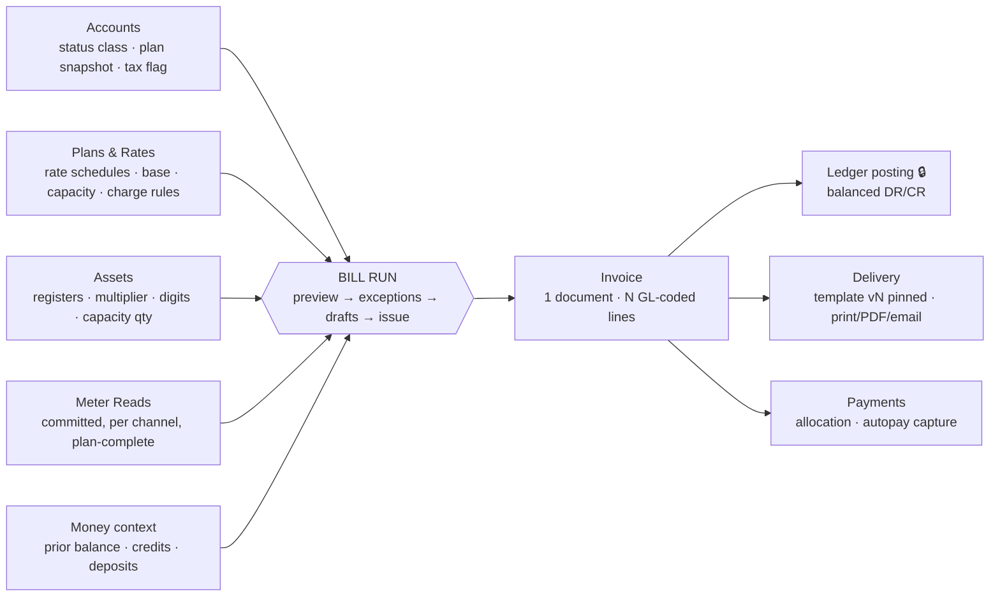

# billing — Pre-Session Model (PM understanding for PO review)

> **STATUS: DRAFT — FOR PRODUCT OWNER REVIEW. Nothing here is a rule.** This document consolidates the PM's complete understanding of billing ahead of story authoring. Confirmed items cite their ruling; open items carry a **BL-#** question ID (battery lives in the working chat; registry rows minted at closure). When the PO ratifies, content graduates into `02-business-rules.md` + epics and this file gains a closure stamp.
> PO directive (2026-08-08): billing is the most important module — full chain Accounts → Plans+Rates → Assets → Reads → payments → credits → penalties/charges → formatting; bulk with full preview; bill = multiple records by GL code; tenant-variable rules; single/correction/move-out/first/budget bills; templates + versions; print/reprint/email.

## 1. Position in the product

Billing consumes everything upstream and feeds everything downstream. It never measures, never prices, never posts, never pays — it **orchestrates**:

Rating math itself is the rating module's engine (🔒 human-owned, GT-tested); billing calls it with the assembled inputs and owns the run, the invoice records, corrections, and delivery.

## 2. Inputs — the assembly contract (per account, per run)

| From | Billing takes | Contract source |
|---|---|---|
| customers | active account; status **behavior class** (billable / base-only / non-billable / terminal); **plan snapshot as of service date** (never the live unit plan); tax-exempt flag; autopay flag; move-in/out dates | BR-CUS-014 sc.6, BR-CUS-055 (class seed = OQ-064), BR-CUS-031/056 |
| rating | per-service rate schedule + version in force at service date; per-service base; capacity charges; plan charge/penalty/tax/deposit rules; discounts (negative charge rules); budget flag | B2 tariff_versions rule; BR-RAT-012/018/021/024/026/028/043 |
| assets | active meter per service; multiplier; register digits; capacity quantities | BR-AST rules, B2 r4 |
| metering | committed reads per **channel** (total/tou_*/export/demand); plan-required channel set complete = VEE gate; estimated reads labeled | BR-MET-049/052/053/059, B2 r8 |
| payments/ledger | prior balance; unallocated credits; deposits held + accrued interest | BR-PAY-010, BR-CUS-050/057 |
| tenancy | cycle (period, read window, due_days); number series; tax authorities; tenant billing settings | BR-MET-009, BR-TEN rules |

A missing input is an **exception**, never a silent skip (see §6 step 3 and BL-2).

## 3. Bill anatomy — one bill is many records

Three layers, deliberately separate:

1. **The document** the customer sees — one bill, rendered by a pinned template version (§10).
2. **`invoice_lines`** — one row per charge component: each usage block, each base charge, each tier/window if itemized, capacity, minimum-bill adjustment, each tax authority, each fee. Each row carries quantity, unit, unit-price, amount (rounded half-up 2dp at finalization), a `taxable` flag, and — **proposed BL-1** — a **stamped `gl_account_id`** frozen at issue so later mapping edits never re-map history.
3. **Journal lines** — the ledger posting service (🔒 the only writer) turns an issued invoice into one balanced entry: DR Accounts Receivable for the invoice total, CR each GL bucket summed from the lines.

### Worked example (BS-1) — Brazos Bend MUD, ACC-1042, Residential Standard, Jul 1–31
Electric TOU + Water tiered + Sewer 40% of water usage-$ + Trash flat + Solar capacity 4 units; prior balance $45.00 past grace.

| Line | Math | Amount | Taxable | GL (sample) |
|---|---|---|---|---|
| Electric on-peak 120 kWh | ×$0.22 | 26.40 | ✔ | 4100 |
| Electric mid-peak 200 kWh | ×$0.14 | 28.00 | ✔ | 4100 |
| Electric off-peak 380 kWh | ×$0.09 | 34.20 | ✔ | 4100 |
| Electric base | plan | 12.00 | ✔ | 4105 |
| Water tier 1 · 5 kgal | ×$4.00 | 20.00 | ✔ | 4110 |
| Water tier 2 · 3 kgal | ×$6.50 | 19.50 | ✔ | 4110 |
| Water base | plan | 8.00 | ✔ | 4115 |
| Sewer 40% × 39.50 | usage-$ only | 15.80 | ✔ | 4120 |
| Trash flat | plan | 18.00 | ✔ | 4130 |
| Solar capacity 4 × $10 | BR-RAT-018 | 40.00 | ✔ | 4150 |
| State tax 6.25% × 221.90 | per line, half-up | 13.87 | — | 2200 |
| County 1.00% | | 2.22 | — | 2201 |
| City franchise 2.00% | | 4.44 | — | 2202 |
| PUC 0.20% | | 0.44 | — | 2203 |
| Late fee max(5, 1.5%×45.00) | overdue portion | 5.00 | ✘ | 4200 |

Current charges **247.87** + prior balance 45.00 = **total due 292.87**.
Posting: DR 1200 AR 247.87 · CR 4100 88.60 · 4105 12.00 · 4110 39.50 · 4115 8.00 · 4120 15.80 · 4130 18.00 · 4150 40.00 · 2200-03 20.97 · 4200 5.00 — balanced.

**GL mapping (BL-1 proposal):** Settings → Finance account mapping — per-service revenue (optional usage/base split), per charge code (already in schema), per tax authority, plus AR / deposit-liability / opening-clearing; seeded chart (full COA = B2 O-14, finance+Eng), tenant-editable; stamped per line at issue.

## 4. Pricing behaviors billing must orchestrate (all ratified in rating/B4)

- **Flat / tiered** — tiers on post-multiplier consumption; thresholds reset per bill and **scale with prorated period** (B4.4). Pure tiers, no allowance (BR-RAT-026).
- **TOU** — up to 3 windows × 2 seasons, holiday=off-peak (BR-RAT-021); consumes per-window channels; sum-sanity ±1% (severity = OQ-066).
- **Demand** — max-demand register read × rate; ratchet off (BR-RAT-014, RD-4). e.g. 14.2 kW × $9.50 = 134.90.
- **Seasonal** — pro-rata day split at boundary; actual boundary read wins (BR-MET-050).
- **Capacity** — qty × rate, taxable like base, prorated per B4.3 (GT-15).
- **Sewer %** — % of water usage-$ excl. base/tax (BR-RAT-015).
- **Minimum bill** — per-service and/or plan-level floor; "minimum bill adjustment" line, taxable (BR-RAT-028, GT-13).
- **Discounts** — negative charge rules on the plan (BR-RAT-043).
- **Proration** — calendar days, base AND usage (B4.3); applies to move-in/out, mid-cycle plan change (split period, each half priced on its snapshot), and status-class changes (e.g. Vacation hold starting mid-cycle: usage lines through the day before hold, base-only after — derived from B4.3, PO may veto).
- **Estimation** — billed like actuals but labeled; true-up by register arithmetic at next actual, current-period rates (OQ-003 closure).
- **Rounding** — per line, half-up, 2dp, at finalization only (B4.4).

## 5. Bill types

| Type | Trigger | What differs |
|---|---|---|
| **Regular cycle** | bulk run per cycle | the baseline (§3) |
| **First bill** | first cycle end after move-in | proration from move-in day (20/31 days: base 12.00→7.74; tier 1 span 5→3.2258 kgal); one-time lines — deposit (non-taxable → deposit liability) + connection charge — **BL-4**: on first bill vs collected at move-in |
| **Final / move-out** | move-out (BR-CUS-031 handoff) | bills **through the move day** (BR-CUS-056); timing immediate vs cycle-end = **BL-5a**; deposit + interest auto-applied (150 × 2% × 14/12 = 3.50 → 153.50 credit), remainder → refund = **BL-5b**; due-days = **BL-5c** |
| **Correction** | read superseded / error found after issue (J6) | original stays issued+visible; **credit note** reverses it (GL pairs); **rebill** issues a new invoice citing the original; customer-facing presentation full-vs-delta = **BL-6**; approval role = **BL-6b** |
| **Single / ad-hoc** | staff, one account | same wizard single-account mode; lines from rules/charge codes only (no hand-typed amounts) = **BL-7** |
| **Budget (level-pay)** | plan flag (BR-RAT-043) | actuals computed every month; customer pays level amount; variance accumulates; proposed math = **BL-3**: eligibility 12-mo history · level = trailing-12 avg rounded to $ · re-level at ±20% drift every 6 mo · annual settle-up month (tenant-set) · off-budget after 2 missed payments. Worked: $2,904/12 → $242 level; July actual 292.87 → variance +50.87 shown on bill |

Same-day move: outgoing pays the move day; incoming starts next day from the same reading — no gap, no double (BR-CUS-056).

## 6. The bulk run — everything visible before anything commits (S31)

1. **Select** cycle + period. Identical re-run blocked by idempotency key with who/when/link (BR-BIL-005 pattern per OQ-044 closure).
2. **"Check what we found"** (S31.2) — Consumers (billable count by status class) · Plans (accounts missing plans/snapshots) · Reads (completeness % per BR-MET-049, estimates in play) · Balances (prior balances, late-fee candidates) · Credits (unallocated credits that will auto-apply) · **Overcharges** (anomaly guardrail: draft > tenant-set % vs trailing average → flagged for review).
3. **Exceptions** (S31.3) — per-case tables + bulk actions; missing read on one service = **BL-2** (proposed: staff choose per case — estimate / hold account / bill without service).
4. **Draft bills** — full line detail per account, KPI totals. Draft powers (**BL-11**): exclude account · re-rate after a fix · add charge-code line · **never edit a computed amount**. Drafts discardable free — immutability starts at issue.
5. **Issue** — numbers minted from tenant series (`BL-{YYMM}-{seq}`, **BL-10**), invoices immutable, ledger posts, delivery queues, `audit_log` rows written. Issue all-remaining or selected subset (**BL-11**).

## 7. Payments, credits, deposits on the bill

- Bill shows: previous balance − payments/credits received + current charges = total due (A19 summary box).
- Unallocated credit auto-applies per allocation order (oldest first; usage+base → taxes → fees last; tenant-reconfigurable — BR-PAY-010).
- Credit bill: total ≤ 0 → nothing due, credit carries forward.
- Autopay = capture-only v1: issued bill schedules capture at due date (details in the Payments pre-session).
- Deposits are liability, never revenue; only touch bills at final-bill application (§5) and via interest accrual (BR-CUS-057).

## 8. Penalties & charges

- **Late fee** — max($5, 1.5% × **overdue portion**), grace from due date, tenant days (default 5, 0–30, calendar/business), first-time waiver manual only (BR-BIL-001/002/003/008). e.g. overdue 400 → 6.00; overdue 45 → 5.00 floor.
- **Charge codes** — tenant-configured (NSF, reconnect, service call…), each with fixed/percent/min and its own GL; UI $30/$45 are samples, never hardcoded (BR-BIL-007).
- Fees/late are **never taxable** (B4.2) and post to their own GL.

## 9. Tax

Base = usage + base + minimum + capacity lines only (B4.2); per-authority lines rounded half-up each; account-level exemption removes all tax lines (GT-11; certificate capture = B4 PLACEHOLDER, finance); authority rates are reference data per jurisdiction.

## 10. Templates, delivery, reprint

- Template **types** (A19): bill, statement, disconnect notices, dunning, receipt + email/SMS bodies. Multiple templates per type (residential/commercial/…).
- **Versioning**: edit = new version, draft → published → archived, audited; one published per template; assignment default by consumer category with account override = **BL-13**; publish rights = **BL-15**.
- **Pinning (BL-14)**: issue stamps template+version on the bill; reprint/re-send renders the pinned version forever; a reprint is an audited event, never a money event.
- **Delivery v1 (BL-8)**: print/PDF v1; customer email via tenant BYO mailbox — wave 6 per roadmap unless PO pulls into v1. (The no-email-v1 ruling was scoped to staff auth mails.)

## 11. Tenant-variable rules (config-over-constant, PO R6 principle)

Due-days (per cycle) · late fee %/min/grace mode+days · minimum-bill amounts · budget parameters (BL-3) · overcharge-guardrail % · correction approval threshold · allocation order · bill number format · template set · bill messages/footer · tax authorities. All seeded with derived defaults; nothing hardcoded. (**BL-9** confirms the list.)

## 12. Immutability, idempotency, audit

Issued invoices/lines: no UPDATE/DELETE ever — corrections are credit notes + rebills (BR-BIL-004). Runs idempotent per (tenant, cycle, period) key — key mechanics Eng-Lead 🔒. Every issue/correction/void/reprint writes `audit_log`. Void shows plain-language consequences first (BR-BIL-009); windows per OQ-012 closure.

## 13. Scenario → test catalog (seed for golden tests + story TCs)

BS-1 regular multi-service (worked §3) · BS-2 first bill proration · BS-3 final bill + deposit · BS-4 same-day move · BS-5 correction credit-note+rebill · BS-6 estimate + true-up · BS-7 minimum bill · BS-8 vacation hold base-only · BS-9 budget level-pay · BS-10 single ad-hoc · BS-11 credit bill · BS-12 missing-service exception · BS-13 tax-exempt · BS-14 demand+seasonal · BS-15 mid-cycle plan change split · BS-16 idempotent re-run blocked · BS-17 template version pinned across reprint · BS-18 back-bill 6 months per-period tariffs · BS-19 penalty bill (assessed reads + charge codes) · BS-20 settlement matrix all 5 paths · BS-21 held-account catch-up sub-run · BS-22 bulk correction with payment re-allocation · BS-23 delivery-queue batch/retry/re-queue.

## 14. Open questions — three-lane ratification (PO process; registry rows at closure)

### Lane A — business/money, item by item
| # | (BL) | Question | PM recommendation |
|---|---|---|---|
| A-1 | BL-1 | GL mapping model + per-line stamping at issue | mapping page as §3; stamp at issue |
| A-2 | BL-3 | Budget billing math (level, variance, re-level, settle-up, drop-off) | §5 proposal, all params tenant-config |
| A-3 | BL-4 | Deposit + connection charge on the FIRST BILL vs collected at move-in | billed on first bill |
| A-4 | BL-5 | Final bill: timing / deposit auto-apply / due-days | immediate · auto-apply · same due-days |
| A-5 | BL-6 | Correction: customer-facing presentation + approval role | full corrected bill citing original · Clerk w/ Admin approval |
| A-6 | BL-2 | Missing read on ONE service at run time | per-case choice in exceptions step (estimate / hold / bill-without-service) |
| A-7 | BL-8 | Customer bill EMAIL in v1 or W6? | PDF/print v1; BYO email W6 |

### Lane B — mechanical defaults, bulk-confirmable
| # | (BL) | Default proposed |
|---|---|---|
| B-1 | BL-7 | Ad-hoc single bill = same wizard, one account; lines from charge codes only, never hand-typed amounts |
| B-2 | BL-9 | Tenant-config list per §11, all seeded defaults |
| B-3 | BL-10 | Bill numbering `BL-{YYMM}-{seq}` from tenant number series |
| B-4 | BL-11 | Draft powers: exclude / re-rate / add charge-code line; never edit computed amounts; issue all-or-selected |
| B-5 | BL-12 | Due date = bill date + cycle due-days; bill-delivery-day stays dropped |
| B-6 | BL-13 | Template assignment: consumer-category default + account-level override |
| B-7 | BL-14 | Template+version PINNED at issue; reprint renders pinned version forever |
| B-8 | BL-15 | Templates: Clerk drafts + test-print; Admin publishes; pinned versions undeletable |
| B-9 | — | Mid-cycle Vacation-hold start: usage lines through day before hold, base-only after (B4.3 derivation) |
| B-10 | — | Overcharge guardrail: draft > tenant-set % vs trailing average → flagged in Step 2 (default 200%, config) |

### Lane C — schema batch #4 (billing) — PREVIEW; firms up as Lane A lands, approved after
1. `invoice_lines` += `gl_account_id` stamped at finalization (A-1).
2. Finance account-mapping tables: service→GL revenue (optional usage/base split), tax-authority→GL liability; AR / deposit-liability / opening-clearing designations; seeded chart (full COA = O-14, finance+Eng-Lead).
3. `invoices` += `template_id`, `template_version` pinned at issue (B-7).
4. `bill_templates` + `bill_template_versions` (append-only; draft/published/archived; audit-locked while any invoice pins them) + category-assignment column (B-6).
5. Budget billing: `account_budget_status` (level amount, variance balance, last_leveled_at, settle-up month) + tenant budget settings (A-2).
6. Tenant billing settings rows: overcharge-guardrail %, correction-approval threshold, bill message/footer (adds to existing late-fee/grace settings).
7. `bill_runs`: formalized status enum + `bill_run_exclusions` (account, reason, who/when) (B-4).
8. Deposit-application-to-final-bill mechanics → flagged to the payments Lane C batch, not decided here.

Related open: OQ-064 (status behavior classes feed §2 — gates billing stories), OQ-066 (sum-sanity severity), OQ-067 (demand estimation), OQ-065 (opening credits).

---

## Addendum r1 — PO Lane A rulings + refinements (2026-08-08)

**Ruled:** A-1 = (a) GL mapping page + per-line stamp at issue. A-3 = (a) deposit + connection on first bill. A-4 = (a) immediate final bill, deposit auto-apply, same due-days — WITH full settlement-case matrix required (below). A-6 = (a) per-case exception choice — WITH a defined held-account catch-up process (below). A-5 escalated: correction is a **WORKFLOW** (multi-record impact, reason codes, approvals) incl. **BULK corrections**. A-7 architecture ruled: **email written to a queue table, ESP picks up in batches** (6k–10k bills can never push in one go); timing v1-vs-W6 = follow-up F-6. A-2 rules/example accepted — override mechanics = follow-up F-1. NEW SCOPE: **ad-hoc back-bill (e.g. 6 unbilled months) and penalty bills/statements (theft/tamper cases)**.

### r1.1 Final-bill settlement matrix (A-4)
Deposit+interest applies first, then exactly one settlement path per remaining balance:
1. **Refund** — deposit covers all: remainder → refund flow (check/ACH). e.g. final 142.30, deposit 153.50 → refund 11.20.
2. **Collect** — balance remains: final bill due per cycle due-days → normal dunning/collections on a closed account.
3. **Transfer to master account** — balance moves to a designated master/owner account (submetering landlord case): balanced transfer transaction (credit final account / debit master), audited, shows on master's next bill as a transfer line. Prereq model = F-2.
4. **Payment plan** — final balance converted to installments (existing payment-plan machinery).
5. **Small-balance write-off** — |balance| ≤ tenant threshold (default $5, F-3): auto write-off line (either direction), GL write-off account, audited.

### r1.2 Correction WORKFLOW (A-5) — single + bulk
Steps: **Initiate** (from bill or bulk selector) → **Reason code** (reference data, tenant-extensible: wrong read, wrong rate/plan, wrong tax, missed charge, goodwill, theft-restated…) → **Scope** (single bill | bulk: by run/cycle/plan/service/date-range) → **Impact preview** (per bill: credit note, rebill lines, GL reversals, balance delta; **payment re-allocation plan** — payments allocated to the original are re-allocated to the rebill, overpayment → credit per BR-PAY-010) → **Approval** (workflow gate, threshold = F-5) → **Execute** (bulk = staged background job with progress + per-bill result summary, idempotent, resumable) → **Deliver** corrected bills (pinned to current template version at rebill issue) + audit every record touched. Nothing money-bearing happens before the approval step; the preview IS the approval artifact.

### r1.3 Held-account catch-up (A-6)
Hold ≠ forget: held accounts land in a **Pending-billing queue** (billing landing KPI chip, aging shown). When the blocker clears (read arrives / estimate accepted), staff launch a **catch-up sub-run**: child of the original bill_run, same period, scoped to held accounts only; idempotency key = parent key + scope so the follow-up never collides with the original; drafts→issue same as any run. Queue ages out to escalation (config days) — nothing silently stays unbilled.

### r1.4 Delivery queue (A-7 architecture — RULED)
Issue writes one **delivery record per bill per channel** (status `queued`) to an outbound-delivery table. A dispatcher job hands batches (tenant-config size, default 500) to the Email Service Provider; statuses `queued → sent → delivered | failed | bounced`, retry ×3 with backoff, per-run delivery dashboard (counts + failures list + re-queue action). Print/PDF renders from the same queue concept (batch PDF generation). Volume note (F-7): BYO mailbox works for small tenants; 6k–10k bills need a transactional ESP connected as the tenant's integration.

### r1.5 Ad-hoc back-bills + penalty bills (NEW)
- **Back-bill**: single-account wizard accepts an arbitrary past period (e.g. 6 months); usage priced **per sub-period against the tariff version in force then** (B2 tariff_versions rule); one bill, period-labeled line groups; back-bill window capped (tenant config, default 12 months — F-4; theft exemption per F-4).
- **Penalty bill / statement**: charge-code-only bill (TAMPER, investigation, damages…) — no usage; renders on the statement template class. B-1 rule holds: **never hand-typed amounts** — theft's unmetered consumption enters as estimated/assessed READS (reason-coded, flagged) which the back-bill then prices; penalties are charge codes.
- Both carry reason codes + the same approval gate as corrections (sensitive money).

### r1.6 Budget overrides (A-2 accepted; mechanics)
Two layers: **tenant settings** override seeded defaults (eligibility months, level rounding, re-level % + cadence, settle-up month, drop-off count); **per-account**: staff may override the computed level (reason + audit; bounded e.g. ±30% of computed — F-1).

### r1.7 Lane C batch #4 — RE-EVALUATED per r1
Adds/changes vs the preview: **9.** correction workflow tables (cases: reason code, scope, status, approver; links to credit notes/rebills; bulk-correction runs + per-bill results). **10.** `bill_runs.parent_run_id` + scope (catch-up sub-runs) — replaces plain exclusions-only model (exclusions table stays). **11.** outbound-delivery queue table (bill × channel, status lifecycle, batch id, ESP response). **12.** balance-transfer transaction (final→master account, balanced, audited) + master-account designation. **13.** write-off support (threshold setting + GL write-off account in mapping). **14.** `invoices.bill_type` enum (cycle | first | final | rebill | backbill | penalty). **15.** budget per-account override columns (level_override, reason). Correction/penalty reason-code lookups = reference data tables. Items 1–8 stand as previewed (A-1 = option a locks item 1–2 shape).

### §15 Boundaries (what billing does NOT own)
Dunning/disconnect notice workflow = collections (J4, payments/notifications) — billing only computes the late fee. Statements over a range = reports (statement ≠ bill, A19). Refund execution, payment plans, autopay capture = payments. Rendering engines + send infrastructure = notifications (billing owns the queue records + pinning). Rating math = rating engine 🔒.

### Follow-ups (F battery — REGISTERED as OQ-068..074) — **ALL CLOSED per PO F-round 2026-08-08** (recommendations confirmed: override ±30% · landlord-link prereq · $5 write-off · 12-mo cap w/ theft exempt · Admin-approval-all v1 · email W6 · BYO/ESP split)
F-1=OQ-068 per-account budget level override allowed, reason+audit, bounded ±30%? (rec: yes) · F-2=OQ-069 master-account transfer prereq: unit/premises linked to a master billing account under a landlord agreement flag; transfer allowed only when set? (rec: yes) · F-3=OQ-070 write-off threshold default $5, config 0–50? · F-4=OQ-071 back-bill cap default 12 months, config; theft cases exempt from cap? · F-5=OQ-072 correction approval: ALL corrections need Admin approval v1 (simplest) vs threshold-based? (rec: all, threshold v2) · F-6=OQ-073 email timing: queue architecture ruled — ship customer email v1 or W6? · F-7=OQ-074 volume sending: BYO for small tenants, transactional ESP integration for volume — confirm.

## Addendum r2 — SESSION CLOSED (2026-08-08)
Lane A ruled (r1) · F battery closed (OQ-068..074) · **Lane B B-1..B-10 CONFIRMED → BR-BIL-020..029** · **Lane C batch #4 APPROVED → B2 Addendum r10** · OQ-064 closed (Marked disconnect = billable). Billing rules complete: BR-BIL-001..029 all CONFIRMED. Pack authoring launched — epics/stories test against WE-1..18 + BS-1..23.
